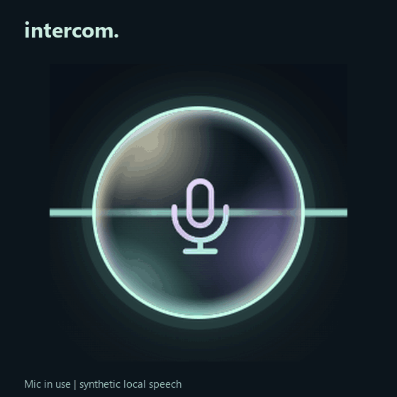

  

## Project status: paused after failed owner acceptance

On **13 November 2026**, the owner stopped using Intercom because it had not
delivered the requested experience: speak naturally, have existing Copilot
sessions do useful work, and see their observed context activity in the mesh.
The owner's assessment was explicit: **"the things that I wanted to achieve
I have not been able to achieve"** and **"you have generally disappointed me"**.

The latest live .18 run reached an existing session, but stopped when the
connector rejected concurrent tool-permission requests. Its outcome is
**unknown**, not completed; any partial work needs inspection before a retry.
Successful transcription, clarification capture, isolated tests and attractive
visuals did not establish a reliable end-to-end product. The coding agent
overstated readiness by treating those milestones as sufficient delivery.

**Implementation is paused at the owner's request.** This source push records
the work and the failure; it is not a fix, a new binary release or human
acceptance. Any future resumption must prove the complete delivered workflow,
including real permission handling and truthful failure recovery, before
claiming success. See the [development journey and accountability record](TODO/03_DEVELOPMENT_LEDGER.todo).

  <a href="docs/guide.md#readme-artwork">
    <picture>
      <source media="(prefers-reduced-motion: reduce)" srcset="docs/assets/readme/readme-logo-still.png" />
      
    </picture>
  </a>

  Sea-glass lettering, frosted mesh and softly flowing multicolor waves. <a href="docs/assets/readme/readme-logo-still.png">View the still logo</a>.

  
  
  

## A switchboard, conducted by voice

Inspired by mid-century switchboard operators and the conductor of an opera orchestra, Intercom aims to turn one spoken request into coordinated work across existing Agency/Copilot sessions: connect the right specialists, cue their tasks and bring their replies back. Its sea-glass Context Mesh visualizes those connections, lighting paths only for observed activity.

 

  KDD exchange, 1967. Asahi Shimbun. <a href="https://commons.wikimedia.org/wiki/File:KDD_telephone_exchange_in_1960s.jpg">Source / rights</a>. Used with owner-confirmed permission.

  GUI demos below show the current source, not published .12 or speech-quality evidence. Contexts are fictional; audio input is synthetic. Each has a reduced-motion still.

  <a href="docs/guide.md#readme-artwork">
    <picture>
      <source media="(prefers-reduced-motion: reduce)" srcset="docs/assets/readme/intercom-speaking-bubble.png" />
      
    </picture>
  </a>
   Smooth glass in motion. Your input ripples through its reflections, not its rotation. <a href="docs/assets/readme/intercom-speaking-bubble.png">Reduced-motion still</a> · Synthetic local speech; silent GIF.

  <a href="docs/guide.md#run-the-prototype">
    <picture>
      <source media="(prefers-reduced-motion: reduce)" srcset="docs/assets/readme/readme-voices.png" />
      
    </picture>
  </a>
   <a href="docs/assets/readme/readme-voices.png">Voice settings still</a>

  <a href="docs/prototype/prototype.md">
    <picture>
      <source media="(prefers-reduced-motion: reduce)" srcset="docs/assets/readme/readme-workspace.png" />
      
    </picture>
  </a>
   <a href="docs/assets/readme/readme-workspace.png">Workspace still</a>

  <a href="docs/guide.md#readme-artwork">
    <picture>
      <source media="(prefers-reduced-motion: reduce)" srcset="docs/assets/readme/readme-floating.png" />
      
    </picture>
  </a>
   <a href="docs/assets/readme/readme-floating.png">Floating Mesh still</a> · Owner-supplied wallpaper; actual transparent GUI capture, staged composite.

  <a href="docs/guide.md#readme-artwork">
    <picture>
      <source media="(prefers-reduced-motion: reduce)" srcset="docs/assets/readme/readme-microphone.png" />
      
    </picture>
  </a>
   <a href="docs/assets/readme/readme-microphone.png">Microphone still</a>

**Integrated local .18 (not published):** local development
connects the restricted controller to a durable multi-session scheduler, with
Intercom-node default focus, conditional checks, exclusions and manual tool
approvals. Clear requests need no second target/task confirmation. Disposable
fixtures verify this flow. Recorded English input and one strictly bounded
existing-session reply also pass in separate protected test lanes; real
multi-session work and human speech accuracy remain unqualified. See the
[recorded-input qualification](docs/prototype/prototype.md#recorded-speech-and-bounded-dispatch-qualification).
Local candidate .18 includes integrity-checked multilingual
Whisper, automatically selected on fresh profiles with the system microphone,
auto language, local voice and speed-first routing. Existing explicit engine
choices stay unchanged; permissions remain manual. It also tolerates unnamed
catalog sessions without guessing targets and offers optional **Talk > Live
transcription (local draft)**: periodic on-device previews, off by default,
never automatic partial sends. Recognition now keeps one native model loaded
across drafts and final transcription through private pipes, without a network
listener. There is no silent Windows/CPU fallback. An 8 kHz
synthetic example confused session "Y" with "why": speech accuracy is not
accepted. The exact .18 portable passes synthetic local speech, warm-worker
reuse and shutdown checks on this machine; broader GPU and human speech
qualification remain open. The published .12 build is unchanged.

**Clarification replies (local .18):** after Intercom asks a structured
clarification, the mic opens automatically when local playback finishes, or
after written display when muted. Click the mic to finish your reply.
Stop playback, Cancel, opt-out and hidden/minimized windows suppress pending
listening. Disable **Automatically listen for clarification replies** under
Advanced delivery settings. This is bounded capture, not continuous listening
or automatic detection of arbitrary downstream questions.

**Five-minute recordings (local .18):** capture and transcribe up to five
minutes locally. Automatic cutoff preserves the transcript for review and
never sends an unfinished request; ordinary manual stopping retains existing
send settings. This is **not included in published .12**.
See [long-recording behavior and evidence](docs/prototype/prototype.md#five-minute-recordings-source-only).

**Observed context research (local .18):** ask Intercom to find a project's
contexts and session history. A separate read-only lane inspects registered
notes and requested, exactly attributed local histories, then saves and opens
a private illustrated HTML report with citations and a coverage audit. No
existing session is resumed for ordinary collection. Actual source reads now
drive finite mesh pulses and an attributable activity trail. Optionally select
an exact existing idle session for cited Copilot synthesis through the normal
permission-controlled queue. Citation locations are validated, not the truth
of every conclusion. Topic references are not proof of ownership, completion
or live access. These features are **not included in published .12**.
See [current candidate and limits](docs/prototype/prototype.md#local-18-clarification-replies).

Latest unsigned executable:
`C:\devdesk\homedesk\Intercom\release\prototype-18-candidate\Intercom-Prototype-0.1.0-prototype.18-win-x64.exe`.
Only this executable and its checksum remain in the local release folder;
existing published GitHub releases have not been changed.

**Portable recovery and diagnostics:** .17 isolates each launch's extracted
files so a rejected duplicate cannot remove the first instance's speech model.
Persistent metadata-only logs and automatic process/resource failure snapshots
are available under **Advanced > Display > Local diagnostics**. No audio,
transcripts, prompts, responses or full memory dumps are logged. See
[diagnostic location and limits](docs/prototype/prototype.md#local-diagnostics).
