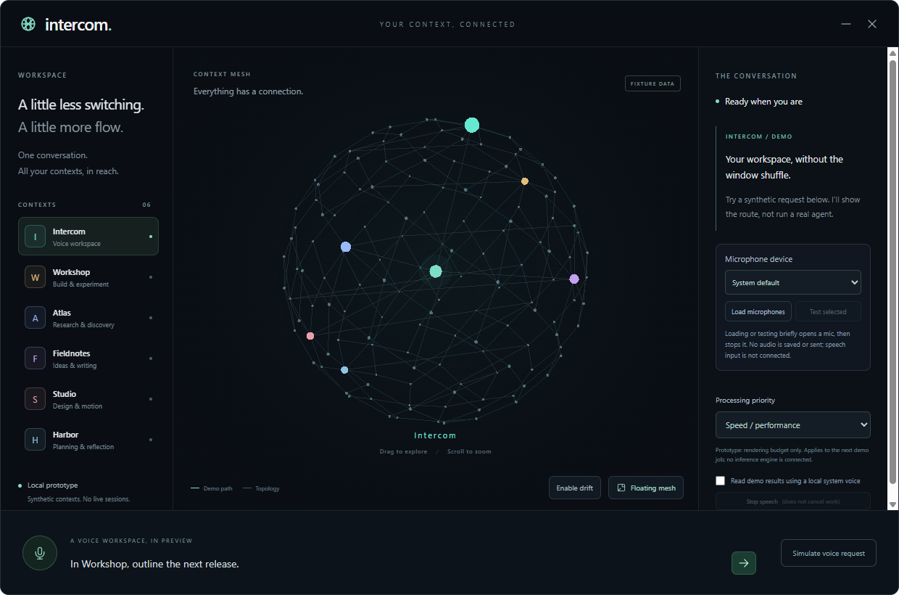

# Intercom

A voice-first desktop assistant for working with existing Agency/Copilot
sessions. Speak a request, choose terminal handoff or background execution, and
hear the result when the requested work finishes.

Its proposed visual surface is a 3D Context Mesh sphere: active context and
session paths light up while other relationships remain dimly visible.

**Top priority:** speed/performance by default, with selectable processing
priorities. The prototype saves the selection and bounds graph rendering;
speech/inference profile settings remain unqualified.

**Stage:** runnable, fixture-only desktop prototype. The owner approved Electron
for this early UI experiment, including a real transparent Floating Mesh mode.
It includes a saved microphone-device picker with explicit, brief device checks.
Wake word, speech recognition, real Context Mesh imports and Agency integration
are not connected. Synthetic activity is explicitly labelled.

**Engineering recommendation:** Tauri 2 + Rust host, React/TypeScript + Three.js
UI, native local-speech worker and SQLite jobs. This revises the initial
Electron recommendation; hardware measurements and Agency/speech proof still
gate selection.

## Run the prototype

The Windows x64 portable EXE is an **unsigned prototype**, not an installer.
[Download the prototype EXE](https://github.com/Zanark/Intercom/releases/download/v0.1.0-prototype.1/Intercom-Prototype-0.1.0-prototype.1-win-x64.exe)
from the [verified prerelease](https://github.com/Zanark/Intercom/releases/tag/v0.1.0-prototype.1).
Windows may show an unknown-publisher/SmartScreen warning; verify
the release checksum and follow your device's security policy.

Local EXE:
`C:\devdesk\homedesk\Intercom\release\Intercom-Prototype-0.1.0-prototype.1-win-x64.exe`
No Node.js installation is needed to run the EXE. First launch extracts the
bundled Electron runtime; startup speed has not been benchmarked.

From `C:\devdesk\homedesk\Intercom` in PowerShell, with Node.js/npm installed:

```powershell
npm ci
npm start
```

Click **Floating mesh** to hide the panels and window background. Drag the
upper cap of the mesh to move the window. Hover near its bottom to restore
the workspace or pin it above other windows. **Escape** restores the workspace;
**Ctrl+Shift+M** toggles modes while Intercom has focus.

Try **Simulate voice request**, confirm the synthetic target, and watch the
demo route light up. No real session or terminal starts. Optional result
speech uses only an available local system voice; it is off by default.

Under **Microphone device**, click **Load microphones**, choose a device, then
use **Test selected** to check that exact input. Each action briefly opens a
microphone and immediately stops its tracks; no recording is saved or uploaded.
The choice survives restart, but never starts listening automatically.

See the [prototype guide](docs/prototype.md) for controls, architecture,
performance behavior, checks and limitations.



Actual prototype capture: synthetic contexts surround the spherical mesh;
the right panel exposes microphone selection and explicitly demo-only activity.


Actual floating-mode capture: the surrounding pixels are transparent, not a
black desktop background. Hover controls are hidden in this capture; no live
context reads are represented.

## Start here

- [Product brief and open decisions](docs/product-brief.md)
- [Architecture and integration boundaries](docs/architecture.md)
- [Technology picks, alternatives and reversal gates](docs/technology-decisions.md)
- [Runtime, IPC, routing and recovery contracts](docs/runtime-contracts.md)
- [Performance profiles and qualification plan](docs/performance-and-qualification.md)
- [Primary-source research evidence](docs/research-sources.md)
- [Local and cloud speech comparison](docs/speech-options.md)
- [Phased roadmap and implementation gates](docs/roadmap.md)
- [Development manual](docs/development-manual.md)
- [Workstream index](TODO/00_INDEX.todo)
- [Development ledger](TODO/03_DEVELOPMENT_LEDGER.todo)
- [GitHub tracking policy](docs/github-tracking.md)
- [Contributor and agent instructions](AGENTS.md)
- [Intercom GitHub Project](https://github.com/users/Zanark/projects/13)

The repository uses numbered, evidence-backed workstreams. The owner authorized
this early fixture-only sub-slice without waiving live connector/speech gates.
The full voice-to-existing-session loop is not implemented.

## Development boundaries

Local agent execution does not guarantee offline model processing. Speech
privacy, permissions, retention, cancellation, and confirmation retain proposed
product contracts. The prototype allows only its own main-frame audio device
checks; camera/other browser permissions and renderer network requests remain
denied. It is not the researched durable job/voice runtime. Continuous capture,
providers, agents and session-control services still need separate authority.

Private session continuity lives in the Git-ignored `.agent-context` directory;
it is not part of public documentation or release packages.
