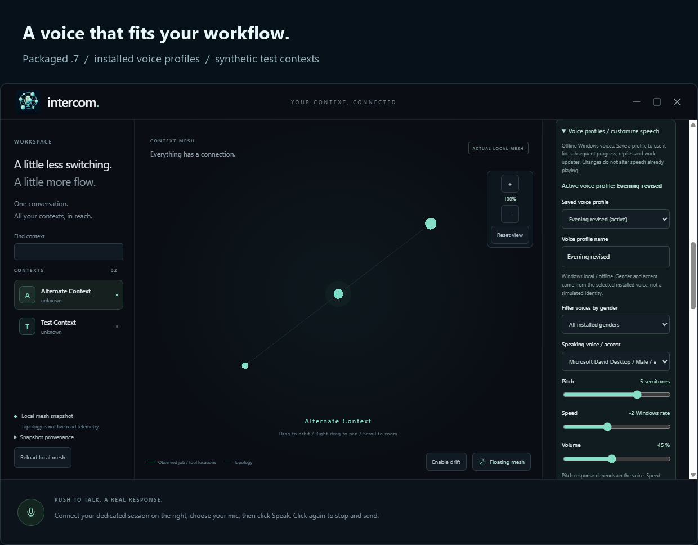
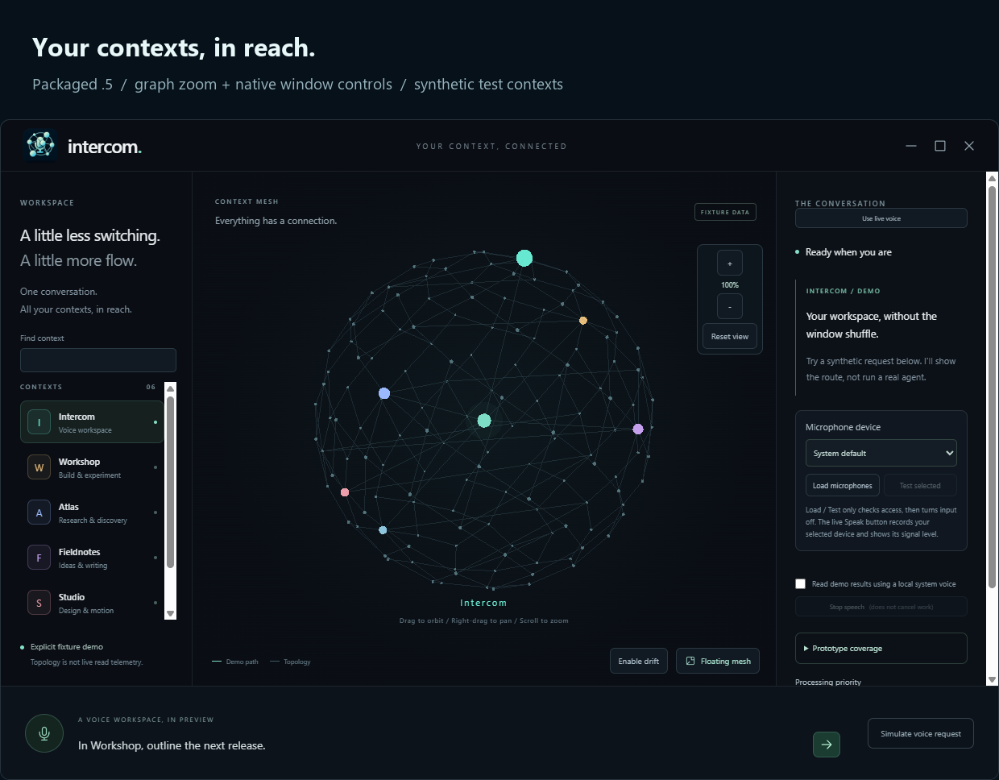
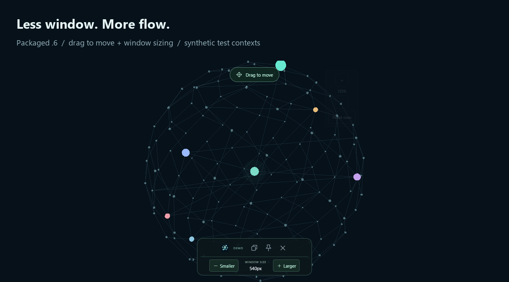

  

  <a href="docs/guide.md#readme-artwork">
    <picture>
      <source media="(prefers-reduced-motion: reduce)" srcset="docs/assets/readme-logo-still.png" />
      
    </picture>
  </a>

  
  
  

  

  

  

