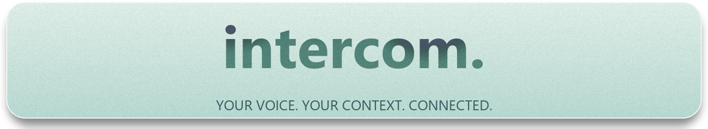
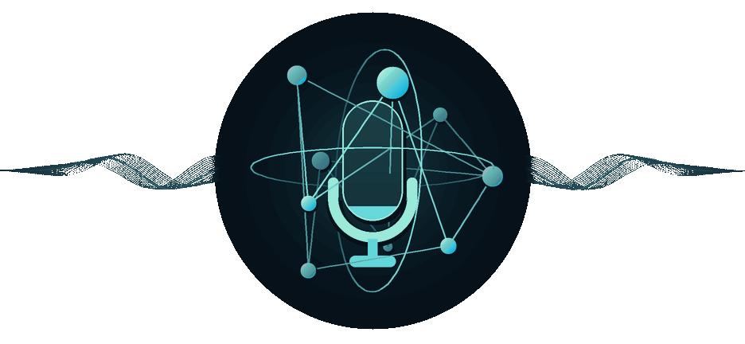
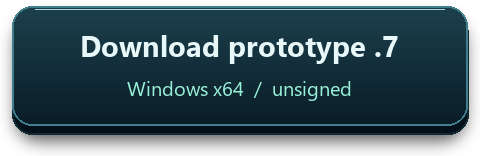
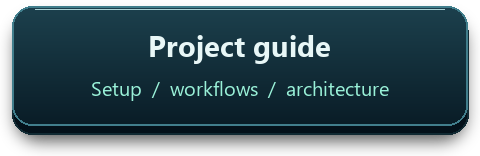
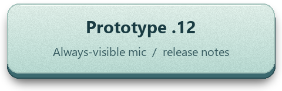
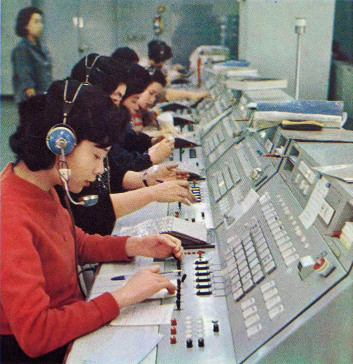
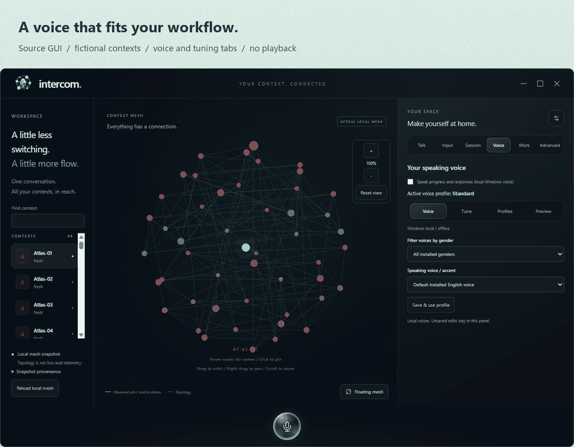
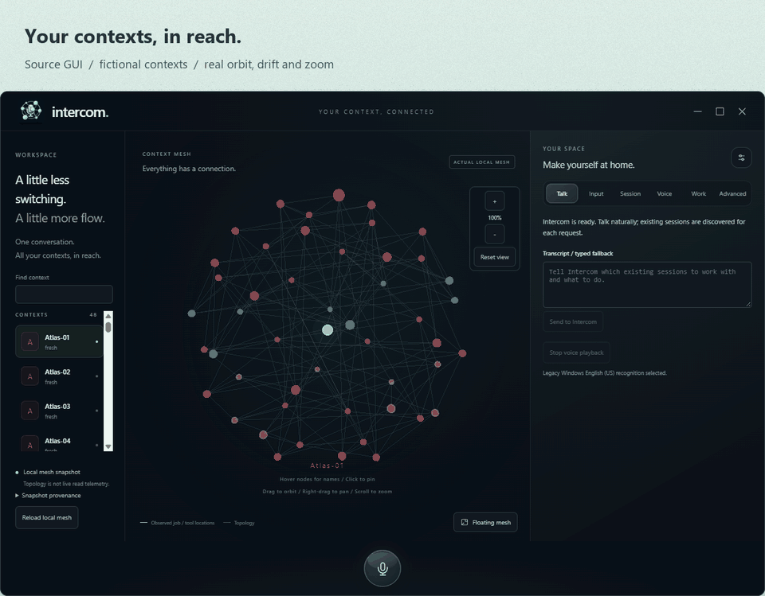
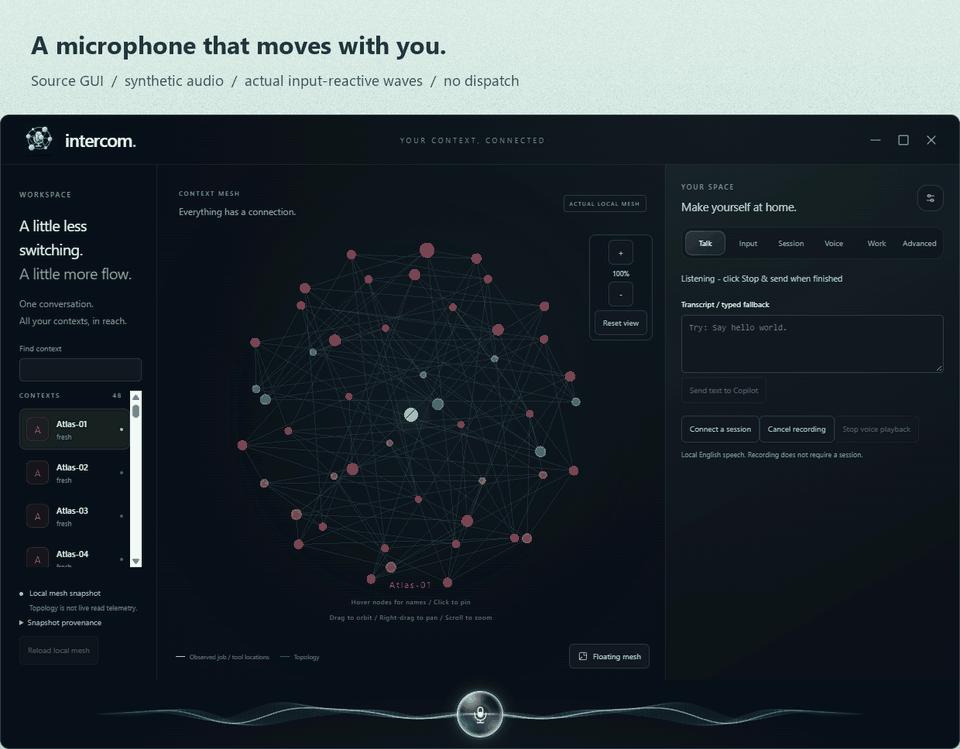

  

  <a href="docs/guide.md#readme-artwork">
    <picture>
      <source media="(prefers-reduced-motion: reduce)" srcset="docs/assets/readme/readme-logo-still.png" />
      
    </picture>
  </a>

  Sea-glass lettering, frosted mesh and softly flowing multicolor waves. <a href="docs/assets/readme/readme-logo-still.png">View the still logo</a>.

  
  
  

## A switchboard, conducted by voice

<table>
  <tr>
    <td width="45%" valign="top">
      
Inspired by mid-century switchboard operators and the conductor of an opera orchestra, Intercom aims to turn one spoken request into coordinated work across existing Agency/Copilot sessions: connect the right specialists, cue their tasks and bring their replies back. Its sea-glass Context Mesh visualizes those connections, lighting paths only for observed activity.

    </td>
    <td width="55%" valign="top">
      
       KDD exchange, 1967. Asahi Shimbun. <a href="https://commons.wikimedia.org/wiki/File:KDD_telephone_exchange_in_1960s.jpg">Source / rights</a>. Used with owner-confirmed permission.
    </td>
  </tr>
</table>

  GUI recordings below use the current source, fictional contexts and synthetic audio, not the published .12 build or speech-quality evidence. Each has a reduced-motion still.

  <a href="docs/guide.md#run-the-prototype">
    <picture>
      <source media="(prefers-reduced-motion: reduce)" srcset="docs/assets/readme/readme-voices.png" />
      
    </picture>
  </a>
   <a href="docs/assets/readme/readme-voices.png">Voice settings still</a>

  <a href="docs/prototype/prototype.md">
    <picture>
      <source media="(prefers-reduced-motion: reduce)" srcset="docs/assets/readme/readme-workspace.png" />
      
    </picture>
  </a>
   <a href="docs/assets/readme/readme-workspace.png">Workspace still</a>

  <a href="docs/guide.md#readme-artwork">
    <picture>
      <source media="(prefers-reduced-motion: reduce)" srcset="docs/assets/readme/readme-floating.png" />
      
    </picture>
  </a>
   <a href="docs/assets/readme/readme-floating.png">Floating Mesh still</a> · Owner-supplied wallpaper; actual transparent GUI capture, staged composite.

  <a href="docs/guide.md#readme-artwork">
    <picture>
      <source media="(prefers-reduced-motion: reduce)" srcset="docs/assets/readme/readme-microphone.png" />
      
    </picture>
  </a>
   <a href="docs/assets/readme/readme-microphone.png">Microphone still</a>

**Functional rebuild in progress (unpublished local work):** local development
connects the restricted controller to a durable multi-session scheduler, with
Intercom-node default focus, conditional checks, exclusions and manual tool
approvals. Clear requests need no second target/task confirmation. Disposable
fixtures verify this flow; real multi-session work and human speech quality
remain unqualified. Local multilingual Whisper uses explicit prepared-folder
setup and integrity checks, without silent Windows/CPU fallback. An 8 kHz
synthetic example confused session "Y" with "why": speech accuracy is not
accepted. Installer and portable GPU qualification remain unfinished. The
running/published .12 is unchanged; the implementation and qualification notes
remain local and are not included in this README/media update.
