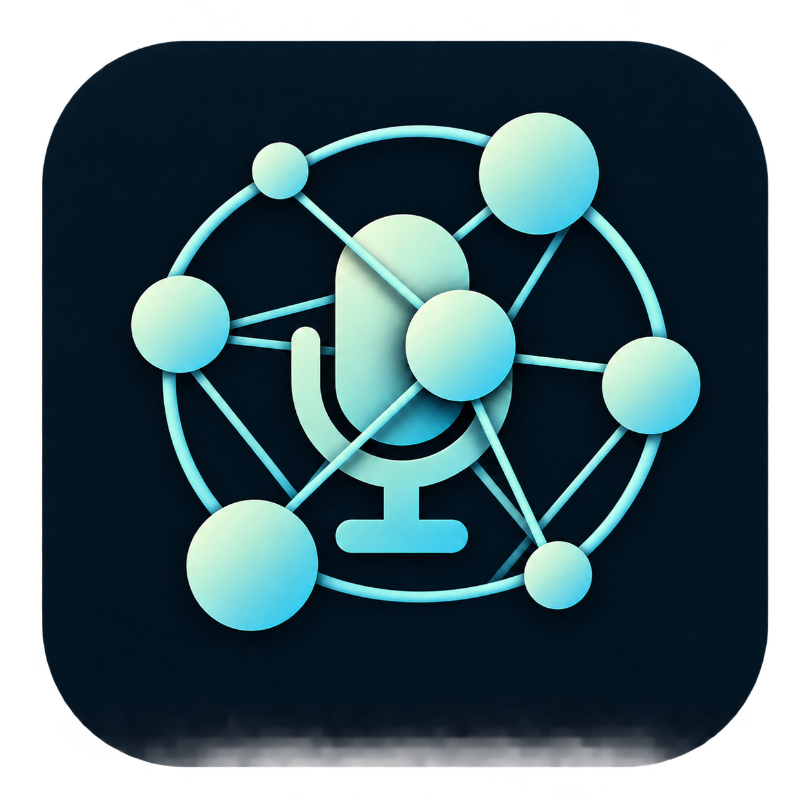

# Intercom



The microphone represents voice; varied-size connected nodes, rounded outer
orbits and straight inner links represent the context mesh. Foreground links
and a node overlap the microphone to give the mark depth.

A voice-first desktop assistant for working with existing Agency/Copilot
sessions. Speak a request, choose terminal handoff or background execution, and
hear the result when the requested work finishes.

Its proposed visual surface is a 3D Context Mesh sphere: active context and
session paths light up while other relationships remain dimly visible.

**Top priority:** speed/performance by default, with selectable processing
priorities. The prototype saves the selection and bounds graph rendering;
background requests apply supported reasoning effort (low/medium/high) without
changing the existing model. Speaking-voice settings are separate from processing
priorities; measured speech quality and speed budgets remain unqualified.

**Stage:** Windows push-to-talk and confirmed background-work prototype. Choose a microphone,
click **Speak**, then **Stop & send**: installed local English recognition
produces text, your designated existing idle Copilot session answers, and
Intercom speaks progress and the actual response. Every launch reads the actual
local Context Mesh snapshot. Background tasks require separate context/session/
task confirmation, retain Copilot permissions and return a durable receipt.
Terminal mode opens the existing session for manual task entry, not automatic
handoff. No wake word, active-session attach or new sessions. Electron is approved
for the prototype, not selected as the final product host.

**Engineering recommendation:** Tauri 2 + Rust host, React/TypeScript + Three.js
UI, native local-speech worker and SQLite jobs. This revises the initial
Electron recommendation; hardware measurements and Agency/speech proof still
gate selection.

## Run the prototype

The current Windows x64 prototype is **unsigned**:
[Download the .7 EXE](https://github.com/Zanark/Intercom/releases/download/v0.1.0-prototype.7/Intercom-Prototype-0.1.0-prototype.7-win-x64.exe)
from the [prototype prerelease](https://github.com/Zanark/Intercom/releases/tag/v0.1.0-prototype.7).
Local release package:
`C:\devdesk\homedesk\Intercom\release\voice-profiles-candidate\Intercom-Prototype-0.1.0-prototype.7-win-x64.exe`

This .7 release adds persistent **Voice profiles**: installed voice/gender/
accent choice, pitch, speed, volume, preview, duplication and naming.
Floating movement/sizing, deep graph zoom and native maximize/restore remain
available; previous executables are preserved.

The live source acceptance path captured synthetic speech, executed the exact
approved read-only `Get-Location` in the existing session, returned "Hello world."
and completed local playback. Existing saved grants meant no native permission
prompt appeared; approval mediation is tested with fixtures, not live-qualified.
The packaged candidate is qualified separately from that historical live task.
Physical FDUCE and human voice-quality acceptance remain unverified. Checksums,
the feature matrix and exact limits are in the [prototype guide](docs/prototype.md).

Windows may show an unknown-publisher/SmartScreen warning; verify
the release checksum and follow your device's security policy.
No Node.js installation is needed to run the EXE. First launch extracts the
bundled Electron runtime; startup speed has not been benchmarked.

The [earlier fixture-only .1 prerelease](https://github.com/Zanark/Intercom/releases/tag/v0.1.0-prototype.1)
is preserved unchanged. The intermediate .2-.6 builds remain local historical
candidates; their features are included in .7.

From `C:\devdesk\homedesk\Intercom` in PowerShell, with Node.js/npm installed:

```powershell
npm ci
npm start
```

Use the top-right **Maximize window** square to fill the screen; it becomes
**Restore window**. Scroll over the graph to zoom toward the pointer, use
**+ / -** for centered zoom, or right-drag to pan. Zoom can enter the sphere;
**Reset view** restores the starting camera and graph orientation.

Click **Floating mesh** to hide the panels and window background. Grab the
visible **Drag to move** handle at the top to move the window. The bottom dock
stays visible: **Smaller / Larger** resize the actual floating window, with a
pixel-size readout. These buttons do not change graph zoom. The dock also
restores the workspace or pins it above other windows. **Escape** restores it;
**Ctrl+Shift+M** toggles modes while Intercom has focus.
Hover reveals graph zoom/reset controls too. Returning from a maximized
workspace restores maximization and retains its previous normal-window bounds.

In the new voice build, paste your existing dedicated session UUID and click
**Connect existing session**. Its terminal must be closed/idle; Intercom
refuses a second writer. Agency and Copilot must be installed, on PATH and
authenticated. No session UUID or credentials ship in the EXE.

Click **Load microphones**, select FDUCE (or your preferred input), then
**Speak**. The meter shows the selected input while recording. Click
**Stop & send** after saying "Say hello world." Intercom transcribes locally,
sends the text and reads the returned answer. **Load/Test only checks access**;
it never starts a conversation. Disable automatic sending to review/edit the
transcript first. A typed fallback is available.

English (US) Windows speech recognition and an installed English voice are
required; nothing is downloaded. Audio stays in memory and is not uploaded.
Text goes to the existing Copilot account/session and may remain in its history.
Use **Show fixture demo** for the older synthetic routing controls.

Open **Voice profiles / customize speech** without connecting a session.
Choose an installed voice, adjust pitch/speed/volume, and **Preview voice**.
Preview does not save edits. **Save & use profile** keeps and activates them;
**Duplicate profile** creates another named configuration. Profiles survive
relaunch and apply to progress, replies and work updates. Gender is installed
voice metadata, not a transformation; pitch depends on the voice, and speed
uses Windows' scale. The required future arbitrary identity/timbre/emotional
style engine has a separate provider boundary but is not implemented here.
See the [speech contract](docs/speech-options.md).


Packaged .7: saved speaking profile with installed voice, pitch, speed and volume.
The sidebar scrolls to preview/save actions below. Contexts are a synthetic
test snapshot loaded through the native mesh reader, not the owner's private mesh.

For real work, choose **Background task** as the voice destination, then review
the proposed text below. Select the target context and an existing idle session,
click **Review target and task**, then confirm the exact immutable proposal.
Approve or reject each surfaced operation once. Review the returned response
and receipt; a response is not independent verification of arbitrary work.
One background job is supported; voice proposals and floating controls remain
available while it runs. The separate terminal destination needs manual task
entry and has no monitored completion.

The mesh reads the published local snapshot on every launch; it does not rebuild
Context Mesh itself. Source/load timestamps and stale warnings are visible.
Missing or malformed data produces an error, never a silent fixture substitute.
Bright spokes indicate observed job/tool locations, not inferred reads of links.

See the [prototype guide](docs/prototype.md) for controls, architecture,
performance behavior, checks and limitations.


Actual packaged v0.1.0-prototype.5 capture: maximize/restore is beside minimize
and close; graph zoom/reset controls sit beside the sphere. This image uses
explicit synthetic demo contexts; normal startup reads the actual local mesh.


Actual packaged .6 fixture capture: grab **Drag to move** above the sphere;
use **Smaller / Larger** in the always-visible bottom dock. The window is
540 px wide while the separate graph zoom is 125%. Surrounding pixels are
transparent; synthetic contexts do not represent actual context reads.

## Start here

- [Product brief and open decisions](docs/product-brief.md)
- [Architecture and integration boundaries](docs/architecture.md)
- [Technology picks, alternatives and reversal gates](docs/technology-decisions.md)
- [Runtime, IPC, routing and recovery contracts](docs/runtime-contracts.md)
- [Performance profiles and qualification plan](docs/performance-and-qualification.md)
- [Primary-source research evidence](docs/research-sources.md)
- [Local and cloud speech comparison](docs/speech-options.md)
- [Phased roadmap and implementation gates](docs/roadmap.md)
- [Development manual](docs/development-manual.md)
- [Workstream index](TODO/00_INDEX.todo)
- [Development ledger](TODO/03_DEVELOPMENT_LEDGER.todo)
- [GitHub tracking policy](docs/github-tracking.md)
- [Contributor and agent instructions](AGENTS.md)
- [Intercom GitHub Project](https://github.com/users/Zanark/projects/13)

The repository uses numbered, evidence-backed workstreams. The owner authorized
the initial fixture sub-slice, local-English conversation and subsequently
confirmed real work with manual approvals and a fresh actual mesh each launch.
Multilingual/hardware/performance and broader orchestration remain open.

## Development boundaries

Local agent execution does not guarantee offline model processing. Speech
privacy, permissions, retention, cancellation, and confirmation retain explicit
boundaries. Only own-main-frame audio is permitted; camera/other browser
permissions and renderer network requests remain denied. Narrow host IPC controls
speech, sanitized mesh loading and confirmed existing-session work; no generic
renderer shell/filesystem bridge exists. The single atomic job receipt is not
the researched SQLite queue/outbox. Continuous listening, cloud audio,
active-session attachment and new services remain outside this prototype.

Private session continuity lives in the Git-ignored `.agent-context` directory;
it is not part of public documentation or release packages.
