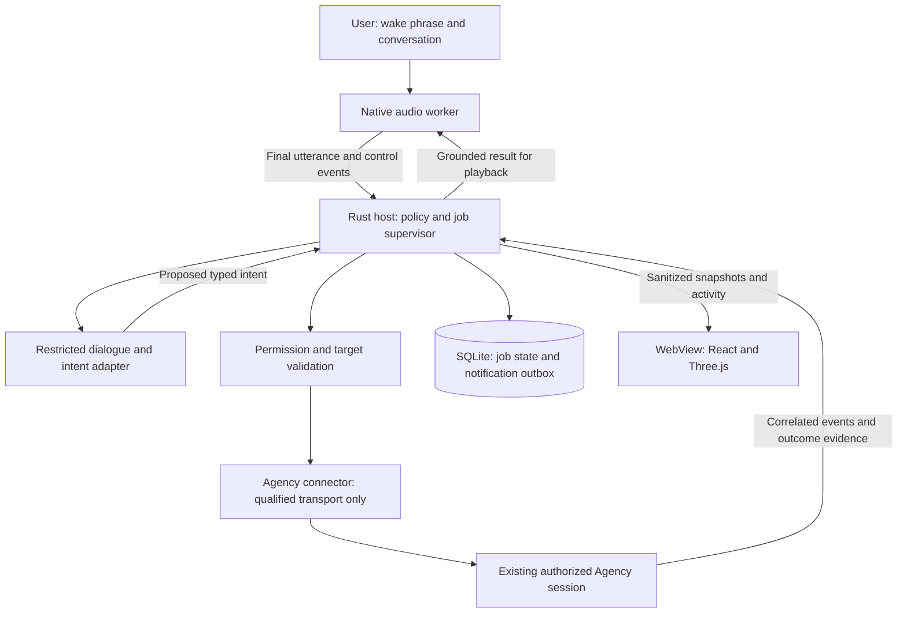

# Runtime contracts and failure behavior

**Functional-slice authorization (2026-11-11):** local multilingual recognition
downloads and a separate restricted Copilot interpretation controller are now
approved. Default focus is the Intercom context node. Clear spoken requests
replace redundant target/task confirmation; ambiguity and real tool permissions
remain explicit. The host must validate typed plans, exact existing sessions,
dependencies and exclusions. Controller proposals are not observations, grants
or work completion. Audio stays local; the controller receives transcript text
and minimal session metadata. No replacement work session or busy attachment.
These requirements are implemented in source as described below; real
multi-session and human speech qualification remain open.

**Current source:** `desktop/services/interpreter.cjs` creates
an ephemeral, tool-free SDK controller, projects only bounded session IDs/names/
context names/idle status, and validates a versioned response before returning
it to the host dispatcher. Up to 16 work/status actions reference exact catalog
IDs. Status exclusions, dependency identity/uniqueness, cycles, idle work targets,
request lengths, Roman output and unknown fields are checked in the host.
The speed profile selects low reasoning effort. Input recognition text may
contain Hindi script; normalization output must be Roman.

SDK 1.0.31 and installed CLI 1.0.109 are deliberately pinned to the qualified
boundary. Startup events and post-model inventories are checked, permissions
are denied, and a connected built-in MCP, enabled skill/agent or tool attempt
invalidates the entire result. A fresh controller is not a replacement work
session. Successful ephemeral session state is deleted through the SDK; aborted
or failed sessions may retain local diagnostics under the owned interpreter
profile. Exact cancellation discards late results; cleanup failure suppresses
the plan and failed forced cleanup blocks another request. These controls are
not an OS sandbox or proof about provider-side context/telemetry.

The interpreter itself does not dispatch or discover sessions. Main-frame IPC
accepts only a request UUID, text and priority, never an authoritative renderer
catalog or proposal. `session-catalog.cjs` reads Agency's actual `summary` names
and binds exact IDs to canonical registered mesh roots. Busy/unknown states do
not become idle; duplicate identities or ambiguous root ownership fail.
Missing or blank names use the explicit `Unnamed session (UUID)` label and a
warning, not a fabricated friendly name or rejection of unrelated requests.
Non-string names remain invalid. The interpreter must not guess among unnamed
sessions; exact IDs or unambiguous context bindings are still required.

`orchestration.cjs` persists a bounded atomic JSON queue before dispatch.
Up to two jobs may run in distinct, non-overlapping canonical workspaces.
Exact original context/workspace bindings are rechecked after interpretation,
then existing WorkHost policy checks and one-shot approvals govern execution.
Explicit exclusions and dependency outcomes are host-enforced. Ordinary work
answers are `responded`, not proven `succeeded`. Status captures are snapshots,
not model-based polling. Voice remains available while jobs run.

Cancellation owns the exact request and its children; late controller output
cannot dispatch. Cleanup errors remain explicit. Recovery never retries or
stops prior-launch work; unknown unacknowledged work reserves its session/root.
Nested saved outcomes are validated before renderer delivery. Plans retain
full Activity / Permission / Result text in fitted controls. Only observed
owned child activity lights graph paths, never model-proposed reads.
Fifty-seven host cases pass, including exact
approval identity, cancellation, recovery and long permission content. This
is fixture evidence, not real provider/work qualification. Read-only actual
catalog enumeration also succeeds with unnamed sessions; it dispatches no work.

Status is limited to host-owned receipts/catalog snapshots; an external
session becoming idle is not verified task completion. Waiting on an unowned
external session is explicitly unsupported by this interpretation contract.

## Bounded clarification replies

Only a validated `clarify` intent can automatically reopen the selected mic.
Wait for actual unsuperseded local playback completion; muted questions use
written display. Stop playback, cancellation, opt-out, changed settings, stale
ownership, failed readiness/playback and hidden/minimized host windows suppress
pending capture. Check the actual host window state after readiness:
Electron hiding is not reliably reflected by `document.hidden` alone.
Cancelled provider playback resolving successfully is still cancellation.

Automatic reply capture retains the visible question and reuses the ordinary
selected-device, five-minute, explicit-stop and uncertain-transcript review
path. It has no silence-based automatic stopping or continuous-listening loop.
Ordinary question-shaped prose, work results and permission prompts do not arm
the microphone. The default-on control is **Advanced > General > Delivery
behavior > Automatically listen for clarification replies**.

The host retains the preceding validated unresolved request and question in
memory for the next accepted request only. The fresh restricted interpreter
receives exactly `{ request, question }`, bounded to 10,000/4,000 Roman-script
characters; unknown fields fail validation. Further clarifications retain the
unresolved request; new user corrections take precedence. Context is not a
permission grant, persisted conversation or renderer-authoritative proposal.
Every turn still discovers a fresh catalog and uses normal dispatcher checks.

## Saved-context research

The validated `research` intent carries only a bounded topic and an explicit
session-history boolean, never work actions or arbitrary file paths. An optional
exact existing idle synthesis-session UUID is allowed only when the owner
explicitly requests that session, not inferred from a project name. The interpreter
additionally receives bounded context IDs/names/aliases, not source bodies.
Catalog failure is visible but does not prevent saved research; executable
plans still require fresh live discovery. Ordinary collection never constructs
a work transport or resumes an existing session. Explicit synthesis uses the
normal work queue described below.

`research.cjs` uses an owned, cancellable worker with a 60-second read bound.
Only registered `.agent-context` STATE/MEMORY/JOURNAL/README files and requested
`events.jsonl` files under exact indexed session UUIDs are eligible. No recursive
search, social-message reading or inbox ingestion occurs. Sources must be
canonical regular non-link children of their approved directories. Exact
BigInt device/inode/size/mtime identity is checked before and after reads;
SHA-256 and source-line citations accompany available evidence. This is not
an OS sandbox or a universal secret detector.

Notes are bounded to 2 MiB each and 64 MiB total. Histories stream in 64 KiB
chunks, up to 256 MiB each and 512 MiB total across at most 256 unique sessions.
Direct project matches and note matches receive history-budget priority.
Only topic-bearing user/assistant messages become evidence; embedded runtime
reminders and notifications are removed. A line above 4 MiB is skipped with
explicit partial coverage; malformed JSON or unsupported message schemas make
that history unavailable. The first two and latest ten matching messages are
retained, with omission counts. Topic discovery includes attributed histories
whose context names/notes do not match. Attribution alone is never work proof.

Reports contain source-labelled extractive summaries, escaped passages and
saved high-confidence topology, never invented activity. HTML is self-contained
with a no-network/script CSP, at most 8 MiB; JSON evidence is at most 16 MiB.
Private files use exclusive creation under the app profile's `research`
directory. Mode 0600 is not encryption or a Windows ACL guarantee.
Main-frame IPC reopens only a generated report UUID in this app instance's
bounded capability map, after verifying the original HTML hash. No arbitrary
renderer path or URL is accepted. `shell.openPath` uses the OS HTML handler;
acceptance is not proof of a visibly displayed browser. Opening failure keeps
the report and exposes its path/error. Cancellation prevents later opening
when observed, but cannot undo an OS open already initiated.

The renderer keeps catalog diagnostics collapsed and report/error feedback in
an independently bounded scrolling region. Source qualification includes real
recorded-request interpretation and private-source reading with all work
transport creation prohibited. That earlier qualification does not establish
real-session semantic synthesis.

### Observed context activity

The research worker emits source metadata only: sequence, timestamp, attributed
context IDs, source kind/path, checking/read/unavailable status, counts and
explicit partial-read errors. It never publishes source bodies over this
progress channel. Shared histories are read once and identify all indexed
owners; attribution is not proof every owner authored the topic work.
Worker batches flush at 32 events or 75 milliseconds and before completion.
The host retains the last 128 events plus cumulative observed context IDs,
coalesces progress publications, and rejects late cancelled-request events.
This transient trail is not persisted in the work queue.

The renderer shows listening, local transcription, interpretation, source
collection, report creation and work/manual-permission phases. Successful
recent research reads trigger one finite graph pulse; checking or unavailable
sources cannot create a read pulse. Reduced motion suppresses the tracer.
Earlier evidence stays explicitly labelled during a new recording. Host
research reads, work-tool locations, saved topology and model proposals are
different evidence classes; none exposes hidden Copilot reasoning.

### Explicit cited synthesis

After collection, Talk can load eligible existing sessions without dispatch.
The selector starts empty; busy/host-reserved targets are disabled. The narrow
bridge accepts report UUID, exact session UUID and priority, never an arbitrary
prompt or source path. An explicitly named synthesis target can also arrive
through validated interpretation. Fresh discovery and original canonical
context/workspace binding precede the normal durable queue, workspace exclusion
and exact manual tool-approval mechanism. No spare session is chosen.

Only this instance's generated, unchanged evidence JSON is eligible. A fixed
host prompt supplies its owned path and treats source text as untrusted data,
not instructions. Reading that JSON supplies the collected text to the
selected Copilot session under its provider/tool policy; local audio is never
sent. This is intentionally distinct from the tool-free interpretation controller.

The response must be bounded versioned JSON with a summary, 1-24 findings and
up to eight next steps. Every finding needs 1-8 exact path/line citations inside
retained collected passages. Unknown fields, malformed output, unsupported
script and forged citations fail explicitly. A location check is not semantic
entailment or independent verification of saved claims. The escaped illustrated
HTML labels model synthesis and retains original extracts/coverage. Opening
uses the same owned hash-checked capability, with cancellation checked directly
before OS handoff. Browser failure preserves the artifact and explicit error.

Plan/action receipts retain report provenance, validated summary or explicit
synthesis error. Finalization remains active until validation/opening settles;
cancelled late output cannot announce completion. Voice reads the validated
summary and next-action question, not raw JSON. Malformed output preserves the
original response and evidence for inspection. Duplicate unacknowledged
synthesis ownership is refused; restart does not reconstruct report capabilities
from arbitrary persisted paths. Synthetic integrated collection/queue/response/
report and manual-permission fixtures pass; no additional real-session work
was performed to qualify this path.

## Current source recognition

Host-owned `voice:configure-recognition` accepts
only a UUID and engine enum. Main selects the local directory using a native
dialog; the renderer cannot supply an arbitrary path. The host canonicalizes
and hash-verifies one pinned CPU/BLAS or Vulkan manifest before atomic settings
save. `voice:recognition-ready` verifies before capture; `voice:transcribe`
validates WAV and routes the selected engine. Packaged .15 supplies a trusted
`resources\speech` bundle root to VoiceHost; a fresh profile selects pinned
Vulkan/auto without a settings file. A saved `source: bundled` resolves through
that host-owned root, never a renderer path. Language persistence strips the
resolved extraction path, so portable relocation does not break the preference.
Explicit custom/legacy choices are preserved. Source runs without a supplied
bundle still require setup; Windows recognition is never an implicit fallback.
Cancellation owns the setup/preflight/native request. Failed preflight preserves
draft text and never opens a microphone.

`voice:recognition-language` accepts only a UUID and `auto` / `en` / `hi`,
requires configured Whisper and atomically saves the hint under the same
exclusive voice-request owner. Older valid settings without a hint normalize
to `auto`; invalid hints fail explicitly. Native transcription receives the
saved language, without translation.

**Five-minute source capture:** the renderer's wall-clock timer and PCM sample
budget both stop at 300 seconds. A boundary-crossing worklet chunk retains only
the remaining samples; repeated/tardy chunks cannot extend the buffer or
finalize twice. Physical disconnection remains a distinct cancellation.
Finalization rechecks the recorded sample duration after flush, so a manual
stop racing the sample limit still requires review. Automatic cutoff preserves
final recognized text without dispatch, regardless of automatic-send settings.
Ordinary earlier stops retain existing quality/length/send gates.

The host independently validates canonical mono PCM16: 8-48kHz, at most
300 seconds and 28,800,044 bytes, including the header at 48kHz. One extra
sample fails. Whole WAV input reaches native recognition without truncation
or audio upload. Whisper's timeout is max(180 seconds, three times audio
duration), bounded at 900 seconds. Legacy Windows uses max(40 seconds, three
times audio duration) internally and a host deadline five seconds longer.
These are cancellation/failure bounds, not expected latency. Short-recording
budgets remain unchanged; exact-request native cancellation is retained.
Recognition text is bounded at 50,000 characters; destination limits remain
10,000 for Intercom and 1,000 for legacy/manual requests. Over-limit drafts
are preserved for explicit shortening, never silently truncated or sent.
This contract is packaged into local .16, not published .12.

The renderer's measured microphone check uses the existing selected-device
recorder for two seconds, then releases it without transcription or dispatch.
Source rate is browser-reported metadata, distinct from AudioContext/canonical
PCM rate. Aggregate RMS/peak/clipping checks do not qualify hardware acoustics.
The separate Speech check uses the same capture/native route but retains raw
text in a separate in-memory result and returns before sending/orchestration.
It preserves the working draft and rejects cancelled late output; original
Hindi script in this diagnostic is not represented as Roman normalization.
Below-16kHz WAV input forces host review regardless of token probability.
The renderer also requires review for below-16kHz reported source input,
including input resampled to 16kHz. This mitigates automatic dispatch, not
recognition accuracy or missing acoustic detail.

**Optional live drafts:** Talk's Live transcription toggle defaults off to
preserve the speed-first profile and lasts for the mounted conversation, not
across reloads. Ordinary capture snapshots the non-consuming PCM buffer after
three seconds, then waits for each local batch result plus three seconds before
the next preview. This is not word-by-word streaming; local .16 reuses a
persistent native model across these batches.
Snapshots need at least one second of usable signal; source capture is bounded
to five minutes (historical .15 retained one minute). Previews reprocess the complete
buffer so far, increasing optional inference cost as recording grows.
One unique preview UUID owns each native request. Stop waits for
its cancellation/settlement before final recognition, including worklet-flush
failure. Cancellation/unmount invalidate late previews and release the stream.
Preview failure is visible and pauses previews without disabling final
recognition. Drafts never dispatch, speak or replace the underlying typed
draft; only the final full recording enters existing length/quality/auto-send
gates. Extra inference consumes CPU/GPU; latency and human multilingual quality
are not qualified. Raw previews, like Speech check, may retain Hindi script.

The .16 private helper receives in-memory WAV through inherited anonymous pipes
and returns bounded, request-correlated JSON. It loads the pinned model once
before microphone capture and keeps it resident across drafts/final recognition.
It opens no network listener or audio device. Exact native cancellation loses
the warm state; next explicit use reloads. Parent-death monitoring and awaited
host close stop the owned worker. Idle RAM cost is unmeasured; memory/paging/
crash-dump protection and secure buffer zeroization are not promised.
The historical CLI diagnostic path remains separate.
GPU output requires an observed Vulkan backend report. No audio/transcript file
is persisted by recognition; its nullable confidence and separate token
probability do not establish accuracy. Native synthetic rate/cancellation
checks passed, but the 8 kHz exact-session-name assertion failed ("Y" became
"why" with high probability). Neither human multilingual quality nor speed-first
acceptance is qualified. Local .16 includes the exact model and machine-qualified
native runtime with license notices; this is not a generic portable GPU
redistribution or automatic installer. Optional custom selection and source runs
still use prepared folders. See
[speech evidence](../research/speech-options.md#activated-native-evidence-and-failed-quality-gate).

The numbered product contracts below remain proposals, not implemented APIs. Read with
[architecture](architecture.md), [technology decisions](technology-decisions.md)
and [qualification](../research/performance-and-qualification.md).

**Prototype exception (.4):** the implemented Electron slice uses narrow
main-frame IPC, push-to-talk local Windows speech, a host-worker actual-mesh
projection, confirmed existing-session ACP work and a single atomic JSON
receipt. It does not implement the proposed Rust/SQLite queue or durable
notification outbox below. Terminal mode only opens the existing session for
manual task entry; it does not claim acknowledged ownership transfer or send
the task automatically. Exact behavior, native/fixture evidence and remaining
gates are in the [current feature matrix](../prototype/prototype.md#prototype-010-prototype12).

## 1. Process topology and authority



Figure: proposed authority boundaries; this editable diagram has not been
rendered or visually reviewed in this documentation-only pass.

The host retains authority while the WebView can close, restart or lose WebGL.
The worker owns microphone/playback and native model state; worker failure
does not imply job failure. The connector owns only the qualified runtime
connection, not the user's independently running terminal.
These process boundaries do not sandbox a malicious native worker.

Use private inherited pipes for the worker. Use versioned, size-bounded frames
with request IDs; drain stdout/stderr concurrently to avoid child deadlock.
Control messages and audio are separate lanes. Keep PCM inside the worker for
local inference; cloud adapters receive it only under approved provider policy.
The WebView receives no raw PCM, agent environment or private context index.

Rust custom commands are the sole frontend entry points. Explicitly configure
the Tauri command manifest/permissions: custom registered commands are otherwise
allowed to windows by default. Do not expose generic shell/filesystem commands
or enable remote-content capabilities. Validate window identity, schema, size
and authority inside every sensitive host handler. Tauri capabilities do not
repair unsafe Rust handlers. See R02-R03 in [sources](../research/research-sources.md).

Use a window-scoped Tauri channel for ordered sanitized updates. Its channel
is a delivery mechanism, not authorization or durable acknowledgment. Snapshot
revision plus deltas handles reload; normal events are only for low-volume UI
signals. Do not stream every token through a global event bus or re-render the
whole graph for every change.

## 2. Audio state is independent of job state

```text
disabled -> enabling -> wake-only -> listening -> finalizing
                                      ^              |
                                      |          interpreting
                                      |              |
                                      +-- speaking / clarifying
conversation sleep/timeout -> wake-only
device failure -> unavailable
explicit mute, OS lock or permission loss -> disabled
```

Proposed defaults need device/user qualification. On lock, suspend capture and
speech and invalidate unconsumed confirmations; do not silently cancel active
jobs or replay sensitive notifications at unlock. Resume listening only under
the selected explicit-unlock/listening policy. Close versus tray-minimize and
exit are distinct controls.

Each activated conversation has an epoch. Each finalized utterance has a
unique ID and revision. Repeated final callbacks are deduplicated; a corrected
final invalidates unapproved intent/confirmation. Partial ASR can update text,
not start work. A late old-worker transcript cannot enter a new conversation.

One capture stream feeds bounded frame buffers. Never allocate, write logs,
perform inference or wait for database/network on the real-time callback.
Detect overflow/discontinuity, mark the affected utterance invalid and ask for
repetition; silently dropping samples can change a session name or negation.
Bound utterance duration and give an explicit timeout outcome.

Stopping assistant speech clears its queued audio and invalidates late TTS
chunks by playback generation. It does not cancel the user's job. Cancelling a
job requires an identified job and its request-scoped cancellation path.
Conversational "no, not that project" before dispatch discards the proposal;
after dispatch it asks whether to cancel and create a separately approved job.
It cannot retract changes already made.

## 3. Identity, discovery and routing

| Identity | Meaning |
|---|---|
| contextId | Registered mesh context; not a runtime session |
| sessionId plus runtime/source | Existing session identity as returned by the qualified connector |
| workspace/resource key | Canonical authorized root or exclusive resource; different sessions can share it |
| connectionEpoch | One authenticated transport lifetime; rejects stale events after reconnect |
| conversationId / utteranceId | Voice-dialogue scope and finalized input |
| requestId / jobId | Approved application request and one execution lifecycle |
| transport request ID | ACP/SDK-specific call correlation, not an interchangeable jobId |

Read only approved mesh metadata and an explicitly authorized session catalog.
Refresh the target's availability/configuration at dispatch, not just at app
startup. Cache is an optimization, not authority. Preserve source/capability
distinctions and do not infer availability from a process ID or mesh avatar.

Alias resolution is exact over normalized approved aliases; collisions yield
clarification. Fuzzy/model suggestions remain proposals. Pronouns such as
"that project" resolve only to an unambiguous active conversation reference.
If the catalog is unavailable, state that rather than choosing an old target.

Before any effect, bind target context/session/workspace, action kind, request
hash, selected profile revision, required permissions and expiry into an
approval record. Bind a spoken answer to one currently presented confirmation,
not any occurrence of "yes." Switching targets or changing the proposed action
invalidates it. Higher-risk policy may require a trusted local confirmation;
wake-word detection alone is never authentication.

Treat mesh descriptions, retrieved documents, transcripts, model output and
tool results as data, not instructions granting permissions. Host policy wins.
No transcript is interpolated into a shell command. Pass request content over
the structured transport; Windows launchers/shims need a separately tested
argument-serialization boundary. A `.cmd` shim is not a native executable.

## 4. Connector capability contract

This is an application-level contract, not a claim that Agency advertises
these exact fields:

| Capability | Required evidence before enabling |
|---|---|
| Discovery | Source identity, workspace, browse-only/resumable/active/busy distinction and freshness |
| Dormant resume | Same existing ID and effective configuration; exclusive ownership without a second writer |
| Live attachment | Supported authenticated control of the actual running process/session, including ownership rules |
| Permission mediation | Exact requests/options and denial/expiry handling; no approve-all shortcut |
| Event stream | Transport-specific framing, request/session attribution and known replay limits |
| Cancellation | Identified prompt cancellation, terminal disposition and surviving side effects |
| Terminal handoff | Explicit ownership transfer or supported shared/view-only attachment; no duplicate resume |
| Recovery | Read-only reconciliation or replay cursor that does not repeat the user's operation |

ACP's standard `loadSession` and optional newer session capabilities must be
negotiated. Standard documentation is not proof that the installed Copilot
implements them, or that loading a persisted conversation attaches to a live
Agency session. SDK JSON-RPC is a different adapter. See R11-R14.

Resuming Copilot can retain its model, agent mode and **allow-all state**.
Preserving configuration is not sufficient if it preserves a policy the app
cannot safely mediate. Inspect the effective supported permission contract;
reject or require explicit coordinated policy qualification for an unsafe or
unknown target. Do not silently reset the user's global/session permissions.

If active attachment cannot be proved, the required live-session feature stays
blocked. A dormant-resume result must not close that gate. Never use keystroke
injection, session-database edits, transcript-file tailing as a control protocol,
or an SDK-created replacement session.

Terminal opening is not a successful handoff by itself. Move through
handoff-pending, acknowledged ownership transfer, and detached-from-Intercom
control. If that cannot be observed, show the limitation and keep dispatch
blocked. Viewing an app-owned log is a different, read-only action.

## 5. Dispatch and durable jobs

Normalize each event with source, connection epoch, session/request attribution,
optional producer event ID/cursor, local arrival sequence and payload version.
Local sequence orders one connection's arrivals; it is not a replay cursor or
proof that the producer lost nothing. Use producer IDs for replay deduplication
only where their stability is qualified. Without them, reducers must tolerate
replay and preserve uncertainty; hashing identical text is not safe delta
deduplication. Detect declared sequence gaps and obtain supported resync, or
mark coverage/outcome unknown. Never fabricate missing tool/read events.

Write approved request metadata and the intended dispatch before transmission.
Commit its state before acknowledging submission to the user. Do not hold a
database transaction open while waiting for an agent, provider or confirmation.

```text
received -> clarifying / awaiting-confirmation
approved -> queued -> dispatching -> running <-> awaiting-user
running -> verifying -> succeeded / finished-unverified / failed
queued -> cancelled-before-send
dispatching/running -> cancellation-requested -> cancelled / outcome-unknown
lost acknowledgment/ambiguous ownership -> outcome-unknown
```

These are proposed persisted states. Enforce compare-and-set transitions in
one owner; stale completions cannot overwrite newer terminal dispositions.
Cancellation after success returns the existing result, not a fabricated undo.
An event arriving after an unknown state can resolve it only if its correlation
and outcome evidence are authoritative.

External dispatch is not atomic with a local database transaction:

| Crash point | Restart behavior |
|---|---|
| Before durable approval | No job accepted or sent |
| Durable queued record, not sent | Revalidate consent, expiry and target before resuming the queue |
| Dispatch began, acknowledgment missing | Mark outcome unknown; never assume unsent or blindly retry |
| Running, connection lost | Reconcile using supported read-only identity/event history, else retain unknown |
| Terminal evidence received before local commit | Recover from supported replay/query if available; otherwise unknown |
| Outcome/outbox committed, before playback | Show pending notification; do not redispatch work |
| Playback happened, acknowledgment missing | Delivery uncertain; receipt remains, no exactly-once speech promise |

At most one active dispatch per session. Initially permit one background job
globally; qualify later bounded concurrency only for disjoint workspaces and
resources. An app-local lock does not exclude external terminals or other apps;
ownership requires the connector's supported coordination or user handoff.
Canonical path/junction handling and shared-resource declarations need tests.

Backpressure favors policy/permission/cancellation/outcome events over cosmetic
progress. Coalesce UI progress, not authoritative terminal events. If the host
cannot durably record critical state, stop accepting dispatch and expose the
storage error; do not report an accepted task.

## 6. Outcome evidence and speech

The connector maps raw events into a request-correlated receipt containing:
identity, intended task, terminal signal, acceptance checks, evidence origin,
known side effects, unresolved items, provenance and timestamps.

An idle event says something about runtime activity, not task correctness.
ACP prompt completion and SDK completion must each be qualified in their own
adapter. Ignore subagent idle for foreground completion; account for attached
work. Detached services need explicit readiness criteria, not process exit.

| Evidence | Permitted claim |
|---|---|
| Agent says finished, no independent acceptance evidence | Agent reports completion; verification unavailable |
| Valid terminal outcome and the task's required checks pass | Qualified success for that task and scope |
| Required action/check failed | Failure or partial result with the actual boundary |
| Lost correlation, process exit without outcome, conflicting events | Outcome unknown; do not infer success |

Some analytical tasks cannot be independently mechanically verified. Label the
evidence level instead of pretending every result has test-backed certainty.
`finished-unverified` is distinct from succeeded and from transport uncertainty.

Persist outcome and outbox record together, unique by job/outcome revision.
Speech derives from that receipt. Simple status uses templates; complex
summary text must retain uncertainty and omit secrets/irrelevant tool output.
The notification mentions the original target so concurrent conversation does
not make "it's done" ambiguous. Do not read private results aloud on a locked
machine; respect mute and notification settings.

## 7. Storage, lifecycle and recovery

### Implemented local .17 portable/diagnostic boundary

Each portable launcher extracts into its own NSIS plugin directory, not a
build-shared temporary directory. In pinned builder 26.18.0 this requires
`portable.unpackDirName: true`, contrary to its `false` documentation. Exact
portable regression proves a rejected duplicate cannot delete the first
instance's model, and subsequent speech uses the same resident helper.
Single-instance refusal does not focus or restart the owner app.

`desktop/services/diagnostics.cjs` stores allowlisted JSONL events beneath the
existing app profile's `diagnostics` directory, outside temporary extraction.
The main-frame IPC wrapper correlates starts/results/failures and preserves
original handler results/errors. App/renderer/native-child failures and fixed
voice phases are recorded without payloads. Normal cancel/close is distinct
from an unexpected native exit, including unexpected code zero.

Four approximately 1 MiB event files and a 128-event queue bound retention.
Each reported failure atomically replaces `last-failure.json` with resource
stats, process IDs/types/memory counters, runtime and owned-helper metadata.
Collector failures are explicitly unavailable. No audio, transcripts, prompts,
responses, raw errors/stacks, argv, environment or memory contents are logged.
Paths remain private. This is not a full memory dump, guaranteed fatal-crash
capture, encryption or an OS access-control boundary.

Storage failure/overflow stays visible independently of the actual operation
outcome; a successful operation is not relabelled failed merely because logging
failed. Renderer APIs accept fixed phases/failure kinds and can open only the
fixed diagnostics directory, never an arbitrary path. Missing/corrupt model
readiness still refuses recording before opening a microphone. The actual
portable missing-model snapshot/recovery test uses only disposable extraction.

### Proposed broader production recovery

Proposed local data is under the current Windows user's application-data
directory, never a repository or network share. Names/retention require approval.

| Data | Proposed handling |
|---|---|
| Raw audio and partial transcript | Bounded volatile buffers; no persistence by default |
| Active conversation context | Bounded memory; explicit session replacement/expiry |
| Queued request content | Minimum encrypted payload only if durable queue recovery is approved; remove after its retention boundary |
| Job/approval/outcome metadata | SQLite with restrictive OS access; hashes are not anonymization |
| Credentials | OS credential APIs; no plaintext DB/log/UI copy |
| Diagnostics | Allowlisted IDs, durations, queue depths and error codes; no content by default |
| Mesh snapshot | Approved projection and revision/hash, not a transcript or social archive |

A non-durable-content mode can retain job metadata without its prompt, but
must ask the user to restate a queued request after restart. Do not advertise
restartable queued work if its payload was never persisted.

Use explicit schema migrations and a pre-migration compatible backup. Refuse an
unsupported newer schema; never replace the DB with an empty success-shaped
fallback. Disk full/read-only/corruption blocks new work visibly. Database
backup must account for journaling; do not copy a live SQLite main file alone
and assume committed WAL state came with it. R19-R20.

Use explicit verified journaling/synchronization settings, initially rollback
journaling with FULL synchronization for critical job/outbox transactions.
Do not silently weaken durability in Speed mode. A single database owner runs
blocking calls on a dedicated thread, not an audio/async event-loop callback.
If WAL is later justified, qualify its pinned SQLite build and checkpoint
policy; a sync guarantee still depends on the OS/filesystem/storage honoring it.

Tray-minimize keeps only the explicitly enabled listener and owned jobs.
Exit warns about active work and offers a policy-qualified outcome; it does not
promise job survival without a separately designed supervisor. UI reload is not
app exit. Never kill a user-owned Agency process. Worker cleanup is scoped to
recorded Intercom-owned processes; Tokio handle drop is not cancellation. R10.

On OS sleep or network loss, mark telemetry stale and reconcile on resume;
never transform silence into completion. Restarting a worker/provider cannot
resubmit a job. Autostart, detached global services and remote listeners remain
outside the current scope.

## 8. Mesh projection and rendering

Import one versioned snapshot, validate IDs/endpoints and allowlist text.
A changed/incomplete snapshot keeps the last valid graph visibly stale with an
error, not silently fresh. File notifications are hints: debounce and perform
bounded validated rereads; a write event is not a complete-file guarantee.
Reject oversize/incompatible input rather than parse without a limit.

Maintain separate topology revision and activity sequence. Index identities
and adjacency once in O(V+E); exact alias/ID lookup uses maps. Render context
nodes by default, expand approved session/detail nodes on demand, and retain
hidden relationships in an accessible list. Do not use every memory/social
node merely because it exists in the source.

Stable spherical placement uses persisted ID-to-slot positions or a fixed
capacity deterministic slot allocation. Recomputing a Fibonacci sphere using
the new total node count would move existing nodes; do not call that stable.
Use bounded overlap correction, never a continuous per-frame force simulation.

Use shared geometry/materials and instancing where appropriate, batched dim
edge buffers and a small active overlay. Rebuild topology only on revision,
not every activity delta. Limit labels and selected hit-testing. Recompute
instanced bounds when positions change and dispose owned GPU resources. R18.

Render on demand while idle. Animate only active work/camera interaction;
pause hidden/minimized decoration, cap pixel ratio and reduce bloom before
reducing legibility or dropping state. Reduced motion removes travel/pulses
while preserving status. No continuous auto-rotation is needed to look spherical.

Bright activity references an actual observed delivery/retrieval/dispatch event,
its job and its evidence. Planned routes are outlined, static links stay dim,
unknown coverage stays unknown. Never turn a graph shortest path into a story
about what the agent read. UI resynchronization rebuilds from the host snapshot;
it must not replay old pulses as new activity or execute work.
