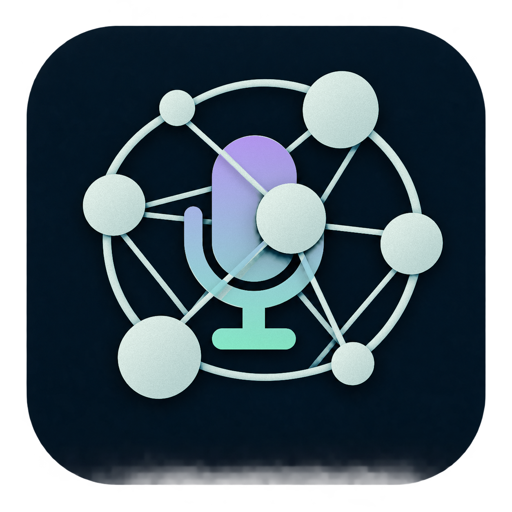
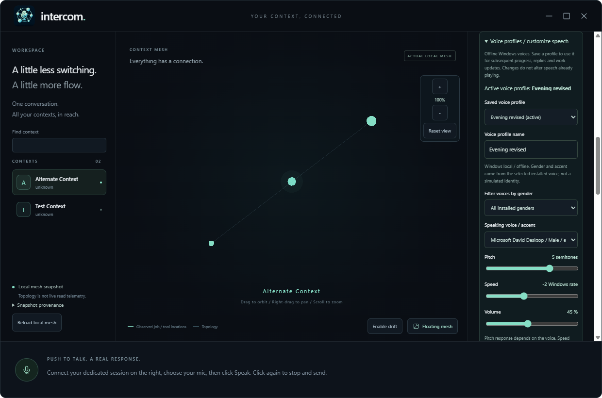
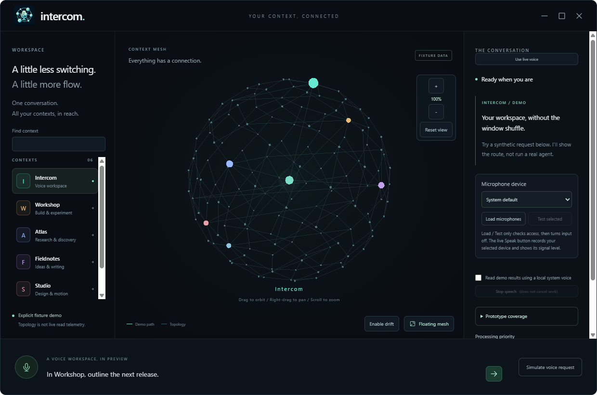
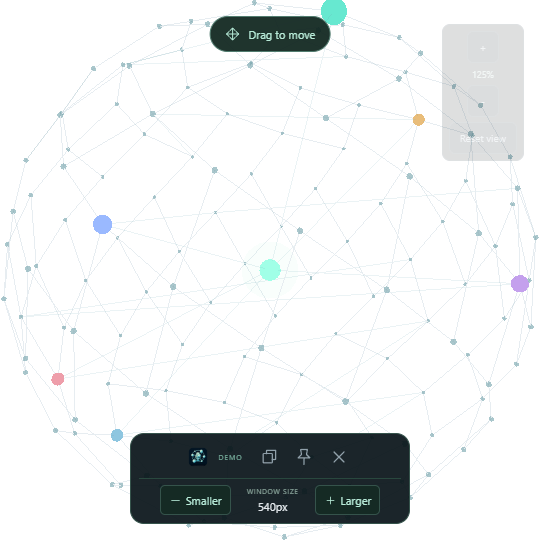

# Intercom project guide

[Visual home](../README.md) · [Prototype details](prototype/prototype.md)



The microphone represents voice; varied-size connected nodes, rounded outer
orbits and straight inner links represent the context mesh. Foreground links
and a node overlap the microphone to give the mark depth.

A voice-first desktop assistant for working with existing Agency/Copilot
sessions. Speak a request, choose terminal handoff or background execution, and
hear the result when the requested work finishes.

Its proposed visual surface is a 3D Context Mesh sphere: active context and
session paths light up while other relationships remain dimly visible.

**Top priority:** speed/performance by default, with selectable processing
priorities. The prototype saves the selection and bounds graph rendering;
background requests apply supported reasoning effort (low/medium/high) without
changing the existing model. Speaking-voice settings are separate from processing
priorities; measured speech quality and speed budgets remain unqualified.

**Stage:** Windows push-to-talk and confirmed background-work prototype. Choose a microphone,
click **Speak**, then **Stop & send**: installed local English recognition
produces text, your designated existing idle Copilot session answers, and
Intercom speaks progress and the actual response. Every launch reads the actual
local Context Mesh snapshot. Background tasks require separate context/session/
task confirmation, retain Copilot permissions and return a durable receipt.
Terminal mode opens the existing session for manual task entry, not automatic
handoff. No wake word, active-session attach or new sessions. Electron is approved
for the prototype, not selected as the final product host.

**Engineering recommendation:** Tauri 2 + Rust host, React/TypeScript + Three.js
UI, native local-speech worker and SQLite jobs. This revises the initial
Electron recommendation; hardware measurements and Agency/speech proof still
gate selection.

## Run the prototype

The current Windows x64 prototype is **unsigned**:
[Download the .12 EXE](https://github.com/Zanark/Intercom/releases/download/v0.1.0-prototype.12/Intercom-Prototype-0.1.0-prototype.12-win-x64.exe)
from the [prototype prerelease](https://github.com/Zanark/Intercom/releases/tag/v0.1.0-prototype.12).
The new local artifact is:
`C:\devdesk\homedesk\Intercom\release\prototype-12-candidate\Intercom-Prototype-0.1.0-prototype.12-win-x64.exe`.
The earlier retained .11 and published .7 are preserved, not overwritten.

Prototype .12 includes the microphone fixes since .7: session-independent local
capture/transcription, a stationary microphone in both views, a collapsed
single-row floating dock, accessible settings/transcripts and explicit review
of uncertain/long recognition. Hover or pin mesh nodes to identify them without
permanent labels. It also packages the reorganized repository and retains
named installed-voice profiles, pitch/speed/volume, deep graph zoom,
maximize/restore and confirmed existing-session background work.

The live source acceptance path captured synthetic speech, executed the exact
approved read-only `Get-Location` in the existing session, returned "Hello world."
and completed local playback. Existing saved grants meant no native permission
prompt appeared; approval mediation is tested with fixtures, not live-qualified.
The packaged candidate is qualified separately from that historical live task.
Physical FDUCE and human voice-quality acceptance remain unverified. Checksums,
the feature matrix and exact limits are in the [prototype guide](prototype/prototype.md).

Windows may show an unknown-publisher/SmartScreen warning; verify
the release checksum and follow your device's security policy.
No Node.js installation is needed to run the EXE. First launch extracts the
bundled Electron runtime; startup speed has not been benchmarked.

The [earlier fixture-only .1 prerelease](https://github.com/Zanark/Intercom/releases/tag/v0.1.0-prototype.1)
is preserved unchanged. The intermediate .2-.6 builds are historical
qualification records; their features are included in .12.

From `C:\devdesk\homedesk\Intercom` in PowerShell, with Node.js/npm installed:

```powershell
npm ci
npm start
```

## Current source: focused glass controls

The current source UI differs from the published .12 download below.
The bottom of the workspace contains only a glass microphone icon. Its tooltip
and accessible name describe **Speak**, **Stop & transcribe / send**, or
**Cancel request**; recording level fills the button. Recording does not require
a connected session.
During capture, original mint/cyan ribbons flow outward symmetrically from the
microphone. Their height and the microphone capsule's vertical fill follow the
same measured input level, not random animation. Floating mode keeps smaller
wings around its microphone. Painting is capped at 30 fps, stops when hidden/
minimized, and is removed when capture stops; reduced motion uses a stationary
shape that still reflects the level. No extra microphone stream is opened.

The right panel opens on **Talk**. Each category keeps its controls in view:

| Tab | Controls |
|---|---|
| Talk | Transcript, explicit send, response and recording cancellation |
| Input | Microphone selection, load and brief test |
| Session | Existing session UUID, connection and request destination |
| Voice | Local playback; Voice / Tune / Profiles / Preview sub-tabs |
| Work | Target / Task / Review / Receipt steps, with separate confirmation |
| Advanced | General: automatic sending and processing priority; Display: drift; About: limits |

Use Left/Right or Home/End on a tab to switch by keyboard. Draft text, session
entry and unsaved voice edits survive category changes. The single recorder
stays mounted across tabs and workspace/floating transitions.

In Floating Mesh, a small microphone sits immediately beside the native drag
grip, outside the default-collapsed controls. Expand the arrow to show the fitted
grid of graph/window controls, settings, conversation and work/receipts.
The grid does not scroll, including at the 360 px minimum size. Settings and
work return to the workspace; conversation toggles the floating transcript.
Recognition review and errors open that transcript automatically. A pending
permission highlights the dock arrow and work control; it never grants approval.

Settings categories fit the 960 x 680 minimum workspace without scrolling.
Long transcripts, work confirmations and receipts may still scroll inside their
content panels; no setting is hidden to fake a fit. The published .12 binary,
release assets and any already-running instance retain their earlier layout.

## Shared graph and window controls

Use the top-right **Maximize window** square to fill the screen; it becomes
**Restore window**. Scroll over the graph to zoom toward the pointer, use
**+ / -** for centered zoom, or right-drag to pan. Zoom can enter the sphere;
**Reset view** restores the starting camera and graph orientation.

**Node identification in .12:** hover a colored
node for its name, or click/tap to pin its details and base path. Names stay
hidden otherwise. Close with Escape, the close button, a same-node click or
blank-space click. Keyboard: focus the graph, arrow through nodes, Enter/Space
to pin. Inspecting a node does not change the work target.

## Published .12 control layout

Click **Floating mesh** to hide the panels and window background. **Prototype .10
and newer, including .12:** the bottom dock starts collapsed. Its **Drag to
move** grip moves the native window; the adjacent arrow expands one horizontal
row containing graph zoom/reset, restore, pin, close and window-size controls.
At small sizes the row scrolls horizontally rather than wrapping. The size
buttons resize the native window without changing graph zoom. There is no
separate top grip or hovering zoom toolbar in this view.

**Prototype .11 and newer, including .12:** the large **Speak** button is fixed at the
bottom center of the whole window, in its own operational bar below the graph
and scrolling panels. It never shifts when recording or cancellation controls
appear. In floating mode it stays centered above, and outside, the collapsed
dock. The input meter appears while recording; **x** cancels the request.
It uses the same selected input and recording in workspace/floating mode:
switching views does not stop or reopen the stream. **Settings** beside the mic
opens/focuses microphone selection in the workspace, or toggles the scrollable
floating voice panel. The transcript is first; microphone/session setup and
playback profiles start collapsed. Stopping opens recognition review/results
or an explicit error in floating mode.
Preparing a work request returns to the workspace for the existing separate
target/task confirmation; it does not dispatch work. The old inert live-mode
footer is not used; the new bar contains the actual recorder. Explicit fixture
demo remains synthetic and separate from live capture.

**Escape** dismisses an open voice panel or node label before restoring the
workspace; **Ctrl+Shift+M** toggles views while Intercom has focus. Returning from
a maximized workspace retains its previous normal-window bounds/maximization.
Older .7-.9 builds retain the top drag handle and two-row dock; they do not
update automatically. See the [current prototype details](prototype/prototype.md#prototype-010-prototype12).

**Prototype .8 and newer, including .12:** click **Settings**
beside Speak first, then **Load microphones**, select FDUCE
(or your preferred input), optionally **Test selected**, then **Speak**. The meter
shows the selected input while recording. No Copilot connection is needed for
recording or local transcription. Click **Stop & transcribe** to retain an
editable transcript; without a connection, nothing is sent, even if automatic
sending is checked. **Load/Test only checks access**, not capture or recognition.
The [prototype guide](prototype/prototype.md#prototype-010-prototype12)
identifies the fixed .12 EXE; the older .7 download is unchanged and still
requires connection before Speak.

To send, paste your existing dedicated session UUID and click **Connect existing
session**, then **Send text to Copilot**. Connecting alone never sends an existing
transcript. Its terminal must be closed/idle; Intercom refuses a second writer.
Agency and Copilot must be installed, on PATH and authenticated. No session UUID
or credentials ship in the EXE. Subsequent recordings with a connected session
and automatic sending enabled use **Stop & send** and read the returned answer.
Disable automatic sending to review/edit before sending. Typed fallback remains
available.

**Prototype .9 and newer, including .12:** low-confidence recognition preserves
the transcript for review instead of discarding it. Nothing is automatically
sent or proposed in any destination; review/edit, then explicitly send or prepare
work. Transcripts over 1,000 characters remain intact but must be shortened
before sending. There is no automatic truncation or splitting. Empty recognition
still gives a distinct error. This improves recovery, not recognition accuracy;
the engine remains Windows English (US), regardless of the speaking-voice profile.
See the [current prototype details](prototype/prototype.md#prototype-010-prototype12).

English (US) Windows speech recognition and an installed English voice are
required; nothing is downloaded. Audio stays in memory and is not uploaded.
Text goes to the existing Copilot account/session and may remain in its history.
Use **Show fixture demo** for the older synthetic routing controls.

Expand **Voice profiles and playback**, then **Voice profiles / customize
speech**, without connecting a session.
Choose an installed voice, adjust pitch/speed/volume, and **Preview voice**.
Preview does not save edits. **Save & use profile** keeps and activates them;
**Duplicate profile** creates another named configuration. Profiles survive
relaunch and apply to progress, replies and work updates. Gender is installed
voice metadata, not a transformation; pitch depends on the voice, and speed
uses Windows' scale. The required future arbitrary identity/timbre/emotional
style engine has a separate provider boundary but is not implemented here.
See the [speech contract](research/speech-options.md).



Packaged .7: saved speaking profile with installed voice, pitch, speed and volume.
The sidebar scrolls to preview/save actions below. Contexts are a synthetic
test snapshot loaded through the native mesh reader, not the owner's private mesh.

For real work, choose **Background task** as the voice destination, then review
the proposed text below. Select the target context and an existing idle session,
click **Review target and task**, then confirm the exact immutable proposal.
Approve or reject each surfaced operation once. Review the returned response
and receipt; a response is not independent verification of arbitrary work.
One background job is supported; voice proposals and floating controls remain
available while it runs. The separate terminal destination needs manual task
entry and has no monitored completion.

The mesh reads the published local snapshot on every launch; it does not rebuild
Context Mesh itself. Source/load timestamps and stale warnings are visible.
Missing or malformed data produces an error, never a silent fixture substitute.
Bright spokes indicate observed job/tool locations, not inferred reads of links.

See the [prototype guide](prototype/prototype.md) for controls, architecture,
performance behavior, checks and limitations.



Actual packaged v0.1.0-prototype.5 capture: maximize/restore is beside minimize
and close; graph zoom/reset controls sit beside the sphere. This image uses
explicit synthetic demo contexts; normal startup reads the actual local mesh.



Actual packaged .6 fixture capture: grab **Drag to move** above the sphere;
use **Smaller / Larger** in the always-visible bottom dock. The window is
540 px wide while the separate graph zoom is 125%. Surrounding pixels are
transparent; synthetic contexts do not represent actual context reads.

## Start here

- [Product brief and open decisions](product/product-brief.md)
- [Architecture and integration boundaries](architecture/architecture.md)
- [Technology picks, alternatives and reversal gates](architecture/technology-decisions.md)
- [Runtime, IPC, routing and recovery contracts](architecture/runtime-contracts.md)
- [Performance profiles and qualification plan](research/performance-and-qualification.md)
- [Primary-source research evidence](research/research-sources.md)
- [Local and cloud speech comparison](research/speech-options.md)
- [Phased roadmap and implementation gates](product/roadmap.md)
- [Development manual](development/development-manual.md)
- [Workstream index](../TODO/00_INDEX.todo)
- [Development ledger](../TODO/03_DEVELOPMENT_LEDGER.todo)
- [GitHub tracking policy](development/github-tracking.md)
- [Contributor and agent instructions](../AGENTS.md)
- [Intercom GitHub Project](https://github.com/users/Zanark/projects/13)

The repository uses numbered, evidence-backed workstreams. The owner authorized
the initial fixture sub-slice, local-English conversation and subsequently
confirmed real work with manual approvals and a fresh actual mesh each launch.
Multilingual/hardware/performance and broader orchestration remain open.

## Development boundaries

### Repository layout

The root keeps the package/build configuration, browser entry, contributor
instructions and numbered workstreams. Implementation and evidence are grouped
by responsibility rather than mixed into those entry points:

| Location | Contents |
|---|---|
| `src/app` | Application shell and shared styles |
| `src/components` | Mesh, microphone, conversation, voice-profile and work UI |
| `src/domain` | Context, processing-profile and routing model |
| `src/voice` | Selected-input recording and WAV encoding |
| `desktop/main.cjs`, `desktop/preload.cjs` | Electron entry and isolated renderer bridge |
| `desktop/services` | Mesh worker, voice, synthesis, ACP and work hosts |
| `desktop/speech` | Local Windows speech script and companion text |
| `public/audio`, `public/branding` | Runtime worklet and application icons, copied into `dist` |
| `tests/unit`, `tests/e2e`, `tests/smoke`, `tests/helpers` | Unit suites, desktop fixtures, opt-in smoke scripts and synthetic audio |
| `tools/docs` | README artwork generator |
| `docs/product`, `docs/architecture`, `docs/research` | Requirements, design/contracts and qualification research |
| `docs/prototype`, `docs/development` | Prototype evidence, contributor workflow and tracking policy |
| `docs/assets/branding`, `docs/assets/readme`, `docs/assets/screenshots` | Original identity, generated showcase and source captures |
| `TODO` | Stable numbered workstreams, index and development ledger |

`dist`, `.local`, `release` and `.agent-context` remain ignored generated,
qualification, delivery and private-continuity locations respectively. The
folder reorganization does not migrate profiles or replace a running release.

Run the existing npm commands from the repository root. `npm test` discovers
the renderer/domain unit suites; `npm run test:voice` and `npm run test:host`
cover native services. `npm run test:desktop` uses disposable profiles and
synthetic audio. Live smoke scripts are not part of those suites and still
require fresh explicit consent before contacting a real Copilot session.

The [Test workflow](../.github/workflows/test.yml) runs the same lint, build,
renderer, native voice/host and Electron desktop commands on Windows Server
2025 with Node 26 for main pushes, pull requests and manual dispatches. It uses
`npm ci`, one desktop worker and the existing synthetic/disposable fixtures.
Only synthetic desktop failure outputs are uploaded, retained for three days.
It does not run live smoke scripts, real sessions, physical microphones,
packaging, releases or deployment. Hosted results are separate from human
speech quality, hardware acceptance and the unfinished local rebuild.

For isolated packaging while a retained release is in use, choose a separate
ignored output rather than replacing it:

```powershell
npm run package:win -- --config.directories.output=.local\reorganization-package
```

### Runtime boundaries

Local agent execution does not guarantee offline model processing. Speech
privacy, permissions, retention, cancellation, and confirmation retain explicit
boundaries. Only own-main-frame audio is permitted; camera/other browser
permissions and renderer network requests remain denied. Narrow host IPC controls
speech, sanitized mesh loading and confirmed existing-session work; no generic
renderer shell/filesystem bridge exists. The single atomic job receipt is not
the researched SQLite queue/outbox. Continuous listening, cloud audio,
active-session attachment and new services remain outside this prototype.

Private session continuity lives in the Git-ignored `.agent-context` directory;
it is not part of public documentation or release packages.

## README artwork

The README's single inspiration paragraph pairs a mid-century switchboard operator
(listening and connecting existing sessions) with an opera-orchestra conductor
(coordinating independent work and returning results). It describes product
intent, not completed speech/orchestration qualification; no UI redesign is
part of this documentation change.
The photo floats right at 52% width using GitHub-compatible HTML, without a
bordered layout table. Text wraps beside it; the right-aligned credit follows
a clearing break so the gallery starts below the photograph.
The accompanying unchanged photograph is
`docs/assets/readme/kdd-telephone-exchange-1967.jpg`, supplied by the owner.
[Wikimedia Commons provenance](https://commons.wikimedia.org/wiki/File:KDD_telephone_exchange_in_1960s.jpg)
credits Asahi Shimbun and a 31 March 1967 source. It is not a 1950s photograph.
Commons notes Japanese public-domain status and a possible U.S. copyright
restriction; the owner explicitly confirmed permission to publish this photo.
That permission is not a blanket public-domain or repository-license claim.

The animated hero, reduced-motion still and static documentation mark use
frosted sea glass: muted seafoam, milky diffuse shading, fine fixed grain and
soft rim highlights rather than polished neon surfaces. The title, raised
link buttons and gallery framing share that palette with dark readable text.
The lowercase `intercom.` wordmark retains its original Segoe UI Bold typeface
with grainy seafoam ink and soft violet pigment washes. The subtitle and
navigation remain in legible Segoe UI.
The animated and static documentation microphones use one smooth vertical
violet-to-seafoam gradient, without the wordmark's streaked pigment washes.
Both logo microphones use a brighter lavender-to-mint gradient. The animated
fill rises and falls with the illustrative voice level. Its
unfilled capsule is transparent, not painted with a second material; the
visible fill retains one smooth gradient and the rim also breathes.
The static mark retains its original silhouette,
foreground node and crossing links. Runtime/EXE icons are not changed.
GitHub controls the page itself; these are rendered images, not a custom CSS
theme or a backdrop filter. Original screenshots are not recolored or retouched.

The [visual README](../README.md) uses an original, looping 3D-projected mesh
around a microphone with a smoothly blended violet/seafoam body. Its
432 x 432 px central sphere is three times the previous 144 px logo. The
transparent 936 x 432 px canvas adds mirrored cyan, mint, lavender, rose and
amber wave ribbons behind the center. Layered rolling harmonics, breathing
strand spacing and a broad, softly blurred colored glow give the wings a flowing, ethereal feel.
Colors drift through the ribbons in a seamless cycle; their energy follows
the same illustrative voice envelope without overpowering the frosted mesh.
The voice level is **simulated**: a GitHub README cannot access your microphone,
read your context activity, or run the desktop application. The animation
does not change Intercom's runtime logo or microphone behavior.
The logo has no embedded caption or rectangular backdrop: only the circular
center glow remains, with transparent space between and around the wave lines.
There is no background panel behind the wings. The GIF uses palette
transparency and clears each frame to avoid trails; the still PNG keeps its
soft alpha edge. Linked button artwork uses raised faces and soft shadows,
not executable controls or CSS hover effects.

The behavioral reference is Microsoft's
[New microphone volume indicator in Teams](https://techcommunity.microsoft.com/blog/Microsoft365InsiderBlog/new-microphone-volume-indicator-in-teams/4442879)
(Anqi Chen, August 14, 2025): mic levels move up/down with incoming speech.
The Intercom artwork is original, not a copied Teams icon.

The README offers a still image when the renderer supports the reduced-motion
media query. You can also [open the still directly](assets/readme/readme-logo-still.png).
All four README GUI panels are now six-second recordings of the current
source renderer: voice/tuning tabs, mesh orbit/zoom, the floating dock, and
input-reactive microphone waves. Each has a reduced-motion PNG and a direct
still link. Historical screenshots remain evidence in this guide; they are
not substituted into the new recordings.

The captures use an isolated build, disposable profile, 48 fictional contexts
and 144 structural connections for a denser globe. This density applies only to
the application demos; the logo keeps its original nine-node geometry.
The captures use no real catalog,
only an enveloped synthetic tone through Chromium's fake audio device.
Recognition readiness is stubbed for recording the UI; no recognition,
speech playback or Agency dispatch runs. The copied documentation host stays
hidden/offscreen, disables background throttling and keeps rendering unpaused;
the renderer/preload are unchanged. No actual user instance, private mesh,
physical microphone, desktop or other application is recorded.
Floating frames retain genuine native-window transparency and are enlarged
over the **owner-supplied sea-glass wallpaper** (`assets/readme/sea-glass-wallpaper.png`),
not presented as an on-desktop recording. Fictional node colors use saturated
coral, amber, plum and indigo to contrast with the cool sea-glass palette.
The caption identifies the wallpaper and compositing.
These are source-build demonstrations, not a new release, proof of native
overlay behavior on a human desktop, or speech-quality acceptance.

Reproduce the documentation assets with Python and Pillow (rendered with
Pillow 12.2.0 and Windows Segoe UI;
these are artwork tools, not application dependencies or bundled fonts):

```powershell
python .\tools\docs\render_readme.py
```

Run from the repository root. This command regenerates branding and link
buttons, leaving the separately captured GUI assets untouched.
The branding generator uses no audio, network, session
connector or live app. Its fixed cyclic rotation and illustrative speech
envelope produce a 144-frame, 20 fps, 7.2-second loop with a shared sea-glass
palette with dedicated multicolor wave ramps. Fixed grain seeds keep the
material reproducible without random frame-to-frame flicker.
The original high-resolution static mark is retained
in `tools/docs/sources/intercom-logo.png`; the generator changes its material,
not its geometry or alpha silhouette. Runtime/EXE icons remain unchanged.

Re-record the GUI gallery using the installed development dependencies:

```powershell
npm run build -- --outDir .local\readme-capture\app\dist
node .\tools\docs\capture_readme.cjs
```

The capture tool launches only its copied, hidden documentation host, refuses
changed host-patching assumptions, blocks transcription/playback/session
dispatch, verifies input levels and floating alpha, cancels capture, closes
its own app and removes its exact disposable profile. Intermediate frames
remain ignored under `.local\readme-capture`; Pillow creates bounded 960px,
10 fps looping GIFs with a shared palette per scene and delta frames.
These opaque gallery composites keep prior frame contents; the transparent
hero still uses clear-frame disposal.
