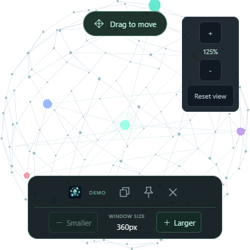
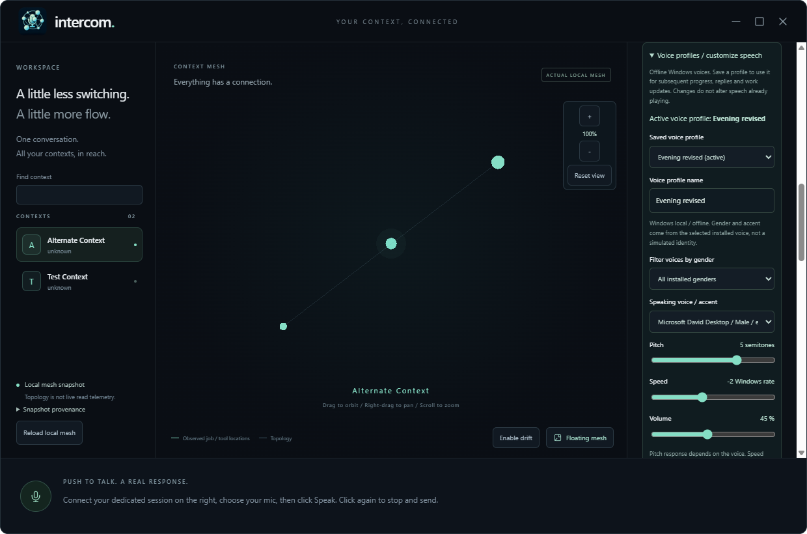

# Desktop prototype

## Local microphone-fix candidate: 0.1.0-prototype.8

Unsigned Windows x64 portable:
`C:\devdesk\homedesk\Intercom\release\microphone-fix-candidate\Intercom-Prototype-0.1.0-prototype.8-win-x64.exe`

110,680,335 bytes; SHA-256:
`022c9b27795353b30b058cf8fc5c67d4eba198b616ec7470627ca1494e2f3199`.
The sibling `SHA256SUMS.txt` records the checksum. This candidate is local,
not a published release or an update to an already-running instance.

**Speak no longer requires a connected Copilot session.** Choose/test an input,
click Speak and then **Stop & transcribe** to get a local editable transcript.
Without a connection, automatic sending is suppressed. Connect an existing
idle session and explicitly click **Send text to Copilot** afterward; connecting
alone never sends the retained transcript. With a connected session and automatic
sending enabled, the stop action remains **Stop & send**. Disabling automatic
sending uses **Stop & transcribe** even when connected. Work destinations still
require separate target/task confirmation. Busy checks and browser-only
unavailability remain enforced.

The .8 archive matches all 16 intended runtime files and version metadata;
licenses are present and private stores/tests are excluded. Eight focused
source desktop cases, eight Vitest and 14 native voice cases pass. The packaged
desktop run passed 20 of 21 cases initially; its unrelated immediate native
pin-state assertion passed on isolated repeat. The three capture-focused cases
also pass after sharing the synthetic-audio fixture. Actual portable startup
verifies session-independent recording, signal and cancellation with synthetic
audio, real mesh loading, voice-profile persistence and window controls.
Physical FDUCE/human speech and listening acceptance remain unverified.

This candidate also includes the source node-inspection feature below.
Published .7 and earlier candidates remain unchanged; no real Copilot prompt
or user-instance restart was performed.

## Published prototype: 0.1.0-prototype.7

[Windows x64 prerelease and checksum](https://github.com/Zanark/Intercom/releases/tag/v0.1.0-prototype.7).
Unsigned local release package:
`C:\devdesk\homedesk\Intercom\release\voice-profiles-candidate\Intercom-Prototype-0.1.0-prototype.7-win-x64.exe`

Size: 110,684,564 bytes. SHA-256:
`2ce4c5d70bdbfd29de7304462a3f0449e73ab2c79ff5617ea76448d00413df03`.
The sibling `SHA256SUMS.txt` records the checksum. Prior .1/.2/.3/.4/.5/.6 builds
remain untouched; the .7 release serves this exact qualified package.

Publication verified on 2026-11-11: release ID `441082947`, nondraft/prerelease,
published `2026-11-11T00:17:46Z`. The annotated tag points to source
`3147d492574980f6c89cc8e9a32920efb859f253`. EXE asset `733479974` and checksum
asset `733479769` were independently downloaded anonymously; both match the
qualified local bytes. The 115-byte checksum file has SHA-256
`070bc2ba1a9a2b83cc9f1db6b1f36c1c0816f50e047a26a665d51c96b599405c`.
The .1 release/asset IDs, sizes and digests remain unchanged. The source tag
stays fixed; the subsequent main-branch receipt commit records publication.

The .7 changes add persistent customizable installed-voice profiles and an
extensible synthesis-provider boundary. The .6 floating movement/sizing and .5
graph navigation/maximize controls remain available. The .4
voice/work proof below remains the existing evidence; no new live work prompt
was sent for this update.

The owner selected push-to-talk for this prototype and confirmed target/task
review, retained permission prompts and busy-session refusal for real work.
Every feature discussed has a coverage entry below; an explicit limitation is
not represented as a finished feature.

| Feature | Actual .7 behavior and qualification |
|---|---|
| Voice conversation | Exact selected microphone, click-on/click-off PCM capture, local en-US ASR/TTS, review/auto-send and typed fallback. Existing-session chat remains tool-restricted. Synthetic speech is verified, physical FDUCE/human speech is not. |
| Voice profiles | Installed voice selection with gender/culture metadata, named persistent profiles, pitch/rate/volume, unsaved preview/stop, save/use, rename/duplicate and inactive deletion. All desktop speech uses the active host profile. Native PCM and packaged persistence/cancellation pass; richer arbitrary identity/timbre/emotion are required future work. |
| Actual mesh each launch | Host worker fresh-reads the published local `context-index.json`, projects contexts and high-confidence structural/handoff relationships, and displays provenance. Actual portable startup loaded 40 contexts/30 relationships in the observed snapshot. No generator run, memory/social-body import or fixture fallback. |
| Session routing | Voice aliases propose a context; ambiguity requires explicit selection. Native discovery lists existing workspace-matching sessions; exact idle/resumable identity and real workspace are checked again before dispatch. No active attach or new session. |
| Background work | Immutable expiring target/task/profile proposal, separate confirmation, one owned ACP job, event-driven progress/result, cancellation and atomic persistent receipt. A terminal agent response is not independent task verification. |
| Approvals | Sets and verifies Agent mode and allow-all OFF, preserving the model and saved grants. Only one-shot allow/reject options are exposed. These settings persist in the existing session; do not confirm if that change is unwanted. UI/protocol fixtures pass; native permission prompting remains unqualified because saved grants covered the live test. |
| New terminal | Opens the confirmed existing session in a separate interactive PowerShell window; prints task as data for manual entry. No automatic task send, ownership acknowledgment or terminal-completion monitoring. Payload safety is tested; actual separate-window qualification remains open. |
| Completion updates | Durable final receipt, best-effort Windows notification and optional native completion/attention speech. Restored receipts are not spoken again. Notification warning is visible; no durable outbox, exactly-once delivery or multi-job queue. |
| Activity sphere | Actual topology is dim; observed owned-job output/tool locations light spokes. Selection, context names and static links do not establish reads or link traversal. |
| Graph navigation | Cursor-directed wheel zoom can enter the sphere; centered +/- buttons, right-drag panning, zoom readout and Reset view. Smaller near clipping preserves close detail. Idle rendering remains on demand. Deep rendered zoom, wheel input, pan and reset pass in the packaged desktop. |
| Window maximize/restore | Top-right native maximize/restore button, host-authoritative state synchronized with native events, square maximized corners. Floating from a maximized workspace restores that state afterward and retains its normal bounds. Actual native transitions are tested, not merely button labels. |
| Floating desktop mesh | Transparent native/renderer backgrounds, visible native **Drag to move** handle and always-visible restore/pin/close/size dock. **Smaller / Larger** change native window size without changing graph zoom or saved workspace bounds. Background work survives mode changes; recording controls cannot be hidden. |
| Speed/default choices | Speed/performance default, Balanced/Accuracy choices, bounded on-demand rendering and supported low/medium/high reasoning effort at request boundaries. Existing model remains selected; speaking rate is independently configurable, not an inference-speed guarantee. No measured latency/resource SLO. |
| Branding | 48 px header microphone/mesh logo, floating icon, native window/taskbar, ICO/EXE resources, favicon and README; prior branded evidence retained below. |
| Always available/natural speech | Application stays open, but this approved slice is push-to-talk, English-only and half-duplex. Wake phrase, full-duplex/barge-in, tray/autostart and continuous listening are not implemented. |

### Graph and window controls

**Source checkout update, not included in the published .7 EXE:** hover a colored
context node to reveal its name and subtitle. Click/tap to pin the small label
and reveal its base path; close it with **Escape**, its close button, another
click on the same node, or a blank-space click. The center identifies the
Intercom voice hub; decorative fixture dots are not real contexts.

Tab to the graph and use arrow keys to inspect nodes, **Home / End** for the
first node / hub, and **Enter / Space** to pin or dismiss. Inspection never
changes the work-routing target or asserts activity. Labels follow camera,
drift and window changes, fit the 360 px floating window and hide off-screen.
The first Escape dismisses an open label without restoring the workspace;
speech cancellation remains available. No permanent node names or extra
idle animation loop are introduced.

Scroll over the graph to zoom toward the pointer, or use **+ / -** for centered
zoom. Right-drag pans; **Reset view** restores the camera target, distance and
starting graph orientation. The previous distant zoom floor is removed; a small
positive floor and near plane prevent a degenerate camera at the target.
Hovering Floating Mesh reveals the same navigation controls without an opaque
window background.

The top-right square maximizes the native window and becomes **Restore window**.
Floating mode temporarily leaves maximization; restoring the workspace returns
to the prior maximized state. Restoring the normal window retains its old bounds.

In Floating Mesh, grab **Drag to move** above the graph to reposition the
window; dragging the graph itself still orbits it. The bottom dock stays
visible without hovering. **Smaller / Larger** resize the actual square window
in 48 px steps between 360 px and the smaller of 1080 px or the monitor work
area. The size readout and disabled buttons follow native host state. Resizing
keeps the window on that monitor, leaves graph zoom unchanged and preserves
workspace restoration. Re-entering floating mode starts at the usual 540 px;
size persistence across modes/launches is not implemented.



Actual packaged .6 fixture capture at 360 px: movement and size controls remain
visible, Smaller is disabled at the minimum, and the graph retains 125% zoom.
The surrounding area is transparent; the contexts are synthetic demo data.

### Voice selection and saved profiles

Open **Voice profiles / customize speech** in live voice mode. No session
connection or microphone access is needed to edit/preview a speaking voice.
Select an installed voice, optionally filter by its declared gender, and adjust
pitch (-12 to +12 requested semitones), speed (-10 to +10 Windows rate) and
volume (0-100). Gender/accent are properties of the chosen installed voice,
not independent voice transformations. Pitch is approximate and engine-dependent;
rate is not a calibrated multiplier. Volume 0 is silent.

**Preview voice** uses the unsaved draft, with **Stop preview** for interruption.
**Save & use profile** persists/activates it; **Duplicate profile** creates another
named configuration. Rename through the name field and save, or use an unchanged
saved profile directly. Only inactive profiles can be deleted; at most 32 profiles
are allowed. A saved change applies to the next utterance, not speech already
playing. Recording stops preview first and locks the controls until capture/
dispatch completes. Playback interruption does not cancel Copilot work.

Catalog discovery is lazy, not an added process on every launch. Profiles live
in a bounded atomic private `voice-profiles.json`; malformed settings,
unsupported providers and missing selected voices are explicit errors, not
silent replacements. Progress, replies, work completion and desktop fixture
speech share the same synthesis entry. Browser-only demo speech remains a
browser fallback, not the native profile implementation.

Arbitrary voice identity, timbre and emotional style are **mandatory future
requirements**, not available Windows controls. `desktop/synthesis.cjs` owns
the provider/validation/cancellation boundary so that a different engine does
not require rewriting conversations/jobs. Richer provider metadata/editor
support and its engine still need implementation and separate approval.
See the [speech-provider contract](speech-options.md).



Actual packaged .7 viewport after profile persistence/reload. The installed
catalog is real; the two mesh contexts are disposable synthetic test data.
The sidebar scrolls independently to preview/save actions. Playback was
intercepted for the UI test, not audibly assessed.

### Background workflow and recovery

Choose **Background task / confirm below**, speak a request, stop recording and
review the text in **Confirmed task**. Choose its context and an existing idle
session with **Find existing sessions**. Review and confirm the exact target,
workspace, task and priority. A proposed utterance alone never dispatches work.
Copilot may retain saved grants; manual policy does not promise a prompt for
every operation. Do not approve an operation you did not intend.

One host-owned job continues while panels change or the mesh floats. Capture
and proposing speech remain available; conversation cannot write to the same
busy session. App exit cancels only its owned transport, not independent
terminals or already-applied task effects. Final receipts require acknowledgment.
Transport loss, interrupted restart and uncertain owned cleanup remain
**unknown**, never automatically retried. After restart, inspect the previous
session/processes and workspace before acknowledging; the new launch cannot
cancel a process it does not own.

`desktop/mesh.cjs` reads at most 64 MiB with a 15-second worker timeout; the
renderer receives only a bounded projection, not the entire source. Source
timestamps over 24 hours old or over five minutes ahead are disclosed. Session
catalogs use at most four 500-row pages (2,000 total); the native CLI rebuilds its
catalog per call, so larger bounded pages avoid repeated expensive discovery.
An observed first 100-row query took 13,868 ms; this is a bottleneck observation,
not a benchmark or a speed claim.

`desktop/acp.cjs` negotiates the installed existing-session load protocol,
validates identity and manual policy, drains bounded JSONL, ignores load replay,
and handles exact permissions and owned cancellation. `desktop/work.cjs` saves
one atomic `work-receipt.json` in the private profile before any dispatch.
Critical transitions/approvals/results persist; cosmetic updates are throttled.
Optional saved UI fields are validated on recovery. This deliberately bounded
prototype differs from the proposed SQLite/outbox runtime.

### Verification and remaining acceptance

.7 passes lint/type/build, eight Vitest, 14 voice/native and 17 mesh/work host
cases, all 17 packaged Electron scenarios and actual portable startup.
The profile cases exercise real IPC/persistence/catalog and intercept playback
only in disposable tests, avoiding audible speech. Native non-audible PCM checks
separately establish installed selection, shorter duration at faster rate,
silence at volume 0 and raised voiced frequency at higher requested pitch.
The measured +12 request is not an exact-octave or naturalness claim.
Cancellation tests cover invalid previews preserving current speech, queued
replacement rejecting rather than claiming success, and capture stopping preview.
The portable launcher separately discovers installed voices, saves/activates a
profile and retains it through renderer reload, alongside actual mesh startup
(40 contexts/30 relationships), input access and graph/window/floating controls.
Its 16-file runtime archive matches sources/assets/metadata and includes notices,
without the private target identity. Both executables are NotSigned; prior
.4/.5/.6 hashes independently match. No new actual Copilot prompt, audible
preview, physical microphone or human voice acceptance was inferred.

.6 passes lint/type/build, four focused source desktop scenarios and all 15
packaged Electron cases. New coverage checks the visible native drag-region
configuration, always-visible controls, actual native size changes, minimum/
maximum clamps, monitor bounds and unchanged graph zoom/workspace restoration.
Packaged 540/360 px fixture screenshots were inspected. A global physical mouse
drag was not automated. The actual portable launcher passes fresh real mesh
startup (40 contexts/30 relationships), input access, maximize/restore, zoom/reset,
visible handle, size changes/readout and floating restoration. The 15-file
archive matches source/assets/metadata, notices are present, private target
identity is absent, both executables are NotSigned and .4/.5 hashes are unchanged.
No new actual Copilot task or human/device acceptance is inferred.

The .5 baseline passed lint/type/build and five focused source desktop scenarios. All 14
packaged Electron cases pass, including rendered deep zoom, pointer wheel input,
pan/reset, actual native maximize/unmaximize events and maximized/floating/
normal-bound restoration. The actual portable launcher separately passes real
mesh loading (40 contexts/30 relationships in the observed snapshot), microphone
access, maximize/restore, zoom/reset and floating restoration. Its 15-file archive
matches runtime source/assets and package metadata, includes the notices and
excludes the private target identity. Launcher and runtime are NotSigned.
These are technical checks, not human acceptance or a new native work test.

The .4 baseline passed lint/type/build, eight Vitest, nine voice/native and
17 mesh/work host cases. The .4 packaged runtime passes all 12 Electron
scenarios, including changed snapshot on process relaunch, stale/malformed
source without fallback, confirmation/one-shot approvals and no replayed speech.
These deterministic UI cases mock native work IPC, not microphone capture.
The actual portable launcher separately passes real-source mesh loading
through its packaged ASAR worker, input access and floating controls.
The inspected 15-file archive matches source/assets, excludes the private
target/session stores/tests/dependencies, and includes required license notices.
Both EXEs are unsigned.

The separately authorized native source acceptance test captured synthesized
"Say hello world", then visibly reviewed/edited it into the exact approved
`Get-Location` task. Copilot completed that exact tool, returned "Hello world."
and native completion playback finished. Agent/allow-all-OFF/low effort were
verified and no desktop-notification warning was returned. **No permission
request occurred because existing saved grants still applied.** Do not infer
live approval mediation, actual Windows toast visibility or physical microphone
acceptance from that result. The one authorized work prompt has been consumed;
the packaged app was not sent an additional work prompt.

```powershell
npm run lint
npm run build
npm test
npm run test:voice
npm run test:host
npm run test:desktop
npm run package:win -- --config.directories.output=release\voice-profiles-candidate
```

No signing/installer, wake-word, new-session creation, active attach, automatic
terminal dispatch, multi-job queue, sleep/lock recovery, human listening or
speed-SLO acceptance is claimed. Private real-mesh screenshots/receipts are
ignored and are not public documentation images.

## Historical conversation candidate: 0.1.0-prototype.3

The owner selected click-on/click-off recording, installed local English
recognition without downloads, and one designated existing dormant Copilot
session. This extends the earlier fixture prototype; it does not authorize
work tools, active-session attachment or always-listening capture.

Local unsigned candidate:
`C:\devdesk\homedesk\Intercom\release\voice-candidate\Intercom-Prototype-0.1.0-prototype.3-win-x64.exe`

It is not published. The public .1 and separate branded .2 artifacts are
preserved. The header logo is now 48 px, versus 32 px previously; floating
controls retain their smaller icon.

### Start a real conversation

1. Install/authenticate Agency and Copilot on PATH. Windows must already have
   an en-US desktop speech recognizer and an English speaking voice.
2. Paste the dedicated existing session UUID and click **Connect existing
   session**. Close its terminal first; busy/browse-only/missing sessions are
   refused, never replaced with a new one.
3. **Load microphones**, choose FDUCE or another input, then **Speak**. Wait
   for **Listening**, speak English and check the signal meter.
4. Click **Stop & send**. Intercom transcribes locally, announces dispatch,
   sends text to that session, then displays and speaks its actual response.
   Try "Say hello world."
5. Disable automatic sending to review/edit the transcript first. Typed text
   is also supported. **Stop voice playback** stops speech independently;
   **Cancel request** stops only Intercom's owned work. A prompt already
   dispatched may remain in Copilot history; cancellation does not roll it back.

Load/Test is deliberately access-only and immediately stops tracks. It does
not start recording, recognize speech or prove the microphone's acoustics.
No microphone is opened on startup. A missing selected input is not silently
substituted. Permission, silence, recognizer, session and playback errors
remain visible; written responses survive a playback failure.

### Actual implementation

- `src/recording.ts` and bundled `pcm-worklet.js` capture the selected exact
  device, show RMS level and encode mono 16-bit PCM WAV. Audio stays in memory,
  at most 60 seconds. Playback stops before capture; browser echo cancellation,
  noise suppression and automatic gain are disabled for this half-duplex path.
  Floating Mesh cannot hide recording controls while input is opening/listening.
  Leaving live mode stops capture and owned work.
- `desktop/speech.ps1` uses installed `System.Speech`, not a downloaded model.
  Event-based multiple-phrase recognition retains speech across pauses through
  stream completion. Low confidence, empty/long text and timeout are rejected.
  Local speech reads progress and verified results; no listening-quality claim.
- `desktop/voice.cjs` uses Agency's local catalog to identify the exact existing
  idle `copilot_cli` session and workspace. One bounded `copilot.exe --resume`
  process handles a request, with only `task_complete` available, shell/write
  denied, built-in MCPs/custom instructions disabled, and no blanket approvals.
  The existing configured model is not silently changed.
- JSONL process events are consumed passively, not through model-based status
  polling. A conversation response requires nonempty assistant text (or a
  successful `session.task_complete` summary), matching final session ID and
  successful process/result exit. An explicit failed completion is rejected.
  Ordinary replies need not invoke the completion tool. Idle or process exit
  alone is not success, and conversation success does not prove arbitrary work
  completed. Unexpected tools invalidate the result. Uncertain dispatch is
  never automatically retried.
- The sandboxed preload exposes explicit voice operations, not a general shell
  or filesystem bridge. Host input/output/time bounds and scoped process-tree
  cancellation apply. Closing the window stops owned work and local playback.
- New default profile: `%APPDATA%\IntercomVoicePrototype`, separate from the
  earlier stable app. The target UUID and last verified response are saved
  privately there, not shipped in source/package defaults. Chromium stores
  microphone/profile choices. Raw audio is not saved by Intercom. Copilot
  receives text and may retain it in existing account/session history.

**Still limited:** English-only prototype; no physical FDUCE acceptance,
Hinglish/technical-word benchmark, subjective voice review, full-duplex/AEC,
wake word, routing across projects, terminal handoff, file/work tools, durable
job queue, sleep/lock recovery, signing or installer. The sphere is synthetic,
not observed session/context access. Speed/performance remains the default
rendering profile; inference/speech quality tuning is not connected.

### Build and verification

```powershell
npm run lint
npm run build
npm test
npm run test:voice
npm run test:desktop
npm run package:win -- --config.directories.output=release\voice-candidate
```

Desktop tests use disposable profiles and deterministic synthetic microphone
audio. Backend IPC mocks qualify UI capture/review/cancellation, not a live
session. Native host tests separately exercise actual installed recognition,
including multiple phrases, and owned-process cancellation. The explicit
`tests/live-voice-smoke.cjs` additionally requires a candidate executable and
an authorized existing session supplied through environment variables; it
makes a real conversation-only request using locally synthesized audio.
Synthetic audio is not physical-microphone acceptance or a performance SLO.

The corrected .3 candidate passes eight Vitest cases, nine host/native cases,
all ten packaged Electron scenarios and the actual portable launcher smoke.
The packaged live smoke captured and transcribed **"Say hello world"**, received
**"Hello world."** from the designated existing session, persisted its matching
response privately and completed native Windows playback without reported
error. This exercises the real audio/recognition/dispatch/response/speech path;
it does not establish how the voice sounds or whether physical FDUCE works.
The single packaged run took 67,370 ms including connection, recording and
playback; this is not a latency benchmark or a speed qualification.

The initial integrated run reached Copilot and produced a real reply, but
Intercom rejected it because it incorrectly required an explicit task-control
event for ordinary conversation. Existing session history was inspected before
another send. The parser now accepts a plain reply only with the same correlated
successful terminal result; regressions retain missing/mismatched/failed-result
and explicit-task-failure rejection.

Candidate size: 110,662,728 bytes. SHA-256:
`1c33043ed52fe78748ace958cf11c84ad5dd12bce3d81c4e982e13add7ead7b6`.
The sibling `SHA256SUMS.txt` records it. Both launcher and runtime are unsigned.
Private receipts/screenshots stay in ignored `.local`; no target session ID is
embedded in the distributable. The prior .1/.2 executable hashes are unchanged.
Raw ASAR inspection verifies 12 runtime files, source-matched code/assets,
no bundled tests/private context/node_modules, and the required license notices.
Both EXEs contain all nine byte-matching source ICO frames.

<details>
<summary>Historical .1/.2 fixture implementation and release receipts</summary>

The sections below describe the earlier fixture-only versions, not the current
voice candidate. Their no-ASR/no-session limitations are historical.

## Scope and launch

This is the owner's authorized early ic-06 UI experiment, not the integrated
voice assistant. Electron is approved for this prototype only. The researched
Tauri/native-audio candidate and live Agency/speech gates remain open.

From `C:\devdesk\homedesk\Intercom`, with Node.js/npm installed:

```powershell
npm ci
npm start
```

`npm start` builds the static UI and opens the desktop host. After a successful
build, `npm run desktop` opens that build without rebuilding it.
`npm run dev` serves only a loopback browser UI; a browser cannot provide
desktop transparency, pinning or window movement. It is not the desktop mode.
The Electron binary may need its first-run download before startup; allow
registry/download access when installing. No Rust/MSVC installation is needed.
The desktop-test command resolves/downloads that runtime before starting its
per-scenario timers; the initial development download had exceeded one timer.

## Windows portable EXE

Published [v0.1.0-prototype.1](https://github.com/Zanark/Intercom/releases/tag/v0.1.0-prototype.1)
is a nondraft prerelease from source commit
`6cfa26fd1d89934f21ba6311bc86037be84fca4c`. Its public EXE was downloaded
independently and matched SHA-256
`29b7282e592331dfb849143be9e2b9e5a1c4799d7b6415c8aa39607b046953f0`.
The published checksum file also matched the local receipt.

`npm run package:win` builds a Windows x64 portable EXE using pinned
electron-builder 26.18.0, without automatically publishing anything:

`C:\devdesk\homedesk\Intercom\release\Intercom-Prototype-0.1.0-prototype.2-win-x64.exe`

The EXE bundles Electron and needs no Node.js installation. It is **unsigned**,
and may trigger SmartScreen/unknown-publisher warnings. Do not bypass an
organization's execution policy. For the published .1 release, compare its
SHA-256 with `SHA256SUMS.txt` from the same GitHub prerelease. Local candidates
have their own checksum beside the EXE; do not compare a .2 candidate with
the .1 release's checksum. This checks file integrity, not publisher
authenticity. There is no installer, auto-update or auto-start.
First launch extracts the runtime to a temporary directory; no fast-start claim
is made. Windows x64 is the build target; no multi-version Windows matrix has
been qualified.

The explicit ASAR allowlist contains only compiled UI assets, two desktop host
files and package metadata. React, React DOM, Scheduler and Three.js license
notices ship beside the runtime, along with Electron/Chromium notices.
Private context, profiles, credentials, source tests and arbitrary repository
files are excluded. Generated release output is Git-ignored.

## Voice-and-mesh branding

The current source uses an original microphone-and-context-mesh logo:
varied-size interconnected nodes, rounded outer links, straight inner links
and a foreground node overlapping the microphone with subtle shadows.
`docs/assets/intercom-logo.png` is the artwork master. Static
`public/intercom-icon.png` (256 px) and `public/intercom.ico` (16 through 256 px)
derive from that same image; no animation, remote asset request or new
runtime dependency is introduced.

The logo appears in the workspace header, revealed floating controls,
favicon, native window/taskbar icon, executable resources and README.
The Windows app identity matches the packaging app ID. Resource editing
is enabled while `signExecutable: false` leaves the build unsigned:
`signAndEditExecutable: false` would also suppress the EXE icon and metadata.
Floating controls still hide normally, preserving the mesh-only surface.
Windows can retain an old icon for an existing pinned shortcut; repinning
the new executable may be necessary. No icon-cache purge or Explorer restart
is performed.

The branded .2 candidate is built separately from the published .1 EXE:

```powershell
npm run package:win -- --config.directories.output=release\branding-candidate
```

Candidate:
`C:\devdesk\homedesk\Intercom\release\branding-candidate\Intercom-Prototype-0.1.0-prototype.2-win-x64.exe`

This is a local, unpublished candidate. The published .1 retains the original
Electron icon. Development and smoke tests use disposable profiles, not an
existing user's app session; the published EXE is not overwritten or restarted.

The candidate's packaged desktop suite and actual portable-launcher smoke pass.
All nine ICO frames (16/20/24/32/40/48/64/128/256 px) match the source bytes
in both executable resource groups. Windows `WM_GETICON` returns the branded
16 px and 32 px icons from the actual candidate window; those captures and
the branded workspace were visually inspected. Header, floating-control and
favicon assets load in the packaged app. This is not a Windows-version matrix
or acceptance of the final artwork.

Candidate size: 110659385 bytes. SHA-256:
`474708cc4756022558beb53daf427fb9ee7ace91cf2fefa30d7d5c106a67031e`.
`C:\devdesk\homedesk\Intercom\release\branding-candidate\SHA256SUMS.txt`
contains that receipt. Both candidate executables report `NotSigned`.
The original published .1 EXE still matches its recorded release hash.

## Controls

| Control | Actual behavior |
|---|---|
| Context list | Select one of six synthetic contexts; enlarge its graph marker |
| Drag graph / scroll | Orbit / zoom the fixed spherical graph |
| Floating mesh | Hide panels and make both the native window and renderer background transparent |
| Upper cap in floating mode | Native drag region for moving the window |
| Hover near bottom / keyboard focus | Reveal restore, always-on-top and close controls |
| Escape | Restore the full workspace; in full mode dismiss the pending proposal and stop speech |
| Ctrl+Shift+M | Toggle floating mode while this app has focus; not a global shortcut |
| Always on top | Pin/unpin explicitly; disabled initially |
| Prepare demo request | Resolve a synthetic alias, clarify ambiguity, then require confirmation |
| Simulate voice request | Insert a predefined text fixture; **does not record or transcribe speech** |
| Run simulation | Start one in-memory demo job; no real session/terminal/process dispatch |
| Cancel demo job | Stop only the simulation; a late completion cannot revive it |
| Processing priority | Save selection locally; snapshot it on the next job |
| Read demo results | Optional local system-voice playback of a fixed, honestly labelled result |
| Stop speech | Stop playback without cancelling the demo job |
| Load microphones / Refresh devices | Briefly open the system input to obtain device labels, enumerate inputs and stop every track |
| Microphone device | Save a chosen input locally, without opening it or starting speech recognition |
| Test selected | Open that exact device (or the explicit system default), then immediately stop it |

Floating controls are normally invisible so the mesh is the visual surface.
The window remains a rectangular input surface; click-through desktop behavior
is not implemented or promised. The window is resizable and its original full
bounds are restored on exit from floating mode.

## Implemented architecture and algorithms

`desktop/main.cjs` owns a frameless, transparent native window. It exposes only
five window actions, validates the calling main frame, disables Node in the
renderer, enables sandbox/context isolation, allows only own-main-frame audio
permission requests/checks, denies camera and other browser permissions,
denies new windows/navigation/webviews and rejects renderer requests outside
the built asset directory. `desktop/preload.cjs` exposes only those actions and
window-state subscription; no shell, filesystem, network or session API exists.

`src/App.tsx` owns the synthetic interaction. Preparing is not dispatching:
the user confirms a displayed target before a simulation starts. Normalized
whole-phrase alias matches in `src/model.ts` preserve unknown and ambiguous
targets instead of fuzzy-guessing. An in-memory job snapshots the selected
profile. The reducer rejects foreign, duplicate, stale and illegal transitions;
terminal cancellation/completion cannot restart. The terminal result is
`finished-unverified`, never qualified success.

Two bounded timers emit demo routing/running/completion events. No worker,
agent/model status polling, session inventory or live read occurs. Graph paths
represent only these synthetic events and stop lighting after termination.

`src/Mesh.tsx` owns Three.js outside React frame reconciliation. A fixed
144-slot Fibonacci sphere keeps node coordinates independent of selected
context or activity. Nearest-neighbor topology is computed once for this small
fixture (bounded O(V^2) setup), not claimed as a general large-mesh importer.
Instanced dots and batched topology lines share GPU resources. Only the small
active path changes; cleanup disposes controls, observers, GPU objects and timers.
WebGL failure displays an error while the context list/demo controls stay usable.

## Speed-first behavior

The UI shell loads before the lazy 3D module. Idle graph rendering is
on-demand, not an always-running orbit loop. Drift is opt-in. Hidden/minimized
rendering pauses using both native window events and browser visibility;
reduced-motion preference disables animation.

| Profile | Prototype rendering only |
|---|---|
| Speed / performance (default) | Pixel ratio capped at 1; animation scheduled no faster than 24 fps |
| Balanced / Accuracy | Pixel ratio capped at 1.5; animation scheduled no faster than 30 fps |

These are caps, not measured achieved frame rates. Actual fps depends on the
display/GPU/OS. Accuracy does not improve a speech/model pipeline: none exists.
Changing selection during a job does not change that job's profile snapshot.
No measured startup, idle CPU/RAM, useful-answer or accuracy target is claimed.

## Storage, audio and instance isolation

Only the selected profile and microphone ID are intentionally saved in renderer local storage.
Requests, proposals and demo jobs are volatile and disappear on reload/exit.
There is no SQLite, durable dispatch, encrypted queue or real recovery proof.
Default Chromium profile: `%APPDATA%\IntercomPrototype`. A test can set
`INTERCOM_PROFILE_DIR` to a disposable directory; it must not point at another
user's profile. Test launches close only their own Electron application.

`src/MicrophonePicker.tsx` never opens an input at startup. Explicit load/test
actions briefly acquire a stream, enumerate devices and stop all tracks in
`finally`, including enumeration failures and unmounts. Selecting a specific
input uses an exact device-ID constraint, not a silent fallback. Device-change
events refresh the list without capture or polling; a missing saved input stays
visibly unavailable. Access, enumeration and preference-storage errors are
visible. Windows microphone privacy controls can still deny access.
No MediaRecorder, transcription, audio file or audio upload is implemented.
These brief checks are not a level meter or an acoustic/voice-quality test.

Optional system speech
is off by default and selects only a voice marked `localService`; no cloud
voice is selected. Missing voices or speech errors produce a visible error
and retain the written result. This is not native audio/AEC/wake qualification
or a guarantee about an operating-system component's privacy implementation.
No voice quality was assessed by listening.

## Verification and limits

```powershell
npm run lint
npm run build
npm test
npm run test:desktop
```

Vitest covers alias boundaries/collisions, unknown/multiple targets, event
identity/ordering, terminal states, profile validation and stable coordinates.
Playwright launches the **actual Electron app**, each time with a disposable
profile. Tests check isolated renderer preferences, real native-capture
transparent corner pixels with visible mesh pixels, reversible mode/bounds,
keyboard/hover restoration, pinning, narrow preload actions, confirmation,
profile snapshots/persistence, cancellation, honest completion and WebGL loss.
An instrumented test also verifies no continuing idle frame requests, opt-in
animation, native minimize pause and restore resumption. No production test
hook was added.
Seven unit cases pass. All six desktop scenarios pass against the actual
packaged executable, including synthetic microphone selection/persistence,
exact-device constraints, stopped tracks, camera denial, missing devices and
access/enumeration errors. The test suite always uses Chromium fake media
devices, not a physical mic. An initial hotplug test raced an unfinished device
load; awaiting its status and scoping status locators fixed the test.
The portable EXE itself was separately launched with a disposable profile;
its ASAR UI, microphone check and reversible Floating Mesh controls passed.

To repeat packaged verification from PowerShell after packaging:

```powershell
$env:INTERCOM_TEST_EXECUTABLE = 'C:\devdesk\homedesk\Intercom\release\branding-candidate\win-unpacked\IntercomPrototype.exe'
npm run test:desktop
$env:INTERCOM_TEST_EXECUTABLE = 'C:\devdesk\homedesk\Intercom\release\branding-candidate\Intercom-Prototype-0.1.0-prototype.2-win-x64.exe'
npm run test:portable
```

The portable smoke check exposes a loopback debugging endpoint only in its
explicit test launch, closes its own app and removes its disposable profile.
Screenshots in `.local/desktop-test-results` are generated and inspected for
this prototype, not evidence of a user's human acceptance.

The build warns about the lazy Three.js chunk exceeding 500 kB. It stays
separate from the initial UI; no false claim of a tiny complete runtime is made.
The initial dependency audit reported one moderate minimatch advisory
(GHSA-g3hv-75wg-m249), propagated through ten development-tool entries.
`npm explain minimatch` placed it under ESLint/TypeScript ESLint, not the
renderer dependencies. The production-only audit was rate-limited, so no clean
production-audit claim is made. No forced major transitive override was applied.
Packaging additionally reports deprecated transitive development tools.
The published .1 ASAR has seven runtime files; the inspected .2 archive has
nine, adding only the local PNG and ICO. Packaged artwork matches the source
bytes; no node_modules, tests, private store or credentials are bundled.
This distributable is not a security/performance qualification.

Still absent: real Context Mesh import, Agency session discovery/control,
terminal handoff, continuous microphone input, wake word, ASR, conversational reasoning,
native audio worker/AEC, durable jobs, OS lock/sleep policy, signing/installer,
and human voice/visual acceptance. A prototype prerelease does not complete the
integrated product or its reliability qualification.

</details>
