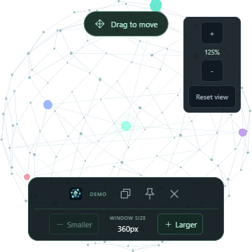
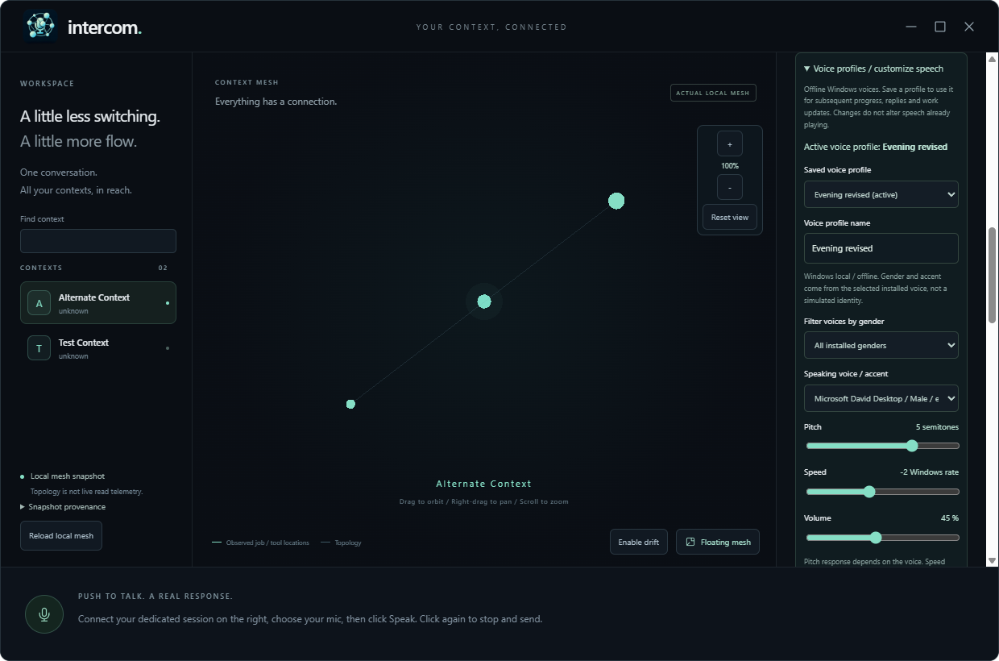

# Desktop prototype

## Local .18 clarification replies

Latest unsigned, local-only Windows x64 executable:
`C:\devdesk\homedesk\Intercom\release\prototype-18-candidate\Intercom-Prototype-0.1.0-prototype.18-win-x64.exe`.
Size: 631,125,280 bytes.
SHA-256: `7d540997d394449bb7449214c0822d5f869476676fcf894522c01e1856acca85`.
ASAR SHA-256: `e1c05ed291ec8685e003b7ce30fcce24e727ee9513a86cee4157df4fd3daaf10`.
The adjacent `.exe.sha256` records the executable checksum.

A structured Intercom clarification automatically opens the selected microphone
after actual local playback completes. Muted questions use written display.
The question remains visible; click the mic to finish the reply. Existing
five-minute cutoff and uncertain-transcript review still prevent unsafe
automatic sends. There is no silence-based automatic stopping or continuous
listening. Arbitrary downstream-session questions, ordinary question-shaped
responses, work results and tool-permission prompts are not triggers.

Disable **Advanced > General > Delivery behavior > Automatically listen for
clarification replies** to keep manual-only capture. Stop playback, Cancel,
opt-out, stale ownership/settings, hidden/minimized windows and failed
playback/readiness suppress pending capture. Failed microphone opening preserves
the question and reports the failure. Options follow the existing per-mount
delivery-setting behavior, not a new persisted preference.

The host retains bounded preceding unresolved request/question context for the
next accepted controller turn only. It is not approval, a saved chat or proof
that a live model correctly understands every reply. Fresh discovery and
ordinary permission checks remain required.

Lint/build, 19 renderer, 12 controller, 28 orchestration and two focused
voice-host cancellation cases pass. Seventeen focused source desktop cases
and sixteen against the exact packaged code pass. Coverage includes delayed
playback, muted/opt-out behavior, cancellation, hidden windows, readiness/
microphone/playback failures, ordinary questions and uncertain reply review.
An initial hidden-window failure exposed unreliable Electron DOM visibility;
checking actual host state after readiness fixes it without weakening the test.

The exact .18 portable also passes synthetic native speech/live drafts/final,
warm-worker reuse/shutdown, duplicate-launch model preservation and intentional
model-loss diagnostics/recovery. All 22 packaged project runtime/renderer files,
eight speech files, 13 notices, native dependency and private-source exclusions
are verified. No physical microphone, audible playback, live model/provider
request, real-session prompt or owner-app automation was used for this slice.
The full voice suite was not rerun: the prior strict legacy Windows
**51/52** "please"/"police" failure remains unwaived. Human multilingual,
natural five-minute, hardware, speed/RAM and real multi-session gates stay open.

After a fresh no-live-process check, only the .18 EXE/checksum remain under
`release`; old .17 and latest unpacked/debug intermediates were removed.
No running instance was stopped or switched. Published .12 is unchanged.

## Local .17 portable lifecycle repair

Historical qualification receipt (.17 is superseded and no longer retained):
`C:\devdesk\homedesk\Intercom\release\prototype-17-candidate\Intercom-Prototype-0.1.0-prototype.17-win-x64.exe`.
Size: 631,124,173 bytes.
SHA-256: `9e897ec1b9d322c4e1c50eb0513ada45553d48b91a5b2a71fe27f71118881bdb`.
ASAR SHA-256: `340e3fc1d656936935c00c9429d2c606c335df19db4e7bf6082fef06a8427285`.
The adjacent `.exe.sha256` records the executable checksum.

The reported second-microphone failure was a missing extracted model, not the
unrelated session-catalog notices. Read-only inspection found the old app
running without its unlocked resources. The pinned portable builder used a
shared extraction directory and recursively cleaned it before/after launch:
a rejected duplicate could therefore remove the original app's model. This
mechanism matches the evidence; the owner's actual duplicate-launch event
was not observed. .17 uses per-launch NSIS plugin directories.

In installed electron-builder 26.18.0, `portable.unpackDirName: true` selects
that unique directory; its documentation incorrectly describes `false` as
unique. The actual generated launcher and regression, not the option's prose,
establish this setting. Do not copy that assumption to other versions unchecked.

The exact .17 portable passes duplicate-launch refusal with unchanged primary
model size/mtime and the same warm helper PID, followed by synthetic local
speech/live-draft/final recognition. Deliberately hiding its own extracted
model creates the expected ENOENT process/resource snapshot; restoring only
that disposable test file permits explicit readiness recovery with a new
helper. Owned helper shutdown also passes. No physical microphone, audible
playback, real-session prompt or owner-app automation is used.

Lint/build, 19 renderer, 62 host, 11 controller and 54 disposable desktop
cases pass. Nine focused packaged desktop cases pass. The voice suite remains
**51/52**, with the unchanged legacy Windows synthetic "please"/"police"
failure; this is not an all-green or human-accuracy claim. All 22 packaged
project runtime/renderer files match source, eight speech files and 13 notices
match, and native dependency/private-source exclusions pass.

After qualification, a fresh check found no Intercom process running. Only
the .17 EXE/checksum remained under `release`; superseded .16 and .17 unpacked/
debug intermediates were removed. No running instance was stopped or switched.
Published .12 is unchanged. The integrated features and qualification limits
in the historical .16 receipt below remain applicable.

### Local diagnostics

Open **Advanced > Display > Local diagnostics > Open diagnostics folder**.
The default persistent directory is
`C:\Users\mishrad\AppData\Roaming\IntercomVoicePrototype\diagnostics`;
an explicitly isolated profile has its own directory. This is outside the
portable extraction directory.

`events.jsonl` and up to three rotated files hold allowlisted lifecycle,
IPC span/duration, native subprocess and voice-phase metadata. Each event
file is limited to approximately 1 MiB; the queue is capped at 128 events.
`last-failure.json` is atomically replaced with the latest reported failure's
process IDs, runtime versions, memory counters, helper status and resource
presence/error codes. It contains paths and should remain private.

No audio, transcript, prompt, response, raw error/stack, subprocess output,
arguments, environment or full memory dump is persisted by this logger.
This is a process/resource snapshot, not a minidump or a guarantee to capture
every fatal crash. Failed persistence/dropped events produce a visible warning;
the original operation still reports its actual success or failure.

Diagnostics were introduced in .17; they cannot reconstruct old .16
failures. Missing/corrupt speech resources continue to block recording before
microphone access. Close an older app normally and launch the verified .18
executable; no automatic restart, model download or silent fallback occurs.

## Integrated local .16

Historical qualification receipt (superseded by .17; .16 is no longer retained):
`C:\devdesk\homedesk\Intercom\release\prototype-16-candidate\Intercom-Prototype-0.1.0-prototype.16-win-x64.exe`.
It is unsigned, local-only and 631,115,985 bytes.
SHA-256: `4c8d433b1bc1d6bab7b8a36943fedcfa4e048819ca8d5fa1f51534bd8af1a00e`.
The adjacent `.exe.sha256` is the checksum file.
Verified packaged ASAR:
`2d3d961ee01e927d3287adf7029d82055ef9155e5bfb4a5f876061cf1aadd25c`.

This integrates five-minute capture and saved-context research described below,
plus reusable local native recognition, real source-read activity and optional
cited Copilot synthesis. The pinned model loads before capture and remains in
one private-pipe helper across drafts/final recognition. No audio listener,
cloud audio or silent engine fallback is added. Cancellation discards the warm
worker; the next explicit operation reloads it. Idle RAM cost is unmeasured.

Research emits bounded path/status metadata, not source bodies, to a transient
activity trail. Successful reads trigger finite attributed mesh pulses.
Tool locations remain distinct from proven reads, and unreported model
activity remains unknown. Ordinary research does not contact work sessions.
Optional synthesis requires an explicitly selected exact idle session and
uses the ordinary queue, exclusions, cancellation and manual tool permissions.
Strict response/citation validation precedes illustrated HTML opening and
spoken summary. A citation proves a retained source location, not entailment.
Browser failures preserve the report with a visible error.

Final lint/build, 19 renderer, 57 host, 11 controller and 53 disposable desktop
cases pass. Eight focused cases also pass against the packaged executable.
The actual portable passes fresh defaults, local synthetic speech check,
live drafts/final transcription, exact X/Y exclusion preservation, controls,
same-native-PID reuse and shutdown with no helper left running. No physical
microphone, audible playback or real work session is used by these checks.
All 21 project runtime/renderer files match source; eight model/runtime files,
13 notices and unpacked native dependency are checked. Private context, audio,
histories, reports, project tests and native development source are excluded;
upstream dependency source/tests may remain in their normal packages.

The voice suite is **50/51**, not green: installed legacy Windows recognition
returns "police" for synthetic "please". The unchanged strict content assertion
is retained. Bundled Vulkan portable recognition is qualified separately on
this machine, not every Windows/GPU environment. Natural five-minute accuracy,
independent multilingual references, physical devices, controlled performance,
real multi-session acceptance and owner experience acceptance remain open.

After qualification, no Intercom/Electron/native-recognition process was
running. Exact superseded .15 and latest unpacked/debug paths were removed.
Only the .16 EXE and checksum remain under `release`; no owner application
was restarted. Published .12 and other remote releases remain unchanged.
`release` is Git-ignored; this is not remote publication.
Earlier version receipts below are historical, not retained local packages.

## Five-minute recordings (source only)

Historical heading retained for links: this behavior is now included in local
.16; the qualification observations below predate that package.

Push-to-talk and the no-send Speech check now accept up to 300 seconds.
The wall-clock deadline and independent sample budget stop capture; a final
chunk crossing the sample boundary retains only the remaining audio. One
finalization owns flush/transcription, including a manual stop racing cutoff.
Device disconnection is still cancellation, not successful recognition.

At automatic cutoff, the final transcript waits for review even when automatic
sending is enabled: the sentence may be unfinished. Earlier manual stopping
retains existing send settings and quality safeguards. Recognition preserves
up to 50,000 characters; Intercom's 10,000-character and legacy/manual
1,000-character request limits remain unchanged. Oversized requests stay
intact for explicit shortening, not automatic splitting/truncation.

The host independently accepts at most 300 seconds of canonical mono PCM16
at 8-48kHz (maximum 28,800,044 bytes). Native processing budgets grow with
duration, without changing short-input budgets or exact-request cancellation.
Whisper has up to 15 minutes; legacy Windows has a five-second host margin.
Those are failure deadlines, not latency promises. Audio stays in memory and
on-device. Optional live drafts remain off by default and serialized; they
reprocess accumulated audio and cost more on longer recordings.

Lint/build, 19 renderer, 39 voice/native and 20 targeted disposable desktop
cases pass. Boundary/one-extra-sample cases cover 8/16/44.1/48kHz. Renderer
fixtures cover long-buffer cancellation, sample/wall-clock cutoff, duplicate
chunks, flush-boundary races, track cleanup and complete over-limit drafts
without controller invocation or automatic dispatch.

Actual local Vulkan recognition now processes the supplied 82.9-second
recording whole, in 9.61 seconds, without the prior offline segmentation.
A separate exact-300-second composite repeats/crops that recording and appends
a distinctive locally synthesized ending plus one second of silence. Vulkan
and legacy Windows both retain the ending, taking 20.94 and 33.00 seconds.
These are individual observations, not benchmarks. The composite is not a
natural five-minute recording, independent transcription reference or physical
microphone test. Legacy Windows badly garbles the repeated recorded speech
despite recognizing the synthetic ending; that check proves duration/completion,
not useful accuracy. The recognition-quality gate remains open.
No provider/controller/work request, audible playback or owner-app automation
occurred. Original recording, decoded source and retained .15 EXE hashes
remain unchanged.

**Local .16 now includes this behavior; published .12 does not.** Earlier .15
was unchanged during the source qualification. Human acceptance and existing
multilingual accuracy/GPU/performance gates remain open.

## Saved-context research (source only)

Historical heading retained for links: local .16 now includes this collection
lane and the optional cited synthesis described above. The original qualification
below deliberately ran collection without contacting a work session.

The source now separates research from live session work. A spoken project
discovery request can inspect registered context notes and requested local
conversation histories, save an illustrated HTML/JSON evidence report and
open it through the system default HTML handler. The Talk receipt retains
the report path and an exact-report reopen control. Catalog notices are
collapsed rather than obscuring the conversation.

An owner-supplied 82.9-second recording was recognized locally using two
at-most-45-second segments with two seconds overlap. Only the exact repeated
overlap phrase was removed before controller qualification. This was offline
preparation, not continuous 83-second app capture or independent accuracy
ground truth. The later source milestone above verifies whole-input native
recognition and longer capture fixtures; retained .15 still has its one-minute
bound.

One real restricted-controller turn identified the intended project and
read-only research intent. Real local collection inspected 41 registered
contexts, read 173 source files including nine available conversation
histories, and found eight contexts with references and four histories with
topic passages. These are references, not eight proven project-work sessions.
The report explicitly discloses 25 unavailable/partial source checks, including
a skipped oversized event line. Current mesh attribution is not every session
ever, and saved assistant statements do not independently establish completion.
Summaries are extractive rather than model-written synthesis.

The integrated controller/report trial took 22.31 seconds; a refined-report
rerun reused the same interpretation and took 9.55 seconds. These are single
observations, not benchmarks or latency promises. The refined report preserves
line citations, source hashes and a saved-topology diagram. Isolated headless
Edge checks passed at desktop and mobile widths without horizontal overflow,
scripts or external requests; representative captures were inspected. Windows
accepted opening the exact verified HTML through its default handler; no
visible owner-browser state was automated.

Work-transport creation was hard-refused in qualification. No existing session
was resumed, no work or tool permission request occurred, and original audio
and the retained .15 EXE hashes stayed unchanged. Audio and collected evidence
remain private and local; only request text/minimal metadata entered the
restricted controller. Real live catalog discovery was deliberately disabled
in this integrated research trial; catalog-failure separation is also covered
by fixtures.

Final lint/build, 16 renderer, 11 controller, 49 host (including nine research)
and 47 disposable desktop cases pass. Checks cover invalid/missing/changed/
linked/oversized sources, history-only discovery, long-line streaming,
unsupported message schemas, omission counts, cancellation, report tampering,
opening failure/recovery and bounded Talk feedback. No physical microphone,
audible playback, owner-app restart, packaging, commit, push or upload occurred.
Human acceptance remains open. **Retained .15 and published .12 do not contain
this source-only feature.**

## Local prototype 0.1.0-prototype.15

Unsigned, local-only Windows x64 portable:
`C:\devdesk\homedesk\Intercom\release\prototype-15-candidate\Intercom-Prototype-0.1.0-prototype.15-win-x64.exe`

631,003,803 bytes; SHA-256:
`22f6609895579284834fb3ea6af8c0d6b161bfb4ff363d2fbed3f5a8b6c2a1f0`.
The sibling `SHA256SUMS.txt` records the checksum. Included speech and ready
defaults are retained from .14. This is working-tree code, not a tagged or
published release. Older local rollback builds were subsequently removed at
the owner's request.

Fixes the reported catalog-name error: resumable sessions with absent/blank
summaries receive explicit `Unnamed session (UUID)` labels and warnings.
Named sessions remain usable; exact identity, busy refusal and ambiguity
checks remain enforced. Actual read-only discovery succeeded with 50 eligible
sessions, six unnamed and four busy; no real work was sent.

**Talk > Live transcription (local draft)** enables optional serialized local
batch previews during ordinary recording. It is off by default on mount,
not word-by-word streaming, and adds CPU/GPU work. Partial text never sends
or speaks. Stopping settles/cancels previews before final recognition,
including failed audio flushes; cancellation/unmount reject late results.
Final quality/review/length and permission gates remain unchanged.

Lint/build/package pass, as do 16 renderer/recording, 37 voice, ten controller
and 39 host cases. The complete desktop suite passes 46/46; nine focused
cases also pass against the unpacked .15 host. These cover live serialization,
final-only dispatch, cancellation, flush failure, unmount, preview failure
recovery, minimum/floating layouts, default routing and broken-engine refusal.
An initial full run found an incorrectly nested new test; its top-level
registration was corrected before the 46-case passing run.

Actual portable-EXE smoke passes with synthetic Windows PCM, a fresh disposable
profile and no recognition settings seeding. Both local diagnostics and live
preview/final recognition preserve X and the Y exclusion; repeated phrase starts
remain visible, not hidden. Auto-send is disabled for this trial, no real request
is dispatched, and tracks plus launcher exit/profile cleanup are checked.
The first run passed behavior but exceeded the old 15-second launcher cleanup
bound; the rerun passes a 60-second bound. Success prints only after cleanup.
This is not a startup/shutdown performance benchmark.

All twelve desktop runtime and seven built-renderer files match source;
twelve notices, unpacked Koffi, exact model/six native hashes, version and
private/development exclusions pass integrity checks. No physical microphone,
audible playback, normal-profile app automation, provider work, installation,
commit, push or upload. Human multilingual/FDUCE recognition, generic GPU
compatibility, measured speed and real multi-session execution remain open.

### Recorded-speech and bounded dispatch qualification

The owner supplied a 38.8-second English recording and subsequently authorized
unattended, safe dispatch testing. Audio was decoded and recognized locally;
only text entered Copilot. The original recording, transcript and detailed
receipts stay private.

Nine additional recorded-input cases pass using extracted .15 renderer/services,
the original bundled speech resources and a disposable hidden app profile:
fresh defaults; complete local Speech check with draft preservation; complete
live-preview/final recognition; cancellation and late-result rejection; explicit
English recognition; below-16kHz host review; concurrency and exact-ID
cancellation/retry; low-source-rate automatic-send refusal; malformed input
followed by recovery. Native recognition ownership never exceeded one operation,
and there were no provider, work-dispatch or playback attempts in this lane.
The host entry was adjusted only for hidden display and the original packaged
resource root: this is not an untouched portable-launcher run.

Observed first live draft: 8.29 seconds from starting capture. Stop-to-final
observations: 7.34 seconds for Speech check and 6.81 seconds with live drafts.
These single observations are not an SLO or controlled benchmark. Native
transcripts differ around the date question; the provisional machine transcript
is not an independent reference, calibrated accuracy score or human approval.
The initial test attempt failed to map packaged resources in development
Electron; the corrected harness passes without a production change.

Three service-level dispatch checks also pass: real catalog/idle-target
verification; genuine restricted-controller clarification of the recording's
unspecified session without dispatch; and one exact-target request through the
real controller, scheduler, WorkHost and ACP into the previously designated
existing test session. Its arithmetic response is independently checked. Date
and time quote an explicitly supplied host timestamp, not a model clock lookup.
The work receipt ends `responded`; a dependent host-only status action ends
`succeeded` and contains that exact durable response. No model is polled for
completion, and the owned transport confirms exit.

This dispatch lane adds test-only target/single-task guards, a completion-only
tool allowlist, explicit shell/write denies and an isolated hook-disabled launch
configuration. A temporary junction binds the exact original session history;
no history is copied and no replacement work session is created. All unexpected
permissions are rejected. The observed turn made zero tool calls and requested
zero permissions. Hash comparisons preserve 120 enumerated repository files,
the original recording, .15 ASAR and user settings/config. Existing session
history/metadata can change as a normal consequence of its authorized resume;
this is not a machine-wide file audit or unrestricted-work qualification.

Both lanes clean up their owned processes/profiles; the temporary history
junction is removed and the original session remains intact. No physical
microphone, audible playback, Hindi/Hinglish reference, human acceptance,
multi-session execution, normal-profile app automation, package replacement or
publication is claimed. The .15 package is unchanged.

## Local prototype 0.1.0-prototype.14

Unsigned, local-only Windows x64 portable:
`C:\devdesk\homedesk\Intercom\release\prototype-14-candidate\Intercom-Prototype-0.1.0-prototype.14-win-x64.exe`

631,007,214 bytes; SHA-256:
`826d5b1973cef9177da4258ff9b700c7a7209d4545707879013a291927156a28`.
The sibling `SHA256SUMS.txt` records the checksum. This packages the current
working-tree runtime, not a clean tagged public release. Retained .13/.12/.11
are unchanged; published .12 remains the latest remote release.

Fresh profiles automatically use the included pinned multilingual Whisper
model and Vulkan runtime, automatic language detection, system microphone,
Standard local Windows voice, speed-first processing and Intercom routing.
No engine-folder selection or microphone discovery is required. Audio stays
on-device; capture starts only on click. Existing explicit custom/Windows
recognition and microphone choices are preserved, not silently migrated.
Language preferences retain a symbolic bundle source across portable extraction
locations. Missing/corrupt resources refuse capture; there is no CPU/Windows
fallback or automatic permission grant.

Default orchestration now speaks local progress and conversation replies.
Live plans announce their actual settled responses/errors once, without
replaying completed receipts at startup. Voice opt-outs and recording
suppression are retained. An agent response is not independent proof that the
requested work succeeded. Installed/authenticated Copilot and eligible existing
idle sessions remain prerequisites; this package does not create work sessions.

Lint/build/package, 15 renderer/recording, 37 voice, ten controller and 38 host
cases pass. The final unpacked host passes nine focused desktop cases, including
default spoken results, opt-out, restored-receipt no-replay, cancellation and
broken explicit configuration. Latest source speech cases also pass 3/3.
Actual portable-EXE smoke passes on a fresh disposable profile with no seeded
recognition settings, engine-root override or device discovery. Synthetic
Windows PCM traverses Chromium capture and the included native Vulkan engine,
preserving X, the Y exclusion and the unsent draft; it repeats "please".
Diagnostics, capture cancellation/track release, voice persistence, window
controls and actual mesh startup (41 contexts, 31 relationships) also pass.

All 19 runtime resources match source. Exact version, twelve notices, unpacked
native module, private/development exclusions and the model plus six native
hashes are verified. No physical input, audible playback, live-session work,
normal-profile launch, installation, commit, push or upload was performed.
Human English/Hindi/Hinglish/FDUCE quality, measured speed and real-session
orchestration remain open. The included native-optimized Vulkan build is
qualified on this development machine, not generic Windows/GPU hardware.

## Local prototype 0.1.0-prototype.13

Unsigned, local-only Windows x64 portable:
`C:\devdesk\homedesk\Intercom\release\prototype-13-candidate\Intercom-Prototype-0.1.0-prototype.13-win-x64.exe`

111,985,553 bytes; SHA-256:
`89dc3056b96f98c1cd16829ffeabb4134816e4098347060681bb9f14b2f91dda`.
The sibling `SHA256SUMS.txt` records the checksum. This packages the current
working-tree runtime, not a clean tagged public release. Published .12 is unchanged.

Includes the approved three-axis glass rotation and independent water-surface
refraction; measured selected-device diagnostics; saved Auto/English/Hindi
recognition hints; separate no-send, draft-preserving local Speech check;
low-source-rate review; and the restricted controller/host scheduler.
Human recognition accuracy and real multi-session execution remain unqualified.

Select **Input > Recognition > Choose local Whisper engine** and choose
`C:\devdesk\homedesk\Intercom\.local\speech-qualification\vulkan-engine`.
Then use **Input > Speech check > Test speech locally**, stopping with the bubble.
Existing profiles may still select legacy Windows recognition. The prepared
model/runtime are external and not bundled; the development Vulkan runtime is
not a qualified generic GPU distribution. The raw Hindi diagnostic may use its
original script; Roman normalization belongs to Intercom interpretation.

Lint/build/package and 15 renderer/recording, 34 voice, ten controller and 38
host cases pass. The packaged desktop suite initially passed 36/39: three
strict-mode failures came from graph tests matching the new decorative mic
canvas. Narrowed all graph selectors; all six affected graph cases then pass.
This is not a claim that all 39 passed together after the selector correction.
Actual portable-launcher smoke passes with disposable settings and synthetic
Windows speech through Chromium capture and native Vulkan transcription.
It preserves session X, the session Y exclusion and the unsent draft, although
the phrase start repeats. It also checks microphone diagnostics, workspace/
floating signal, cancellation/track release, voice persistence, window/graph
controls and actual mesh startup (41 contexts, 31 relationships).

Nineteen packaged runtime resources match source; exact .13 version, ten
license notices, unpacked native module and private/development exclusions
are verified. Retained .12/.11 hashes are unchanged. No physical microphone,
audible playback, real-session work, normal-profile launch, installation,
commit, push or release upload was performed. Human English/Hindi/Hinglish/
FDUCE acceptance and measured speed remain open; the existing Vite chunk-size
warning remains.

## Earlier glass-only source qualification (historical)

The following same-version .12 candidate predates local .13 and its speech
checks. Its mirrored ribbons and explicit target/task review describe that
earlier source, not the current glass/refraction and restricted-controller UI.

The source now separates Talk, Input, Session, Voice, Work and Advanced.
Voice has Voice/Tune/Profiles/Preview categories; work has Target/Task/Review/
Receipt steps; Advanced holds General/Display/About. Controls stay in view at
the minimum workspace size rather than stacking into one long settings form.
Drafts, the selected device and the single recording controller survive tab and
mode changes. Work still requires explicit target/task confirmation and retains
one-shot permissions.

The workspace footer shows only a 60 px glass microphone with input-level fill
and accessible state labels. Floating mode uses a 34 px microphone beside the
native drag grip, outside a collapsed fitted controls grid. Original mirrored
ribbons move outward from the microphone and scale with the existing measured
input level; the capsule fills vertically. The effect exists only during
capture, paints at most 30 fps, pauses while hidden/minimized and uses stationary
level-reactive shapes for reduced motion. It opens no extra audio stream.
The expanded dock
does not scroll at the 360 px minimum; conversation feedback is separate and
long transcripts/results may scroll. Pending permissions highlight the dock.
See the [source control guide](../guide.md#current-source-focused-glass-controls).

This is not a new prerelease or an update to an already-running instance.
The .12 release and retained .11 below remain unchanged.

### Local candidate qualification

Unsigned, unpublished same-version .12 candidate:
`C:\devdesk\homedesk\Intercom\.local\glass-ui-candidate\Intercom-Prototype-0.1.0-prototype.12-win-x64.exe`

110,683,012 bytes; SHA-256:
`0823d9d071fe2ce56fa3cd36440b292c75bc627c12e5d3aaf187519c551ba4b2`.
Do not confuse it with the published .12 download below.

Lint/type/build and four focused source desktop cases pass. The final packaged
desktop result records **passed, no failed cases**, for the 30-case suite.
It covers minimum-size settings, keyboard switching/draft retention, one-stream
cross-mode capture, waveform symmetry/motion/pausing/reduced motion and cleanup,
alongside the existing permission/review/receipt scenarios. Actual portable
smoke separately passes synthetic workspace/floating signal and cancellation,
track cleanup, native profiles, graph/window controls and real mesh startup
(40 contexts, 30 relationships). Fifteen runtime resources match the build;
version, four notices and private/development exclusions are verified.

Published .12 and retained .11 checksums are unchanged. No physical FDUCE/human
speech or subjective listening acceptance, real Copilot task, user-app restart
or performance benchmark was performed for this candidate.

## Prototype 0.1.0-prototype.12

[Windows x64 prerelease and checksum](https://github.com/Zanark/Intercom/releases/tag/v0.1.0-prototype.12).
Unsigned Windows x64 portable:
`C:\devdesk\homedesk\Intercom\release\prototype-12-candidate\Intercom-Prototype-0.1.0-prototype.12-win-x64.exe`

110,679,248 bytes; SHA-256:
`326129e8193fe2021c3fef988d4dc154aee362f02ed528a76fc37e9646c5699d`.
The sibling `SHA256SUMS.txt` records the checksum.
Launching a new build does not update an already-running instance.

Published 2026-11-11 at `11:44:57Z`: release `441617942`, nondraft/prerelease,
tagged source `48ceeb9ed4d60f08a28528e03040cd595fb1f944`.
EXE asset `735318495` and checksum asset `735318497` were independently
downloaded anonymously and match the qualified local bytes. The 117-byte
checksum file has SHA-256
`c25156d8c99b62ddd8e31312b3a181736e92892089ff0b1dbf5c02005786d462`.
The source tag stays fixed; this main-branch receipt records publication.

### Changes since published .7

| Feature | Actual .12 behavior |
|---|---|
| Always-visible microphone | Stationary 64 px Speak control across the whole workspace and above the floating dock, outside scrolling content. Settings opens input selection; transcript comes first and secondary controls start collapsed. |
| Local capture without a session | Selected-device recording/transcription does not require Copilot. Disconnected text stays editable and unsent; connection alone never dispatches it. |
| Recognition recovery | Uncertain text requires explicit review in every destination. Over-limit text is retained for manual shortening, not silently truncated, split or automatically sent. This does not change recognition accuracy or its English-only engine. |
| Floating controls | Default-collapsed, single-row dock with native movement/sizing and graph controls. The microphone stays outside it; one selected stream survives view changes. Review/errors/settings open in a scrollable panel. |
| Node identification | Hover for a name; click/tap or keyboard-pin for details/path. Labels stay hidden otherwise. Inspection never changes the work target or establishes observed context reads. |
| Repository and presentation | Reorganized renderer/native/test/docs/tooling paths with verified packaged resources. Centered image-led README, transparent animated sphere and supplied desktop/browser showcases. The README mic animation is simulated, not live input. |

Installed voice profiles, synthesis controls, actual-mesh loading, graph
navigation, native window controls, confirmed existing-session work and durable
receipts retain the [.7 baseline contracts](#published-prototype-010-prototype7).
The microphone, floating dock and node-identification rows above supersede the
corresponding historical .7 behavior.

### Qualification and limits

Fresh .12 lint/type/build, eight renderer/PCM units, 17 native voice cases and
17 mesh/work-host cases pass. **All 28 packaged desktop cases pass together**
against the .12 unpacked executable with disposable profiles and synthetic
audio/mesh. Actual portable startup separately passes synthetic workspace/
floating recording, signal, cancellation and track release; native voice
profiles/persistence; maximize/restore; graph/native-size controls; and the
collapsed dock. Its real snapshot loaded 40 contexts and 30 relationships.
All 15 built runtime resources match source; exact package version, four
license notices and development/private exclusions are verified.

These are not physical FDUCE or human speech/listening acceptance. No new real
Copilot task, audible preview or user-app restart was performed for .12.
Native permission prompts, automatic terminal task handoff, richer arbitrary
voice identity/timbre/emotion and measured performance remain unqualified or
unimplemented as described in the baseline. Speed is the default preference,
not a measured latency guarantee. Push-to-talk remains English-only and
half-duplex: no wake word, always-listening mode, active-session attach or new
session creation. The optional external prompt-inbox connector is not included.
Vite still reports the existing mesh chunk-size warning.

The retained .11 EXE checksum is unchanged. Earlier .7/.1 release identities,
notes, assets/digests and source tags were independently verified unchanged.

## Local microphone-layout candidate: 0.1.0-prototype.11

Unsigned Windows x64 portable:
`C:\devdesk\homedesk\Intercom\release\mic-layout-candidate\Intercom-Prototype-0.1.0-prototype.11-win-x64.exe`

110,679,182 bytes; SHA-256:
`1c3300408728cda012096d0ef2c0508fecd3c2d20142cc73c3669d8fe35aeed8`.
The sibling `SHA256SUMS.txt` records the checksum. This separate local candidate
includes the previous microphone/review fixes; it does not replace the running
app or published .7 release automatically.

The 64 px **Speak** button is centered in a dedicated bottom bar across the
whole workspace, outside graph and panel scrolling. Equal side columns keep
the mic stationary while recording status, input meter and cancellation change.
In floating mode the same mic remains centered above the collapsed dock.
**Settings** beside it opens/focuses microphone selection in the workspace or
toggles the floating panel. Transcript comes first; setup and playback profiles
start collapsed. Recording still works without a session, and switching views
preserves the selected input and stream. Work confirmation and uncertain-text
review are unchanged. No new dependency, provider, watcher or poller.

Lint/type/build and 13 focused source desktop cases pass. The packaged run
passed 20 of 21 cases; its older zoom test tried clicking inside the now
default-collapsed floating dock. Updating that test to expand the dock passes
on isolated repeat, without changing the runtime or rebuilding the package.
Coverage includes centered hit-tested mic at 1240x820/960x680, panel scrolling,
settings focus, maximize/restore, cross-mode capture, 360 px floating feedback,
dispatch/review safeguards, graph navigation, nodes and idle rendering.
Reviewed default and expanded-settings workspace captures and minimum floating
feedback. Actual portable startup passes synthetic workspace/floating capture,
cancel/track release, real 40-context/30-link mesh, voice-profile persistence and
native graph/window/dock controls. All 16 runtime files/metadata match source;
notices/private exclusions and .4-.10 preservation hashes pass.
Physical FDUCE/human speech and listening remain unverified. No live Copilot
prompt, audible preview, user-app restart or new public release.

## Local floating-microphone candidate: 0.1.0-prototype.10

Unsigned Windows x64 portable:
`C:\devdesk\homedesk\Intercom\release\floating-mic-candidate\Intercom-Prototype-0.1.0-prototype.10-win-x64.exe`

110,682,241 bytes; SHA-256:
`7786311f362a5a1c5dc319b7047d61d214fc6f90269ae89fcbc139913d6df0d4`.
The sibling `SHA256SUMS.txt` records the checksum. This separate local candidate
includes the previous microphone/review fixes; it does not replace the running
app or published .7 release automatically.

The inert live footer is gone. One operational microphone stays outside the
floating dock and remains available when the dock is collapsed. Workspace and
floating mode share one recorder, selected input and transcript: changing views
does not interrupt capture. Voice settings, recognition errors, transcripts and
responses open in a scrollable floating panel. Settings/profile groups collapse
to prioritize feedback; Escape closes the panel before restoring the workspace.
Work preparation restores the workspace for its separate target/task confirmation.
Explicit fixture-demo mode remains synthetic, not an always-listening recorder.

The bottom dock starts collapsed with a native **Drag to move** grip and expand
button. Its expanded controls occupy one horizontally scrollable row: graph
zoom/reset, restore, pin, close and native size controls/readout. No top drag
handle or separate floating zoom toolbar remains. Graph camera state persists.
No new poller, watcher, speech provider or dependency was added.

Lint/type/build, 15 focused source desktop cases and 17 focused packaged cases
pass. Packaged coverage includes cross-mode selected-device capture, one-stream
ownership, visible narrow-window feedback, track cleanup, separate work review,
collapsed/single-row dock, sizing, node inspection, uncertain/over-limit review
and existing voice-profile/preview behavior. Backend dispatch is mocked.
Actual portable startup verifies synthetic microphone signal/cancellation in
both views, visible floating feedback, released tracks, actual 40-context/30-link
mesh, persistent voices and native window/graph controls. All 16 runtime files
and metadata match source; notices/private exclusions and .4-.9 preservation
hashes pass. Physical FDUCE/human speech and listening remain unverified.
No live Copilot prompt, audible preview, user-app restart or new public release.

## Local recognition-review candidate: 0.1.0-prototype.9

Unsigned Windows x64 portable:
`C:\devdesk\homedesk\Intercom\release\recognition-review-candidate\Intercom-Prototype-0.1.0-prototype.9-win-x64.exe`

110,678,507 bytes; SHA-256:
`d3afca6b3f9a828538959f1f7c1ae23f69d747b72278657f8aeb5bf48689e402`.
The sibling `SHA256SUMS.txt` records the checksum. This separate local candidate
includes the .8 microphone fix; neither an already-running instance nor the
published .7 release is updated automatically.

The previous "Speech was unclear or too long" error combined different causes
and discarded reviewable text. Recognition below 0.35 confidence now retains the
transcript with an explicit review warning, never automatically sending chat
or preparing background/terminal work. Review/edit, then click **Send text to
Copilot** or **Prepare work from text**. Work still requires its separate exact
target/task confirmation. A transcript over 1,000 characters is retained, but
must be shortened manually before sending; nothing is truncated or split.
Results are bounded at 10,000 characters. Missing speech and invalid confidence
have distinct errors. The English-US recognizer, minimum-phrase confidence and
threshold are unchanged: this improves recovery, not recognition accuracy.
The owner's reported message alone does not establish which condition occurred.

Lint/type/build, 17 native voice cases and eight focused packaged desktop cases
pass. The latter cover low-confidence review in all three destinations,
over-limit retention/manual shortening, session-independent recording, normal
connected capture, failure and explicit review/cleanup. Native tests include
synthetic English recognition; UI backend dispatch is mocked. Actual portable
startup passes synthetic capture/meter/cancellation, real mesh, voice-profile
persistence and window controls. All 16 runtime files/metadata match source;
notices/private exclusions pass. Earlier .4-.8 artifacts remain unchanged.
No live Copilot prompt, audible preview, user-app restart or new public release.
Physical FDUCE/human speech and listening acceptance remain open.

## Local microphone-fix candidate: 0.1.0-prototype.8

Unsigned Windows x64 portable:
`C:\devdesk\homedesk\Intercom\release\microphone-fix-candidate\Intercom-Prototype-0.1.0-prototype.8-win-x64.exe`

110,680,335 bytes; SHA-256:
`022c9b27795353b30b058cf8fc5c67d4eba198b616ec7470627ca1494e2f3199`.
The sibling `SHA256SUMS.txt` records the checksum. This candidate is local,
not a published release or an update to an already-running instance.

**Speak no longer requires a connected Copilot session.** Choose/test an input,
click Speak and then **Stop & transcribe** to get a local editable transcript.
Without a connection, automatic sending is suppressed. Connect an existing
idle session and explicitly click **Send text to Copilot** afterward; connecting
alone never sends the retained transcript. With a connected session and automatic
sending enabled, the stop action remains **Stop & send**. Disabling automatic
sending uses **Stop & transcribe** even when connected. Work destinations still
require separate target/task confirmation. Busy checks and browser-only
unavailability remain enforced.

The .8 archive matches all 16 intended runtime files and version metadata;
licenses are present and private stores/tests are excluded. Eight focused
source desktop cases, eight Vitest and 14 native voice cases pass. The packaged
desktop run passed 20 of 21 cases initially; its unrelated immediate native
pin-state assertion passed on isolated repeat. The three capture-focused cases
also pass after sharing the synthetic-audio fixture. Actual portable startup
verifies session-independent recording, signal and cancellation with synthetic
audio, real mesh loading, voice-profile persistence and window controls.
Physical FDUCE/human speech and listening acceptance remain unverified.

This candidate also includes the source node-inspection feature below.
Published .7 and earlier candidates remain unchanged; no real Copilot prompt
or user-instance restart was performed.

## Published prototype: 0.1.0-prototype.7

[Windows x64 prerelease and checksum](https://github.com/Zanark/Intercom/releases/tag/v0.1.0-prototype.7).
Unsigned local release package:
`C:\devdesk\homedesk\Intercom\release\voice-profiles-candidate\Intercom-Prototype-0.1.0-prototype.7-win-x64.exe`

Size: 110,684,564 bytes. SHA-256:
`2ce4c5d70bdbfd29de7304462a3f0449e73ab2c79ff5617ea76448d00413df03`.
The sibling `SHA256SUMS.txt` records the checksum. Prior .1/.2/.3/.4/.5/.6 builds
remain untouched; the .7 release serves this exact qualified package.

Publication verified on 2026-11-11: release ID `441082947`, nondraft/prerelease,
published `2026-11-11T00:17:46Z`. The annotated tag points to source
`3147d492574980f6c89cc8e9a32920efb859f253`. EXE asset `733479974` and checksum
asset `733479769` were independently downloaded anonymously; both match the
qualified local bytes. The 115-byte checksum file has SHA-256
`070bc2ba1a9a2b83cc9f1db6b1f36c1c0816f50e047a26a665d51c96b599405c`.
The .1 release/asset IDs, sizes and digests remain unchanged. The source tag
stays fixed; the subsequent main-branch receipt commit records publication.

The .7 changes add persistent customizable installed-voice profiles and an
extensible synthesis-provider boundary. The .6 floating movement/sizing and .5
graph navigation/maximize controls remain available. The .4
voice/work proof below remains the existing evidence; no new live work prompt
was sent for this update.

The owner selected push-to-talk for this prototype and confirmed target/task
review, retained permission prompts and busy-session refusal for real work.
Every feature discussed has a coverage entry below; an explicit limitation is
not represented as a finished feature.

| Feature | Actual .7 behavior and qualification |
|---|---|
| Voice conversation | Exact selected microphone, click-on/click-off PCM capture, local en-US ASR/TTS, review/auto-send and typed fallback. Existing-session chat remains tool-restricted. Synthetic speech is verified, physical FDUCE/human speech is not. |
| Voice profiles | Installed voice selection with gender/culture metadata, named persistent profiles, pitch/rate/volume, unsaved preview/stop, save/use, rename/duplicate and inactive deletion. All desktop speech uses the active host profile. Native PCM and packaged persistence/cancellation pass; richer arbitrary identity/timbre/emotion are required future work. |
| Actual mesh each launch | Host worker fresh-reads the published local `context-index.json`, projects contexts and high-confidence structural/handoff relationships, and displays provenance. Actual portable startup loaded 40 contexts/30 relationships in the observed snapshot. No generator run, memory/social-body import or fixture fallback. |
| Session routing | Voice aliases propose a context; ambiguity requires explicit selection. Native discovery lists existing workspace-matching sessions; exact idle/resumable identity and real workspace are checked again before dispatch. No active attach or new session. |
| Background work | Immutable expiring target/task/profile proposal, separate confirmation, one owned ACP job, event-driven progress/result, cancellation and atomic persistent receipt. A terminal agent response is not independent task verification. |
| Approvals | Sets and verifies Agent mode and allow-all OFF, preserving the model and saved grants. Only one-shot allow/reject options are exposed. These settings persist in the existing session; do not confirm if that change is unwanted. UI/protocol fixtures pass; native permission prompting remains unqualified because saved grants covered the live test. |
| New terminal | Opens the confirmed existing session in a separate interactive PowerShell window; prints task as data for manual entry. No automatic task send, ownership acknowledgment or terminal-completion monitoring. Payload safety is tested; actual separate-window qualification remains open. |
| Completion updates | Durable final receipt, best-effort Windows notification and optional native completion/attention speech. Restored receipts are not spoken again. Notification warning is visible; no durable outbox, exactly-once delivery or multi-job queue. |
| Activity sphere | Actual topology is dim; observed owned-job output/tool locations light spokes. Selection, context names and static links do not establish reads or link traversal. |
| Graph navigation | Cursor-directed wheel zoom can enter the sphere; centered +/- buttons, right-drag panning, zoom readout and Reset view. Smaller near clipping preserves close detail. Idle rendering remains on demand. Deep rendered zoom, wheel input, pan and reset pass in the packaged desktop. |
| Window maximize/restore | Top-right native maximize/restore button, host-authoritative state synchronized with native events, square maximized corners. Floating from a maximized workspace restores that state afterward and retains its normal bounds. Actual native transitions are tested, not merely button labels. |
| Floating desktop mesh | Transparent native/renderer backgrounds, visible native **Drag to move** handle and always-visible restore/pin/close/size dock. **Smaller / Larger** change native window size without changing graph zoom or saved workspace bounds. Background work survives mode changes; recording controls cannot be hidden. |
| Speed/default choices | Speed/performance default, Balanced/Accuracy choices, bounded on-demand rendering and supported low/medium/high reasoning effort at request boundaries. Existing model remains selected; speaking rate is independently configurable, not an inference-speed guarantee. No measured latency/resource SLO. |
| Branding | 48 px header microphone/mesh logo, floating icon, native window/taskbar, ICO/EXE resources, favicon and README; prior branded evidence retained below. |
| Always available/natural speech | Application stays open, but this approved slice is push-to-talk, English-only and half-duplex. Wake phrase, full-duplex/barge-in, tray/autostart and continuous listening are not implemented. |

### Graph and window controls

**Included in .12, not in the historical .7 EXE:** hover a colored
context node to reveal its name and subtitle. Click/tap to pin the small label
and reveal its base path; close it with **Escape**, its close button, another
click on the same node, or a blank-space click. The center identifies the
Intercom voice hub; decorative fixture dots are not real contexts.

Tab to the graph and use arrow keys to inspect nodes, **Home / End** for the
first node / hub, and **Enter / Space** to pin or dismiss. Inspection never
changes the work-routing target or asserts activity. Labels follow camera,
drift and window changes, fit the 360 px floating window and hide off-screen.
The first Escape dismisses an open label without restoring the workspace;
speech cancellation remains available. No permanent node names or extra
idle animation loop are introduced.

Scroll over the graph to zoom toward the pointer, or use **+ / -** for centered
zoom. Right-drag pans; **Reset view** restores the camera target, distance and
starting graph orientation. The previous distant zoom floor is removed; a small
positive floor and near plane prevent a degenerate camera at the target.
Hovering Floating Mesh reveals the same navigation controls without an opaque
window background.

The top-right square maximizes the native window and becomes **Restore window**.
Floating mode temporarily leaves maximization; restoring the workspace returns
to the prior maximized state. Restoring the normal window retains its old bounds.

In Floating Mesh, grab **Drag to move** above the graph to reposition the
window; dragging the graph itself still orbits it. The bottom dock stays
visible without hovering. **Smaller / Larger** resize the actual square window
in 48 px steps between 360 px and the smaller of 1080 px or the monitor work
area. The size readout and disabled buttons follow native host state. Resizing
keeps the window on that monitor, leaves graph zoom unchanged and preserves
workspace restoration. Re-entering floating mode starts at the usual 540 px;
size persistence across modes/launches is not implemented.



Actual packaged .6 fixture capture at 360 px: movement and size controls remain
visible, Smaller is disabled at the minimum, and the graph retains 125% zoom.
The surrounding area is transparent; the contexts are synthetic demo data.

### Voice selection and saved profiles

Open **Voice profiles / customize speech** in live voice mode. No session
connection or microphone access is needed to edit/preview a speaking voice.
Select an installed voice, optionally filter by its declared gender, and adjust
pitch (-12 to +12 requested semitones), speed (-10 to +10 Windows rate) and
volume (0-100). Gender/accent are properties of the chosen installed voice,
not independent voice transformations. Pitch is approximate and engine-dependent;
rate is not a calibrated multiplier. Volume 0 is silent.

**Preview voice** uses the unsaved draft, with **Stop preview** for interruption.
**Save & use profile** persists/activates it; **Duplicate profile** creates another
named configuration. Rename through the name field and save, or use an unchanged
saved profile directly. Only inactive profiles can be deleted; at most 32 profiles
are allowed. A saved change applies to the next utterance, not speech already
playing. Recording stops preview first and locks the controls until capture/
dispatch completes. Playback interruption does not cancel Copilot work.

Catalog discovery is lazy, not an added process on every launch. Profiles live
in a bounded atomic private `voice-profiles.json`; malformed settings,
unsupported providers and missing selected voices are explicit errors, not
silent replacements. Progress, replies, work completion and desktop fixture
speech share the same synthesis entry. Browser-only demo speech remains a
browser fallback, not the native profile implementation.

Arbitrary voice identity, timbre and emotional style are **mandatory future
requirements**, not available Windows controls. `desktop/services/synthesis.cjs` owns
the provider/validation/cancellation boundary so that a different engine does
not require rewriting conversations/jobs. Richer provider metadata/editor
support and its engine still need implementation and separate approval.
See the [speech-provider contract](../research/speech-options.md).



Actual packaged .7 viewport after profile persistence/reload. The installed
catalog is real; the two mesh contexts are disposable synthetic test data.
The sidebar scrolls independently to preview/save actions. Playback was
intercepted for the UI test, not audibly assessed.

### Background workflow and recovery

Choose **Background task / confirm below**, speak a request, stop recording and
review the text in **Confirmed task**. Choose its context and an existing idle
session with **Find existing sessions**. Review and confirm the exact target,
workspace, task and priority. A proposed utterance alone never dispatches work.
Copilot may retain saved grants; manual policy does not promise a prompt for
every operation. Do not approve an operation you did not intend.

One host-owned job continues while panels change or the mesh floats. Capture
and proposing speech remain available; conversation cannot write to the same
busy session. App exit cancels only its owned transport, not independent
terminals or already-applied task effects. Final receipts require acknowledgment.
Transport loss, interrupted restart and uncertain owned cleanup remain
**unknown**, never automatically retried. After restart, inspect the previous
session/processes and workspace before acknowledging; the new launch cannot
cancel a process it does not own.

`desktop/services/mesh.cjs` reads at most 64 MiB with a 15-second worker timeout; the
renderer receives only a bounded projection, not the entire source. Source
timestamps over 24 hours old or over five minutes ahead are disclosed. Session
catalogs use at most four 500-row pages (2,000 total); the native CLI rebuilds its
catalog per call, so larger bounded pages avoid repeated expensive discovery.
An observed first 100-row query took 13,868 ms; this is a bottleneck observation,
not a benchmark or a speed claim.

`desktop/services/acp.cjs` negotiates the installed existing-session load protocol,
validates identity and manual policy, drains bounded JSONL, ignores load replay,
and handles exact permissions and owned cancellation. `desktop/services/work.cjs` saves
one atomic `work-receipt.json` in the private profile before any dispatch.
Critical transitions/approvals/results persist; cosmetic updates are throttled.
Optional saved UI fields are validated on recovery. This deliberately bounded
prototype differs from the proposed SQLite/outbox runtime.

### Verification and remaining acceptance

.7 passes lint/type/build, eight Vitest, 14 voice/native and 17 mesh/work host
cases, all 17 packaged Electron scenarios and actual portable startup.
The profile cases exercise real IPC/persistence/catalog and intercept playback
only in disposable tests, avoiding audible speech. Native non-audible PCM checks
separately establish installed selection, shorter duration at faster rate,
silence at volume 0 and raised voiced frequency at higher requested pitch.
The measured +12 request is not an exact-octave or naturalness claim.
Cancellation tests cover invalid previews preserving current speech, queued
replacement rejecting rather than claiming success, and capture stopping preview.
The portable launcher separately discovers installed voices, saves/activates a
profile and retains it through renderer reload, alongside actual mesh startup
(40 contexts/30 relationships), input access and graph/window/floating controls.
Its 16-file runtime archive matches sources/assets/metadata and includes notices,
without the private target identity. Both executables are NotSigned; prior
.4/.5/.6 hashes independently match. No new actual Copilot prompt, audible
preview, physical microphone or human voice acceptance was inferred.

.6 passes lint/type/build, four focused source desktop scenarios and all 15
packaged Electron cases. New coverage checks the visible native drag-region
configuration, always-visible controls, actual native size changes, minimum/
maximum clamps, monitor bounds and unchanged graph zoom/workspace restoration.
Packaged 540/360 px fixture screenshots were inspected. A global physical mouse
drag was not automated. The actual portable launcher passes fresh real mesh
startup (40 contexts/30 relationships), input access, maximize/restore, zoom/reset,
visible handle, size changes/readout and floating restoration. The 15-file
archive matches source/assets/metadata, notices are present, private target
identity is absent, both executables are NotSigned and .4/.5 hashes are unchanged.
No new actual Copilot task or human/device acceptance is inferred.

The .5 baseline passed lint/type/build and five focused source desktop scenarios. All 14
packaged Electron cases pass, including rendered deep zoom, pointer wheel input,
pan/reset, actual native maximize/unmaximize events and maximized/floating/
normal-bound restoration. The actual portable launcher separately passes real
mesh loading (40 contexts/30 relationships in the observed snapshot), microphone
access, maximize/restore, zoom/reset and floating restoration. Its 15-file archive
matches runtime source/assets and package metadata, includes the notices and
excludes the private target identity. Launcher and runtime are NotSigned.
These are technical checks, not human acceptance or a new native work test.

The .4 baseline passed lint/type/build, eight Vitest, nine voice/native and
17 mesh/work host cases. The .4 packaged runtime passes all 12 Electron
scenarios, including changed snapshot on process relaunch, stale/malformed
source without fallback, confirmation/one-shot approvals and no replayed speech.
These deterministic UI cases mock native work IPC, not microphone capture.
The actual portable launcher separately passes real-source mesh loading
through its packaged ASAR worker, input access and floating controls.
The inspected 15-file archive matches source/assets, excludes the private
target/session stores/tests/dependencies, and includes required license notices.
Both EXEs are unsigned.

The separately authorized native source acceptance test captured synthesized
"Say hello world", then visibly reviewed/edited it into the exact approved
`Get-Location` task. Copilot completed that exact tool, returned "Hello world."
and native completion playback finished. Agent/allow-all-OFF/low effort were
verified and no desktop-notification warning was returned. **No permission
request occurred because existing saved grants still applied.** Do not infer
live approval mediation, actual Windows toast visibility or physical microphone
acceptance from that result. The one authorized work prompt has been consumed;
the packaged app was not sent an additional work prompt.

```powershell
npm run lint
npm run build
npm test
npm run test:voice
npm run test:host
npm run test:desktop
npm run package:win -- --config.directories.output=release\voice-profiles-candidate
```

No signing/installer, wake-word, new-session creation, active attach, automatic
terminal dispatch, multi-job queue, sleep/lock recovery, human listening or
speed-SLO acceptance is claimed. Private real-mesh screenshots/receipts are
ignored and are not public documentation images.

## Historical conversation candidate: 0.1.0-prototype.3

The owner selected click-on/click-off recording, installed local English
recognition without downloads, and one designated existing dormant Copilot
session. This extends the earlier fixture prototype; it does not authorize
work tools, active-session attachment or always-listening capture.

Local unsigned candidate:
`C:\devdesk\homedesk\Intercom\release\voice-candidate\Intercom-Prototype-0.1.0-prototype.3-win-x64.exe`

It is not published. The public .1 and separate branded .2 artifacts are
preserved. The header logo is now 48 px, versus 32 px previously; floating
controls retain their smaller icon.

### Start a real conversation

1. Install/authenticate Agency and Copilot on PATH. Windows must already have
   an en-US desktop speech recognizer and an English speaking voice.
2. Paste the dedicated existing session UUID and click **Connect existing
   session**. Close its terminal first; busy/browse-only/missing sessions are
   refused, never replaced with a new one.
3. **Load microphones**, choose FDUCE or another input, then **Speak**. Wait
   for **Listening**, speak English and check the signal meter.
4. Click **Stop & send**. Intercom transcribes locally, announces dispatch,
   sends text to that session, then displays and speaks its actual response.
   Try "Say hello world."
5. Disable automatic sending to review/edit the transcript first. Typed text
   is also supported. **Stop voice playback** stops speech independently;
   **Cancel request** stops only Intercom's owned work. A prompt already
   dispatched may remain in Copilot history; cancellation does not roll it back.

Load/Test is deliberately access-only and immediately stops tracks. It does
not start recording, recognize speech or prove the microphone's acoustics.
No microphone is opened on startup. A missing selected input is not silently
substituted. Permission, silence, recognizer, session and playback errors
remain visible; written responses survive a playback failure.

### Actual implementation

- `src/voice/recording.ts` and bundled `pcm-worklet.js` capture the selected exact
  device, show RMS level and encode mono 16-bit PCM WAV. Audio stays in memory,
  at most 60 seconds. Playback stops before capture; browser echo cancellation,
  noise suppression and automatic gain are disabled for this half-duplex path.
  Floating Mesh cannot hide recording controls while input is opening/listening.
  Leaving live mode stops capture and owned work.
- `desktop/speech/speech.ps1` uses installed `System.Speech`, not a downloaded model.
  Event-based multiple-phrase recognition retains speech across pauses through
  stream completion. Low confidence, empty/long text and timeout are rejected.
  Local speech reads progress and verified results; no listening-quality claim.
- `desktop/services/voice.cjs` uses Agency's local catalog to identify the exact existing
  idle `copilot_cli` session and workspace. One bounded `copilot.exe --resume`
  process handles a request, with only `task_complete` available, shell/write
  denied, built-in MCPs/custom instructions disabled, and no blanket approvals.
  The existing configured model is not silently changed.
- JSONL process events are consumed passively, not through model-based status
  polling. A conversation response requires nonempty assistant text (or a
  successful `session.task_complete` summary), matching final session ID and
  successful process/result exit. An explicit failed completion is rejected.
  Ordinary replies need not invoke the completion tool. Idle or process exit
  alone is not success, and conversation success does not prove arbitrary work
  completed. Unexpected tools invalidate the result. Uncertain dispatch is
  never automatically retried.
- The sandboxed preload exposes explicit voice operations, not a general shell
  or filesystem bridge. Host input/output/time bounds and scoped process-tree
  cancellation apply. Closing the window stops owned work and local playback.
- New default profile: `%APPDATA%\IntercomVoicePrototype`, separate from the
  earlier stable app. The target UUID and last verified response are saved
  privately there, not shipped in source/package defaults. Chromium stores
  microphone/profile choices. Raw audio is not saved by Intercom. Copilot
  receives text and may retain it in existing account/session history.

**Still limited:** English-only prototype; no physical FDUCE acceptance,
Hinglish/technical-word benchmark, subjective voice review, full-duplex/AEC,
wake word, routing across projects, terminal handoff, file/work tools, durable
job queue, sleep/lock recovery, signing or installer. The sphere is synthetic,
not observed session/context access. Speed/performance remains the default
rendering profile; inference/speech quality tuning is not connected.

### Build and verification

```powershell
npm run lint
npm run build
npm test
npm run test:voice
npm run test:desktop
npm run package:win -- --config.directories.output=release\voice-candidate
```

Desktop tests use disposable profiles and deterministic synthetic microphone
audio. Backend IPC mocks qualify UI capture/review/cancellation, not a live
session. Native host tests separately exercise actual installed recognition,
including multiple phrases, and owned-process cancellation. The explicit
`tests/smoke/live-voice-smoke.cjs` additionally requires a candidate executable and
an authorized existing session supplied through environment variables; it
makes a real conversation-only request using locally synthesized audio.
Synthetic audio is not physical-microphone acceptance or a performance SLO.

The corrected .3 candidate passes eight Vitest cases, nine host/native cases,
all ten packaged Electron scenarios and the actual portable launcher smoke.
The packaged live smoke captured and transcribed **"Say hello world"**, received
**"Hello world."** from the designated existing session, persisted its matching
response privately and completed native Windows playback without reported
error. This exercises the real audio/recognition/dispatch/response/speech path;
it does not establish how the voice sounds or whether physical FDUCE works.
The single packaged run took 67,370 ms including connection, recording and
playback; this is not a latency benchmark or a speed qualification.

The initial integrated run reached Copilot and produced a real reply, but
Intercom rejected it because it incorrectly required an explicit task-control
event for ordinary conversation. Existing session history was inspected before
another send. The parser now accepts a plain reply only with the same correlated
successful terminal result; regressions retain missing/mismatched/failed-result
and explicit-task-failure rejection.

Candidate size: 110,662,728 bytes. SHA-256:
`1c33043ed52fe78748ace958cf11c84ad5dd12bce3d81c4e982e13add7ead7b6`.
The sibling `SHA256SUMS.txt` records it. Both launcher and runtime are unsigned.
Private receipts/screenshots stay in ignored `.local`; no target session ID is
embedded in the distributable. The prior .1/.2 executable hashes are unchanged.
Raw ASAR inspection verifies 12 runtime files, source-matched code/assets,
no bundled tests/private context/node_modules, and the required license notices.
Both EXEs contain all nine byte-matching source ICO frames.

<details>
<summary>Historical .1/.2 fixture implementation and release receipts</summary>

The sections below describe the earlier fixture-only versions, not the current
voice candidate. Their no-ASR/no-session limitations are historical.

## Scope and launch

This is the owner's authorized early ic-06 UI experiment, not the integrated
voice assistant. Electron is approved for this prototype only. The researched
Tauri/native-audio candidate and live Agency/speech gates remain open.

From `C:\devdesk\homedesk\Intercom`, with Node.js/npm installed:

```powershell
npm ci
npm start
```

`npm start` builds the static UI and opens the desktop host. After a successful
build, `npm run desktop` opens that build without rebuilding it.
`npm run dev` serves only a loopback browser UI; a browser cannot provide
desktop transparency, pinning or window movement. It is not the desktop mode.
The Electron binary may need its first-run download before startup; allow
registry/download access when installing. No Rust/MSVC installation is needed.
The desktop-test command resolves/downloads that runtime before starting its
per-scenario timers; the initial development download had exceeded one timer.

## Windows portable EXE

Published [v0.1.0-prototype.1](https://github.com/Zanark/Intercom/releases/tag/v0.1.0-prototype.1)
is a nondraft prerelease from source commit
`6cfa26fd1d89934f21ba6311bc86037be84fca4c`. Its public EXE was downloaded
independently and matched SHA-256
`29b7282e592331dfb849143be9e2b9e5a1c4799d7b6415c8aa39607b046953f0`.
The published checksum file also matched the local receipt.

`npm run package:win` builds a Windows x64 portable EXE using pinned
electron-builder 26.18.0, without automatically publishing anything:

`C:\devdesk\homedesk\Intercom\release\Intercom-Prototype-0.1.0-prototype.2-win-x64.exe`

The EXE bundles Electron and needs no Node.js installation. It is **unsigned**,
and may trigger SmartScreen/unknown-publisher warnings. Do not bypass an
organization's execution policy. For the published .1 release, compare its
SHA-256 with `SHA256SUMS.txt` from the same GitHub prerelease. Local candidates
have their own checksum beside the EXE; do not compare a .2 candidate with
the .1 release's checksum. This checks file integrity, not publisher
authenticity. There is no installer, auto-update or auto-start.
First launch extracts the runtime to a temporary directory; no fast-start claim
is made. Windows x64 is the build target; no multi-version Windows matrix has
been qualified.

The explicit ASAR allowlist contains only compiled UI assets, two desktop host
files and package metadata. React, React DOM, Scheduler and Three.js license
notices ship beside the runtime, along with Electron/Chromium notices.
Private context, profiles, credentials, source tests and arbitrary repository
files are excluded. Generated release output is Git-ignored.

## Voice-and-mesh branding

The current source uses an original microphone-and-context-mesh logo:
varied-size interconnected nodes, rounded outer links, straight inner links
and a foreground node overlapping the microphone with subtle shadows.
`docs/assets/branding/intercom-logo.png` is the artwork master. Static
`public/branding/intercom-icon.png` (256 px) and `public/branding/intercom.ico` (16 through 256 px)
derive from that same image; no animation, remote asset request or new
runtime dependency is introduced.

The logo appears in the workspace header, revealed floating controls,
favicon, native window/taskbar icon, executable resources and README.
The Windows app identity matches the packaging app ID. Resource editing
is enabled while `signExecutable: false` leaves the build unsigned:
`signAndEditExecutable: false` would also suppress the EXE icon and metadata.
Floating controls still hide normally, preserving the mesh-only surface.
Windows can retain an old icon for an existing pinned shortcut; repinning
the new executable may be necessary. No icon-cache purge or Explorer restart
is performed.

The branded .2 candidate is built separately from the published .1 EXE:

```powershell
npm run package:win -- --config.directories.output=release\branding-candidate
```

Candidate:
`C:\devdesk\homedesk\Intercom\release\branding-candidate\Intercom-Prototype-0.1.0-prototype.2-win-x64.exe`

This is a local, unpublished candidate. The published .1 retains the original
Electron icon. Development and smoke tests use disposable profiles, not an
existing user's app session; the published EXE is not overwritten or restarted.

The candidate's packaged desktop suite and actual portable-launcher smoke pass.
All nine ICO frames (16/20/24/32/40/48/64/128/256 px) match the source bytes
in both executable resource groups. Windows `WM_GETICON` returns the branded
16 px and 32 px icons from the actual candidate window; those captures and
the branded workspace were visually inspected. Header, floating-control and
favicon assets load in the packaged app. This is not a Windows-version matrix
or acceptance of the final artwork.

Candidate size: 110659385 bytes. SHA-256:
`474708cc4756022558beb53daf427fb9ee7ace91cf2fefa30d7d5c106a67031e`.
`C:\devdesk\homedesk\Intercom\release\branding-candidate\SHA256SUMS.txt`
contains that receipt. Both candidate executables report `NotSigned`.
The original published .1 EXE still matches its recorded release hash.

## Controls

| Control | Actual behavior |
|---|---|
| Context list | Select one of six synthetic contexts; enlarge its graph marker |
| Drag graph / scroll | Orbit / zoom the fixed spherical graph |
| Floating mesh | Hide panels and make both the native window and renderer background transparent |
| Upper cap in floating mode | Native drag region for moving the window |
| Hover near bottom / keyboard focus | Reveal restore, always-on-top and close controls |
| Escape | Restore the full workspace; in full mode dismiss the pending proposal and stop speech |
| Ctrl+Shift+M | Toggle floating mode while this app has focus; not a global shortcut |
| Always on top | Pin/unpin explicitly; disabled initially |
| Prepare demo request | Resolve a synthetic alias, clarify ambiguity, then require confirmation |
| Simulate voice request | Insert a predefined text fixture; **does not record or transcribe speech** |
| Run simulation | Start one in-memory demo job; no real session/terminal/process dispatch |
| Cancel demo job | Stop only the simulation; a late completion cannot revive it |
| Processing priority | Save selection locally; snapshot it on the next job |
| Read demo results | Optional local system-voice playback of a fixed, honestly labelled result |
| Stop speech | Stop playback without cancelling the demo job |
| Load microphones / Refresh devices | Briefly open the system input to obtain device labels, enumerate inputs and stop every track |
| Microphone device | Save a chosen input locally, without opening it or starting speech recognition |
| Test selected | Open that exact device (or the explicit system default), then immediately stop it |

Floating controls are normally invisible so the mesh is the visual surface.
The window remains a rectangular input surface; click-through desktop behavior
is not implemented or promised. The window is resizable and its original full
bounds are restored on exit from floating mode.

## Implemented architecture and algorithms

`desktop/main.cjs` owns a frameless, transparent native window. It exposes only
five window actions, validates the calling main frame, disables Node in the
renderer, enables sandbox/context isolation, allows only own-main-frame audio
permission requests/checks, denies camera and other browser permissions,
denies new windows/navigation/webviews and rejects renderer requests outside
the built asset directory. `desktop/preload.cjs` exposes only those actions and
window-state subscription; no shell, filesystem, network or session API exists.

`src/app/App.tsx` owns the synthetic interaction. Preparing is not dispatching:
the user confirms a displayed target before a simulation starts. Normalized
whole-phrase alias matches in `src/domain/model.ts` preserve unknown and ambiguous
targets instead of fuzzy-guessing. An in-memory job snapshots the selected
profile. The reducer rejects foreign, duplicate, stale and illegal transitions;
terminal cancellation/completion cannot restart. The terminal result is
`finished-unverified`, never qualified success.

Two bounded timers emit demo routing/running/completion events. No worker,
agent/model status polling, session inventory or live read occurs. Graph paths
represent only these synthetic events and stop lighting after termination.

`src/components/Mesh.tsx` owns Three.js outside React frame reconciliation. A fixed
144-slot Fibonacci sphere keeps node coordinates independent of selected
context or activity. Nearest-neighbor topology is computed once for this small
fixture (bounded O(V^2) setup), not claimed as a general large-mesh importer.
Instanced dots and batched topology lines share GPU resources. Only the small
active path changes; cleanup disposes controls, observers, GPU objects and timers.
WebGL failure displays an error while the context list/demo controls stay usable.

## Speed-first behavior

The UI shell loads before the lazy 3D module. Idle graph rendering is
on-demand, not an always-running orbit loop. Drift is opt-in. Hidden/minimized
rendering pauses using both native window events and browser visibility;
reduced-motion preference disables animation.

| Profile | Prototype rendering only |
|---|---|
| Speed / performance (default) | Pixel ratio capped at 1; animation scheduled no faster than 24 fps |
| Balanced / Accuracy | Pixel ratio capped at 1.5; animation scheduled no faster than 30 fps |

These are caps, not measured achieved frame rates. Actual fps depends on the
display/GPU/OS. Accuracy does not improve a speech/model pipeline: none exists.
Changing selection during a job does not change that job's profile snapshot.
No measured startup, idle CPU/RAM, useful-answer or accuracy target is claimed.

## Storage, audio and instance isolation

Only the selected profile and microphone ID are intentionally saved in renderer local storage.
Requests, proposals and demo jobs are volatile and disappear on reload/exit.
There is no SQLite, durable dispatch, encrypted queue or real recovery proof.
Default Chromium profile: `%APPDATA%\IntercomPrototype`. A test can set
`INTERCOM_PROFILE_DIR` to a disposable directory; it must not point at another
user's profile. Test launches close only their own Electron application.

`src/components/MicrophonePicker.tsx` never opens an input at startup. Explicit load/test
actions briefly acquire a stream, enumerate devices and stop all tracks in
`finally`, including enumeration failures and unmounts. Selecting a specific
input uses an exact device-ID constraint, not a silent fallback. Device-change
events refresh the list without capture or polling; a missing saved input stays
visibly unavailable. Access, enumeration and preference-storage errors are
visible. Windows microphone privacy controls can still deny access.
No MediaRecorder, transcription, audio file or audio upload is implemented.
These brief checks are not a level meter or an acoustic/voice-quality test.

Optional system speech
is off by default and selects only a voice marked `localService`; no cloud
voice is selected. Missing voices or speech errors produce a visible error
and retain the written result. This is not native audio/AEC/wake qualification
or a guarantee about an operating-system component's privacy implementation.
No voice quality was assessed by listening.

## Verification and limits

```powershell
npm run lint
npm run build
npm test
npm run test:desktop
```

Vitest covers alias boundaries/collisions, unknown/multiple targets, event
identity/ordering, terminal states, profile validation and stable coordinates.
Playwright launches the **actual Electron app**, each time with a disposable
profile. Tests check isolated renderer preferences, real native-capture
transparent corner pixels with visible mesh pixels, reversible mode/bounds,
keyboard/hover restoration, pinning, narrow preload actions, confirmation,
profile snapshots/persistence, cancellation, honest completion and WebGL loss.
An instrumented test also verifies no continuing idle frame requests, opt-in
animation, native minimize pause and restore resumption. No production test
hook was added.
Seven unit cases pass. All six desktop scenarios pass against the actual
packaged executable, including synthetic microphone selection/persistence,
exact-device constraints, stopped tracks, camera denial, missing devices and
access/enumeration errors. The test suite always uses Chromium fake media
devices, not a physical mic. An initial hotplug test raced an unfinished device
load; awaiting its status and scoping status locators fixed the test.
The portable EXE itself was separately launched with a disposable profile;
its ASAR UI, microphone check and reversible Floating Mesh controls passed.

To repeat packaged verification from PowerShell after packaging:

```powershell
$env:INTERCOM_TEST_EXECUTABLE = 'C:\devdesk\homedesk\Intercom\release\branding-candidate\win-unpacked\IntercomPrototype.exe'
npm run test:desktop
$env:INTERCOM_TEST_EXECUTABLE = 'C:\devdesk\homedesk\Intercom\release\branding-candidate\Intercom-Prototype-0.1.0-prototype.2-win-x64.exe'
npm run test:portable
```

The portable smoke check exposes a loopback debugging endpoint only in its
explicit test launch, closes its own app and removes its disposable profile.
Screenshots in `.local/desktop-test-results` are generated and inspected for
this prototype, not evidence of a user's human acceptance.

The build warns about the lazy Three.js chunk exceeding 500 kB. It stays
separate from the initial UI; no false claim of a tiny complete runtime is made.
The initial dependency audit reported one moderate minimatch advisory
(GHSA-g3hv-75wg-m249), propagated through ten development-tool entries.
`npm explain minimatch` placed it under ESLint/TypeScript ESLint, not the
renderer dependencies. The production-only audit was rate-limited, so no clean
production-audit claim is made. No forced major transitive override was applied.
Packaging additionally reports deprecated transitive development tools.
The published .1 ASAR has seven runtime files; the inspected .2 archive has
nine, adding only the local PNG and ICO. Packaged artwork matches the source
bytes; no node_modules, tests, private store or credentials are bundled.
This distributable is not a security/performance qualification.

Still absent: real Context Mesh import, Agency session discovery/control,
terminal handoff, continuous microphone input, wake word, ASR, conversational reasoning,
native audio worker/AEC, durable jobs, OS lock/sleep policy, signing/installer,
and human voice/visual acceptance. A prototype prerelease does not complete the
integrated product or its reliability qualification.

</details>
