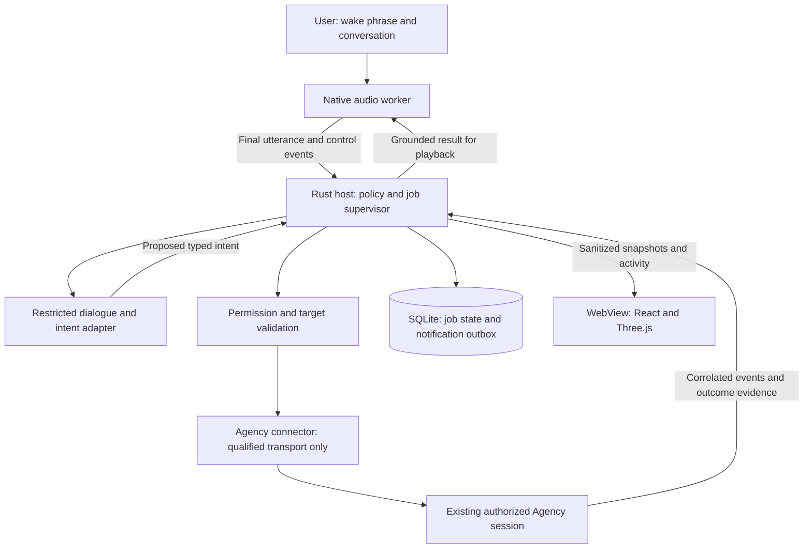

# Runtime contracts and failure behavior

Proposed application contracts, not implemented APIs. Read with
[architecture](architecture.md), [technology decisions](technology-decisions.md)
and [qualification](performance-and-qualification.md).

## 1. Process topology and authority



Figure: proposed authority boundaries; this editable diagram has not been
rendered or visually reviewed in this documentation-only pass.

The host retains authority while the WebView can close, restart or lose WebGL.
The worker owns microphone/playback and native model state; worker failure
does not imply job failure. The connector owns only the qualified runtime
connection, not the user's independently running terminal.
These process boundaries do not sandbox a malicious native worker.

Use private inherited pipes for the worker. Use versioned, size-bounded frames
with request IDs; drain stdout/stderr concurrently to avoid child deadlock.
Control messages and audio are separate lanes. Keep PCM inside the worker for
local inference; cloud adapters receive it only under approved provider policy.
The WebView receives no raw PCM, agent environment or private context index.

Rust custom commands are the sole frontend entry points. Explicitly configure
the Tauri command manifest/permissions: custom registered commands are otherwise
allowed to windows by default. Do not expose generic shell/filesystem commands
or enable remote-content capabilities. Validate window identity, schema, size
and authority inside every sensitive host handler. Tauri capabilities do not
repair unsafe Rust handlers. See R02-R03 in [sources](research-sources.md).

Use a window-scoped Tauri channel for ordered sanitized updates. Its channel
is a delivery mechanism, not authorization or durable acknowledgment. Snapshot
revision plus deltas handles reload; normal events are only for low-volume UI
signals. Do not stream every token through a global event bus or re-render the
whole graph for every change.

## 2. Audio state is independent of job state

```text
disabled -> enabling -> wake-only -> listening -> finalizing
                                      ^              |
                                      |          interpreting
                                      |              |
                                      +-- speaking / clarifying
conversation sleep/timeout -> wake-only
device failure -> unavailable
explicit mute, OS lock or permission loss -> disabled
```

Proposed defaults need device/user qualification. On lock, suspend capture and
speech and invalidate unconsumed confirmations; do not silently cancel active
jobs or replay sensitive notifications at unlock. Resume listening only under
the selected explicit-unlock/listening policy. Close versus tray-minimize and
exit are distinct controls.

Each activated conversation has an epoch. Each finalized utterance has a
unique ID and revision. Repeated final callbacks are deduplicated; a corrected
final invalidates unapproved intent/confirmation. Partial ASR can update text,
not start work. A late old-worker transcript cannot enter a new conversation.

One capture stream feeds bounded frame buffers. Never allocate, write logs,
perform inference or wait for database/network on the real-time callback.
Detect overflow/discontinuity, mark the affected utterance invalid and ask for
repetition; silently dropping samples can change a session name or negation.
Bound utterance duration and give an explicit timeout outcome.

Stopping assistant speech clears its queued audio and invalidates late TTS
chunks by playback generation. It does not cancel the user's job. Cancelling a
job requires an identified job and its request-scoped cancellation path.
Conversational "no, not that project" before dispatch discards the proposal;
after dispatch it asks whether to cancel and create a separately approved job.
It cannot retract changes already made.

## 3. Identity, discovery and routing

| Identity | Meaning |
|---|---|
| contextId | Registered mesh context; not a runtime session |
| sessionId plus runtime/source | Existing session identity as returned by the qualified connector |
| workspace/resource key | Canonical authorized root or exclusive resource; different sessions can share it |
| connectionEpoch | One authenticated transport lifetime; rejects stale events after reconnect |
| conversationId / utteranceId | Voice-dialogue scope and finalized input |
| requestId / jobId | Approved application request and one execution lifecycle |
| transport request ID | ACP/SDK-specific call correlation, not an interchangeable jobId |

Read only approved mesh metadata and an explicitly authorized session catalog.
Refresh the target's availability/configuration at dispatch, not just at app
startup. Cache is an optimization, not authority. Preserve source/capability
distinctions and do not infer availability from a process ID or mesh avatar.

Alias resolution is exact over normalized approved aliases; collisions yield
clarification. Fuzzy/model suggestions remain proposals. Pronouns such as
"that project" resolve only to an unambiguous active conversation reference.
If the catalog is unavailable, state that rather than choosing an old target.

Before any effect, bind target context/session/workspace, action kind, request
hash, selected profile revision, required permissions and expiry into an
approval record. Bind a spoken answer to one currently presented confirmation,
not any occurrence of "yes." Switching targets or changing the proposed action
invalidates it. Higher-risk policy may require a trusted local confirmation;
wake-word detection alone is never authentication.

Treat mesh descriptions, retrieved documents, transcripts, model output and
tool results as data, not instructions granting permissions. Host policy wins.
No transcript is interpolated into a shell command. Pass request content over
the structured transport; Windows launchers/shims need a separately tested
argument-serialization boundary. A `.cmd` shim is not a native executable.

## 4. Connector capability contract

This is an application-level contract, not a claim that Agency advertises
these exact fields:

| Capability | Required evidence before enabling |
|---|---|
| Discovery | Source identity, workspace, browse-only/resumable/active/busy distinction and freshness |
| Dormant resume | Same existing ID and effective configuration; exclusive ownership without a second writer |
| Live attachment | Supported authenticated control of the actual running process/session, including ownership rules |
| Permission mediation | Exact requests/options and denial/expiry handling; no approve-all shortcut |
| Event stream | Transport-specific framing, request/session attribution and known replay limits |
| Cancellation | Identified prompt cancellation, terminal disposition and surviving side effects |
| Terminal handoff | Explicit ownership transfer or supported shared/view-only attachment; no duplicate resume |
| Recovery | Read-only reconciliation or replay cursor that does not repeat the user's operation |

ACP's standard `loadSession` and optional newer session capabilities must be
negotiated. Standard documentation is not proof that the installed Copilot
implements them, or that loading a persisted conversation attaches to a live
Agency session. SDK JSON-RPC is a different adapter. See R11-R14.

Resuming Copilot can retain its model, agent mode and **allow-all state**.
Preserving configuration is not sufficient if it preserves a policy the app
cannot safely mediate. Inspect the effective supported permission contract;
reject or require explicit coordinated policy qualification for an unsafe or
unknown target. Do not silently reset the user's global/session permissions.

If active attachment cannot be proved, the required live-session feature stays
blocked. A dormant-resume result must not close that gate. Never use keystroke
injection, session-database edits, transcript-file tailing as a control protocol,
or an SDK-created replacement session.

Terminal opening is not a successful handoff by itself. Move through
handoff-pending, acknowledged ownership transfer, and detached-from-Intercom
control. If that cannot be observed, show the limitation and keep dispatch
blocked. Viewing an app-owned log is a different, read-only action.

## 5. Dispatch and durable jobs

Normalize each event with source, connection epoch, session/request attribution,
optional producer event ID/cursor, local arrival sequence and payload version.
Local sequence orders one connection's arrivals; it is not a replay cursor or
proof that the producer lost nothing. Use producer IDs for replay deduplication
only where their stability is qualified. Without them, reducers must tolerate
replay and preserve uncertainty; hashing identical text is not safe delta
deduplication. Detect declared sequence gaps and obtain supported resync, or
mark coverage/outcome unknown. Never fabricate missing tool/read events.

Write approved request metadata and the intended dispatch before transmission.
Commit its state before acknowledging submission to the user. Do not hold a
database transaction open while waiting for an agent, provider or confirmation.

```text
received -> clarifying / awaiting-confirmation
approved -> queued -> dispatching -> running <-> awaiting-user
running -> verifying -> succeeded / finished-unverified / failed
queued -> cancelled-before-send
dispatching/running -> cancellation-requested -> cancelled / outcome-unknown
lost acknowledgment/ambiguous ownership -> outcome-unknown
```

These are proposed persisted states. Enforce compare-and-set transitions in
one owner; stale completions cannot overwrite newer terminal dispositions.
Cancellation after success returns the existing result, not a fabricated undo.
An event arriving after an unknown state can resolve it only if its correlation
and outcome evidence are authoritative.

External dispatch is not atomic with a local database transaction:

| Crash point | Restart behavior |
|---|---|
| Before durable approval | No job accepted or sent |
| Durable queued record, not sent | Revalidate consent, expiry and target before resuming the queue |
| Dispatch began, acknowledgment missing | Mark outcome unknown; never assume unsent or blindly retry |
| Running, connection lost | Reconcile using supported read-only identity/event history, else retain unknown |
| Terminal evidence received before local commit | Recover from supported replay/query if available; otherwise unknown |
| Outcome/outbox committed, before playback | Show pending notification; do not redispatch work |
| Playback happened, acknowledgment missing | Delivery uncertain; receipt remains, no exactly-once speech promise |

At most one active dispatch per session. Initially permit one background job
globally; qualify later bounded concurrency only for disjoint workspaces and
resources. An app-local lock does not exclude external terminals or other apps;
ownership requires the connector's supported coordination or user handoff.
Canonical path/junction handling and shared-resource declarations need tests.

Backpressure favors policy/permission/cancellation/outcome events over cosmetic
progress. Coalesce UI progress, not authoritative terminal events. If the host
cannot durably record critical state, stop accepting dispatch and expose the
storage error; do not report an accepted task.

## 6. Outcome evidence and speech

The connector maps raw events into a request-correlated receipt containing:
identity, intended task, terminal signal, acceptance checks, evidence origin,
known side effects, unresolved items, provenance and timestamps.

An idle event says something about runtime activity, not task correctness.
ACP prompt completion and SDK completion must each be qualified in their own
adapter. Ignore subagent idle for foreground completion; account for attached
work. Detached services need explicit readiness criteria, not process exit.

| Evidence | Permitted claim |
|---|---|
| Agent says finished, no independent acceptance evidence | Agent reports completion; verification unavailable |
| Valid terminal outcome and the task's required checks pass | Qualified success for that task and scope |
| Required action/check failed | Failure or partial result with the actual boundary |
| Lost correlation, process exit without outcome, conflicting events | Outcome unknown; do not infer success |

Some analytical tasks cannot be independently mechanically verified. Label the
evidence level instead of pretending every result has test-backed certainty.
`finished-unverified` is distinct from succeeded and from transport uncertainty.

Persist outcome and outbox record together, unique by job/outcome revision.
Speech derives from that receipt. Simple status uses templates; complex
summary text must retain uncertainty and omit secrets/irrelevant tool output.
The notification mentions the original target so concurrent conversation does
not make "it's done" ambiguous. Do not read private results aloud on a locked
machine; respect mute and notification settings.

## 7. Storage, lifecycle and recovery

Proposed local data is under the current Windows user's application-data
directory, never a repository or network share. Names/retention require approval.

| Data | Proposed handling |
|---|---|
| Raw audio and partial transcript | Bounded volatile buffers; no persistence by default |
| Active conversation context | Bounded memory; explicit session replacement/expiry |
| Queued request content | Minimum encrypted payload only if durable queue recovery is approved; remove after its retention boundary |
| Job/approval/outcome metadata | SQLite with restrictive OS access; hashes are not anonymization |
| Credentials | OS credential APIs; no plaintext DB/log/UI copy |
| Diagnostics | Allowlisted IDs, durations, queue depths and error codes; no content by default |
| Mesh snapshot | Approved projection and revision/hash, not a transcript or social archive |

A non-durable-content mode can retain job metadata without its prompt, but
must ask the user to restate a queued request after restart. Do not advertise
restartable queued work if its payload was never persisted.

Use explicit schema migrations and a pre-migration compatible backup. Refuse an
unsupported newer schema; never replace the DB with an empty success-shaped
fallback. Disk full/read-only/corruption blocks new work visibly. Database
backup must account for journaling; do not copy a live SQLite main file alone
and assume committed WAL state came with it. R19-R20.

Use explicit verified journaling/synchronization settings, initially rollback
journaling with FULL synchronization for critical job/outbox transactions.
Do not silently weaken durability in Speed mode. A single database owner runs
blocking calls on a dedicated thread, not an audio/async event-loop callback.
If WAL is later justified, qualify its pinned SQLite build and checkpoint
policy; a sync guarantee still depends on the OS/filesystem/storage honoring it.

Tray-minimize keeps only the explicitly enabled listener and owned jobs.
Exit warns about active work and offers a policy-qualified outcome; it does not
promise job survival without a separately designed supervisor. UI reload is not
app exit. Never kill a user-owned Agency process. Worker cleanup is scoped to
recorded Intercom-owned processes; Tokio handle drop is not cancellation. R10.

On OS sleep or network loss, mark telemetry stale and reconcile on resume;
never transform silence into completion. Restarting a worker/provider cannot
resubmit a job. Autostart, detached global services and remote listeners remain
outside the current scope.

## 8. Mesh projection and rendering

Import one versioned snapshot, validate IDs/endpoints and allowlist text.
A changed/incomplete snapshot keeps the last valid graph visibly stale with an
error, not silently fresh. File notifications are hints: debounce and perform
bounded validated rereads; a write event is not a complete-file guarantee.
Reject oversize/incompatible input rather than parse without a limit.

Maintain separate topology revision and activity sequence. Index identities
and adjacency once in O(V+E); exact alias/ID lookup uses maps. Render context
nodes by default, expand approved session/detail nodes on demand, and retain
hidden relationships in an accessible list. Do not use every memory/social
node merely because it exists in the source.

Stable spherical placement uses persisted ID-to-slot positions or a fixed
capacity deterministic slot allocation. Recomputing a Fibonacci sphere using
the new total node count would move existing nodes; do not call that stable.
Use bounded overlap correction, never a continuous per-frame force simulation.

Use shared geometry/materials and instancing where appropriate, batched dim
edge buffers and a small active overlay. Rebuild topology only on revision,
not every activity delta. Limit labels and selected hit-testing. Recompute
instanced bounds when positions change and dispose owned GPU resources. R18.

Render on demand while idle. Animate only active work/camera interaction;
pause hidden/minimized decoration, cap pixel ratio and reduce bloom before
reducing legibility or dropping state. Reduced motion removes travel/pulses
while preserving status. No continuous auto-rotation is needed to look spherical.

Bright activity references an actual observed delivery/retrieval/dispatch event,
its job and its evidence. Planned routes are outlined, static links stay dim,
unknown coverage stays unknown. Never turn a graph shortest path into a story
about what the agent read. UI resynchronization rebuilds from the host snapshot;
it must not replay old pulses as new activity or execute work.
